# 798g 的轻量大屏终端：个人极客向鸿蒙 PC 折腾记

> 雪松Cedar，2026年10月

## 0 序章：为什么我买了一台鸿蒙电脑？

早年就听说了华为 MateBook X Pro 2024：14.2 英寸、980g，触摸 OLED 屏幕、压感触控板，还有 40W 性能释放。站在 2026 年回头看，这套模具依然惊世骇俗，真是领先业界两年的水平。实体店也体验过，单手托起来非常精致，就是展示机表面温度蛮高。

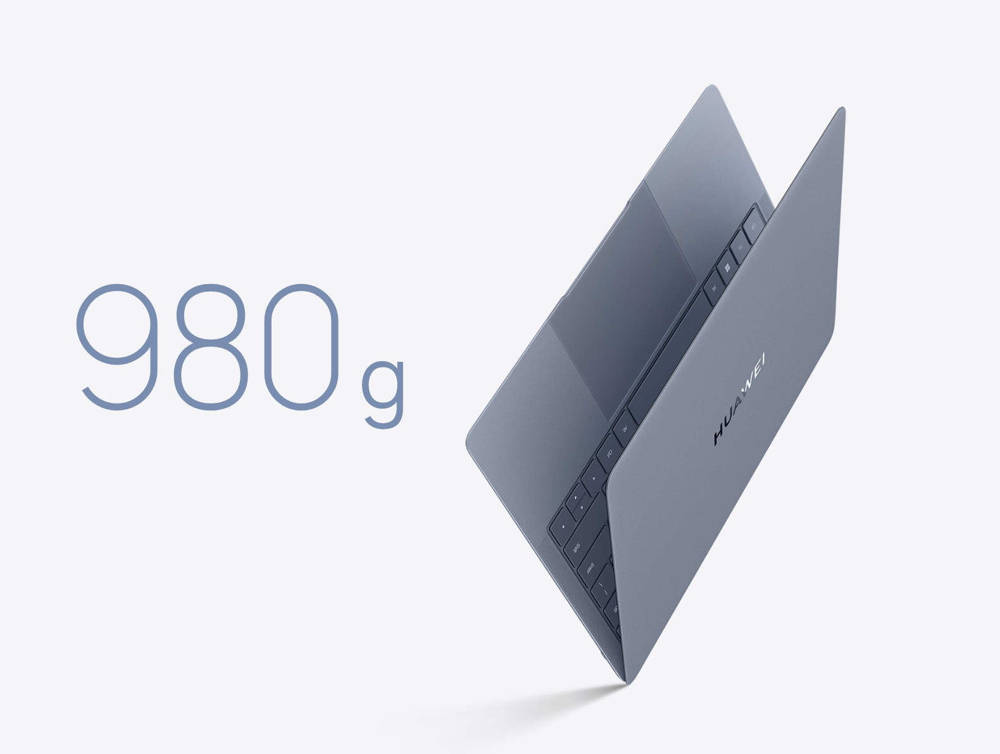

2025 年模具没变，换成纯血鸿蒙 PC，我嗤之以鼻。直到 2026 年 9 月网上冲浪刷到了 MateBook Pro S，居然还能在保留触屏和压感触控板的情况下，牺牲一部分性能释放、缩减一些电池容量、换用新镁锂合金材料和新榫卯结构，硬生生又减掉了接近 200g 的重量。14.2 英寸的大屏幕，798g！参考这两三年华为轻薄本模具迭代，我意识到 Pro S 将提前预订年度笔记本并再度引领行业一两年，实在是心动难耐。

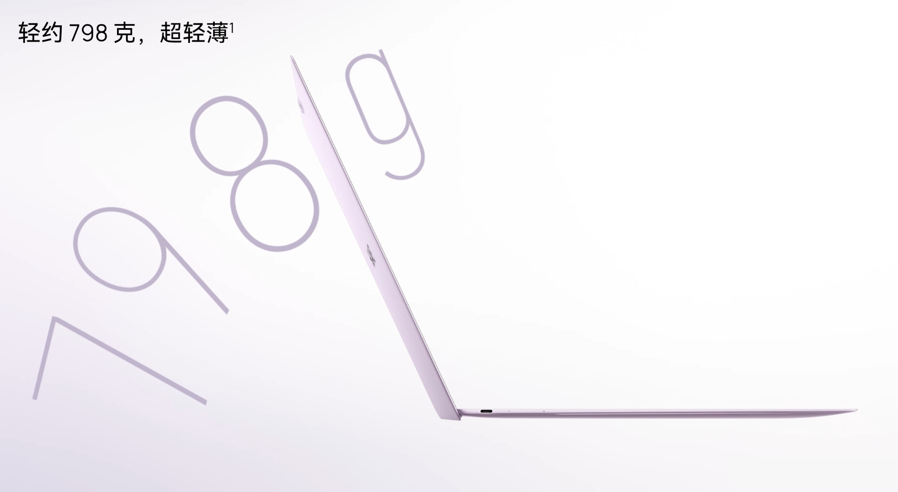

我的主力一直是 Windows 台式机，个人资料、软件和高性能算力都在上面。人不可能一直坐在电脑桌前，陪伴我四年的 Surface Go 3，让我越来越在意一台移动设备的屏幕和输入体验。

所以，鸿蒙 PC 这个原本的缺点，突然也变成了某种折腾玩乐的因素。远程桌面能不能满足我的需求？从 Windows 迁移过来，又会遇到什么新鲜玩意儿和限制？最终我还是买下了这台机器。用下来，购买目的基本实现了，硬件和鸿蒙本身也带来了不少意料之外的惊喜，只是折腾着折腾着，也让我对桌面操作系统有了一些新的思考。

## 1 从 Surface 到 MateBook：我的移动终端需求

### 1.1 我的 All in One 主机

这一两年我的主力设备一直是 9700X + 9070 XT 的 Windows 台式机，个人社交软件、文件管理、上网冲浪、单机游戏、影视存储全在上面。配合 WSL2 开发等等，实际上构成了我的 All in One 系统。

无奈人不可能一直坐在电脑桌前，随时随地访问个人资料与高性能算力，便成了自然而然的需求。外出设备只要能通过网络连接台式机，就能接着用熟悉的软件和文件，不必在两台电脑之间来回同步。

### 1.2 Surface Go 3 陪我走过的四年

2022 年，为了外出上课和 OneNote 手写记笔记，我花了四千元高价买入了电子垃圾 Microsoft Surface Go 3。奔腾 6500Y、8+128GB，磕磕绊绊撑过了我的本科和硕士初期。

500 多克的重量，11 寸不到的面积，又是精致模具微软大厂出品，携带体验确实很好。无级调节支架、触屏、手写笔，加上纯血第一方原生 Windows，它也成了我最爱的 RDP 远程桌面启动器。到工位后插上网线，双击 RDP 文件连接台式机，浏览器、Terminal、微信、VSCode 和个人文件都在远端，Surface 本地的 Windows 几乎没有存在感。

但一旦外出在桌面前坐下，小屏幕总觉得 UI 挤在了一起，眼馋同学们 14–16 英寸的正常笔记本。被动散热模具烫手，屏幕只有 60Hz，续航 5 小时不到，键盘盖也不是 19mm 标准键距，触控板玻璃手感虽好但面积狭小。偶尔想在本地多开几个浏览器标签页、Terminal，或者播放视频，羸弱的 Surface 连这些都做不好了。

### 1.3 从移动算力，到移动显示与输入

尤其是后两年不再需要手写记笔记、备考之后，微软的手写笔几乎一直闲置在机器边上。倒是触屏一直在享受。被微软下场做的触摸桌面系统惯坏了之后，轻量化的移动设备倘若没有触屏，总感觉让我缺失了些交互体验。毕竟在不用频繁键盘输入的时候，手指指哪儿打哪儿、滑动缩放，还是很流畅的。

我逐渐意识到，我的需求其实已经从“移动算力”变成“移动显示与输入”。在背包尺寸的限制下，我想要更轻、更大的屏幕，还有舒服的键盘和触控板。需要高性能或者个人文件资料时，再通过 RDP 或 Sunshine-Moonlight 串流到自己的台式机上完成。

MateBook Pro S 恰好戳中了这些需求。相比Surface，重量略增，换来了压感触控板、主动散热、120Hz 高分辨率超高亮度放眼全笔记本行业说一不二的顶级 OLED 屏幕、评测超越 MacBook Air 的续航，以及终于手指不再拥挤的全尺寸键盘输入体验。总体来看，硬件堪称完美，至于这套模具实际用起来怎么样，后面再慢慢说。

### 1.4 带着妥协下单

唯一的缺点与不确定因素，甚至可以是某种折腾玩乐的因素——鸿蒙 PC 操作系统。实体店里体验过，动效系统流畅直观体验就能超过臃肿充满历史包袱的Windows。简单搜了一圈，得益于 AI Agent 的发展和一年多的时间积累，鸿蒙商店里已经有不少RDP应用了，再不济还有完整的 Moonlight 兜底，远程连接这个最大的需求看起来能搞定。Win虚拟机虽说有网卡直通，Win on Arm也有mstsc.exe，但不是抱有很大的希望。一开始担心鸿蒙 OS 的打印机，搜了很多测评视频，都说单位公司的打印机兼容没遇到问题，我想一年多了华为应该也主动或被动解决了不少，暂时不担心。

下单前也知道，像 Surface 那样外接多个显示器、连接台式机后多屏办公，目前鸿蒙还做不到。至于 UFS 闪存，Surface 的 128GB SSD 我至今没用超过 60GB，笔记本上不存资料，容量和速度对我都无所谓。双 USB-C 接口被不少人嫌少，但作为 Surface 用户的升级，多出一个 C 口已经很满意了，原来的拓展坞也能继续用。之前的 Surface 高温 LCD 屏幕在高对比度界面停留久了之后也会有残影，OLED 长期来看总是有烧屏风险的，但可以在两三年危险到来之前转手，姑且相信华为的屏幕防烧屏能力（x

既然是为模具体验买单，首选就应该是最低配。16+512GB？跟我当年刚上大学买的拯救者一样，够了够了。也纠结过 24GB 内存，但 Windows 虚拟机不是我的重点，还是相信华为对 16GB 的优化能力与我自己良好的后台清理习惯。

颜色原本想选有个性的黄色，紫色要 24GB 起步。后来国庆期间在京东发现优惠，6200 元不到买到了全新丝绒白。拆开之后立马觉得：数码产品还得是白色！曾经在店里只能体验片刻的轻薄感，现在完全属于我咯～

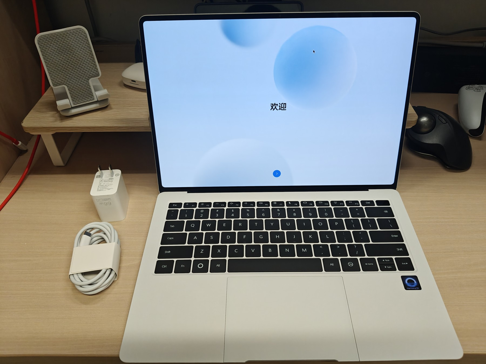

## 2 硬件先赢一次：798克的精致模具

### 2.1 798g：轻到改变使用姿势

最重要的轻量化，798g 的实力无需多言，给身边所有人上手端一下，第一反应全都是：“哇哦这么轻！”

这种能单手、甚至两三个手指头拿起来的笔记本，真的体验会质变！就算在桌前也可以瘫在椅子上，各种姿势使用，想挪个位置随手就能拿起来。试了一下跟视频博主那样单手拿着，像纸板一样给自己扇风当扇子，手力足够的话完全可行。

用了自己这台超轻薄电脑一两周，再去商场掂量 Xiaomi Book Pro 14、Lenovo Yoga Air 14 Ultra 以及 MateBook Pro 这些 1kg 级别的机器，都感觉坠手了。

这么轻的同时，屏幕和键盘仍然保持了足够的刚性，当然跟 Surface、拯救者那样的硬度没法比。


### 2.2 屏幕：买屏幕送笔记本电脑

3120×2080 的高清分辨率，264 PPI，在我眼里已经和手机屏幕一样看不出像素点了，毕竟 15cm 以内盯着像素点也根本不是使用场景。

屏幕有圆角，跟机身是和谐的。假如这是 Windows，那一定是缺点，毕竟 Windows 系统和许多传统软件没有考虑圆角，角落可能留着按钮或其他内容。但到了鸿蒙，由于软硬件协同，而且脱胎于移动系统，UI 在角落留出了空间，整体协调合理。

字体默认大小和粗细都挺好，我只把显示大小改成了最小。毕竟 Surface 上的 1080p、125% 缩放我也是盯着看下来了，习惯小一点的 UI，容纳更多内容。同时，电脑端终于也有了手机一样的注视不熄屏体验。

刷新率一开始直接 120Hz 拉满，反正续航不错。后来又测试了系统默认的智能切换，闲置时恢复 60Hz，移动一下就回到 120Hz。我尝试自己盲测，肉眼无法区分，那还是改成智能刷新率以省电了。谁不想续航更长一些呢？总归不用过 Surface 的苦日子了。

后来看到穷玩组的 [MateBook Pro S 防窥版屏幕测试报告](https://www.bilibili.com/video/BV1g8Y46VEpE/)，更加感叹这块屏幕：标准 RGB Stripe 排列用在量产 OLED 笔记本上，力大砖飞，没有对像素排列和算法的奇技淫巧，只有极致的发光材料和巧夺天工的制造技术。测试里的同分辨率文字对比，Pro S 也比 MateBook Pro 更清晰。


EOTF亮度映射完美贴合，RGB灰平衡一条通天大直线，色准强无敌。HDR 极小区域亮度超过 2000 nit，响应时间也很出色。华为出品无需担心！好到了一个几乎“没有意义”的地步。总体来看，也算是一种买屏幕送笔记本电脑了。


当然也有遗憾。虽然做了 AR 抗反射，玻璃覆盖难免反光，背后有强光时还是会照镜子，指纹多了就拿布擦一擦。个人不愿贴膜，Surface 用户自适应。转轴平时能单手开合并正常停住，但手指点击触屏时屏幕会明显晃动，作为触屏笔记本还是挺影响体验的。最大开合角度约 135°，无法 180° 展平。鸿蒙 PC 也不能把屏幕画面旋转 180°，不然还可以试试将 A 面放在桌面、键盘本体朝上，倒过来当平板使用。

### 2.3 键盘：手指终于不再拥挤

从 Surface Go 3 的小键盘换到全尺寸键盘，最直接的变化就是手指终于不再拥挤。查了一圈参数才发现挺有意思：我那台厚重的拯救者 R9000P 2021，TrueStrike 原感键盘同样只有 1.5mm 键程；以键盘手感著称的 ThinkPad，如今 X1 Carbon 等高端机型也普遍缩到了 1.5mm，与本机器一致。前任 MateBook Pro 的模具则是 1.8mm。传统机械键盘动辄 3～4mm 的行程自然没法比，但在现代轻薄本里面，还能维持与厚重游戏本相同的 1.5mm 键程，已经相当够用了。

不过键程只是衡量键盘的一项参数。常见笔记本键盘通过剪刀脚稳定键帽、橡胶碗提供阻力和回弹，再由薄膜触点检测输入。1.5mm 只告诉我们手指最多能按下去多深；按下去是清脆还是肉、触底是生硬还是柔和、回弹是否干净利落，还得看整个机构的设计。键帽弧面、底板刚性和空腔共振也会影响体验。

Pro S 轻按重按手感一致，段落反馈很干脆，触底柔和，没有 MacBook 敲击钢板的体验。键帽稳定性很好，中心四角都能触发，也没什么晃动与倾斜。但单论每个按键的敲击手感，我仍觉得逊于 Surface Type Cover，遑论 Surface 键盘盖自带的角度和整体回弹感受。快速连续输入时，Pro S 的键盘太平整、没有斜度，跟手腕处于一个平面，手指要下探得更深。


一个糟心细节是 F、J 两个按键的定位凸起位置太靠下，正常标准指法下食指归位时根本摸不到。等摸到凸起，手指都已经在接缝处、无法按下了。我百元廉价键盘的 F、J 凸起位置都合理，这点细节不应该疏忽啊～

右上角是指纹电源键二合一，不是我习惯的最右上角 Del。好在电源键下沉、手感也不一样，摸上去就会意识到它左边才是 Del，大概几天就能适应。Home、End、Page Up、Page Down 没有独立按键，分配给了 Fn 加方向键；这点比不上微软的 Surface，即使小小的也给了独立编辑键。

底下一行的右 Ctrl 被舍弃，换成了略长于 1U 的小艺 AI 键。按下时背光会有流光炫彩 RGB，跟屏幕右下角的小艺呼应，还蛮好看。默认顶排是多媒体功能，按下 Fn 亮灯后才输入 F1～F12，能看出取舍是多媒体优先。背光对我来说能亮就行，真有需要时按 F3 临时开启。

### 2.4 压感触控板：一整块都能按下去

压感触控板是我选购这台机器时非常看重的配置之一。以前用过的 Surface Go 3 是传统机械触控板，面积不大，主要只有底部左右两侧容易按下去，所以我平时也不怎么按压，都是轻点代替点击。老拯救者游戏本的触控板更是用了几年还掉漆。

MateBook Pro S 这块巨大的玻璃触控板，光是面积和表面质感就舒服太多了。通过压力检测识别点击，再利用线性马达模拟按键反馈，整个表面都能按压。系统里可以调节按压灵敏度和振动强度：灵敏度靠左变得更硬、更难按动，肌无力的我还是选择拉到最右边；振感强度也拉到最右，让大马达充分发挥。全域按压加上马达振感，手感确实顶级，相比 Surface 是相当明显的升级。

目前鸿蒙 PC 产品线里，除了定位相对入门的 MateBook 14，MateBook Pro、Pro S、Fold 的键盘以及大部分 MatePad 的键盘基本都配备了压感触控板，系统也专门设计了不少配套手势。这倒有点早年苹果的味道了：MacBook 的 Force Touch 配合 macOS 多指手势，也是软硬件一起设计才能有这样的体验。华为现在也逐渐走上了这条路线。

但是但是！同样对比苹果，鸿蒙目前似乎还没充分发挥压感的潜力。单指轻点和实际按下都是普通左键，只是后者多了马达反馈，没发现类似 MacBook Force Click 那样的二级深按操作。之前还翻过鸿蒙开发文档，API 确实有读取压力值的接口，但 Pro S 有没有把触控板的连续压力数据开放给第三方应用还不知道。硬件都做到这份上了，系统交互还可以再挖掘挖掘。

### 2.5 续航、充电与散热

续航强无敌！10 月 6 日晚上 19 点充满电，接下来体验系统、捣鼓软件、装虚拟机五六个小时，中途出去玩自然睡眠，几乎不掉电。7 日又进行影音娱乐、码字了许久，直到 8 日上午 11 点半还有 10% 的电量。这期间有睡眠时间，不是连续亮屏；其中一两个小时还外接了 27 寸 2K 显示器持续输出画面。低电量时自动打开省电模式，也没让我感觉到性能卡顿。


总体来看，这体验让我完全无需电量焦虑，一两天充一次电足矣～自带的华为 66W 适配器体积和重量都比较小巧轻便，原配 C to C 线支持 6A，系统提示 65W 超级快充，还可以在控制中心开启 Turbo 充电加速。

我在约 50% 电量、亮屏状态下用第三方“系统监视器”看了一下，无论是否开启 Turbo，电池充电功率都在 50W 左右；到了 60% 多则降到 30W 左右。我猜测 Turbo 的区别可能在熄屏充电时，充电功率也会随电量调整，电量越少充得越快。现有充电头也试了一下：小米 67W 适配器配合官方魔改的 A to C 线能够激活超级快充，OPPO 90W 的则不行，推测 PD 65W 公有协议适配。

电源管理也让我想起 Surface 有一次放在背包里意外睡醒，拿出来时巨烫无比，还进不了系统，最后售后重新换了一台。Pro S 日常睡眠的体验目前让我放心不少。系统默认开启的快速启动会让关机变慢，我对那几秒开机速度也不执着，就把它关掉了。

大部分情况下风扇不工作，只有高负载时才启动，避免散热鳍片长期积灰。虽然评测说风扇很安静，独处的室内还是能听到；也好，提醒自己此时负载压力过大，适当停下让 Pro S 喘口气，风扇声就会消失。媒体实测满载性能释放约 20W，对我来说完全是好事情：发热不大，键盘面和底壳都只有温热。相比被动散热的 Surface，还多了主动风扇来应付临时高负载，我已经知足了。


重点不是跑分，XE90 已经能完全满足我本地轻负载的需求。之前让 AI 调研后估计过：它的单核、多核性能大致相当于我不开睿频的老拯救者 R7-5800H。台式机负责高性能算力，这台移动终端用起来轻快、凉快、续航长，对我而言就很合适。

### 2.6 其他让我喜欢的细节

前后双摄！对于一台笔记本来说还是太超模了。1080p 摄像头对比手机肯定不够看，但在平板和电脑领域仍然不错，很多机器还是 720p。试着拿它拍人像，有种拿着大平板拍照的有趣感觉。不过照片是 16:9，转 90 度拍摄时也没有识别旋转，最终还是横版照片。

A 面的摄像头凸起，网上有人嫌它无用、破坏整体设计。我实际发现它是一个很好的握持抓手点，不然机身整体太光滑，很难靠摩擦力稳定拿住。前后都有环境光传感器，比 Surface 的单侧好多了，我完全信赖自动亮度调节。人脸解锁也很快，开盖的一秒钟就搞定。非接触认证的含金量，我的台式机可是特意买了个 Windows Hello 摄像头呢～


扬声器放在桌面上的时候特别优秀，我这种木耳朵都听起来比手机、拯救者、Surface 要好；但一旦拿起举在手中，声音就差了些。感觉设计时充分考虑了桌面声场反射，音量上限也很大，开 20% 左右就足够正常使用。机身里还有六颗麦克风，配合会议记录也给了我惊喜，后面再细说。

只有右边能DP视频输出，但左右两边都能插外设，原来的 SSD 拓展坞也能跑到 100～200MB/s，对我而言已经足够了。

轻量、大屏、触屏和舒服的输入设备，买之前心心念念的东西，拿到手之后确实没有让我失望。既然这套硬件先赢了一次，接下来就该看看：当初唯一真正不确定的鸿蒙 PC，用起来究竟怎么样？

## 3 初入鸿蒙：一套逐渐顺手的桌面系统

### 3.1 第一次开机：先联网，再进桌面

开箱的时候特意拍了视频记录。选择语言、地区、协议与声明，保护数据隐私，这些我都默认直接过。到了连接网络这一步，我没找到跳过选项。ZJUWLAN 会弹出浏览器认证页面，倒是没有系统外观割裂感；不过我尝试不认证直接下一步，激活就超时了。还是得乖乖输入网络账号密码，完成联网激活。

创建用户默认就是管理员，锁屏密码倒是可以留空跳过。然后强制跳出恢复密钥，类似 Windows 的 BitLocker 吧，我向来不太喜欢这种需要额外保管一串密钥的环节，但也只能继续，还提醒我记录复杂的 64 字符。之后登录华为账号也是必经的一步，还好我早年就创建过。增强服务与用户体验改进的选项一大堆太长不看，倒是很贴心地给了一个一键关闭所有的按钮，留着进系统之后再慢慢探索。

最后点下“立即体验”，丝滑进入桌面。默认浅色，背景和丝绒白配色应该是对应的。左侧文件管理、我的华为、视频、游戏中心、小艺、WPS、剪映、抖音都是预装；右侧又摆满了 HDR 增强、音乐、日历、阅读、小艺和精品应用等卡片。

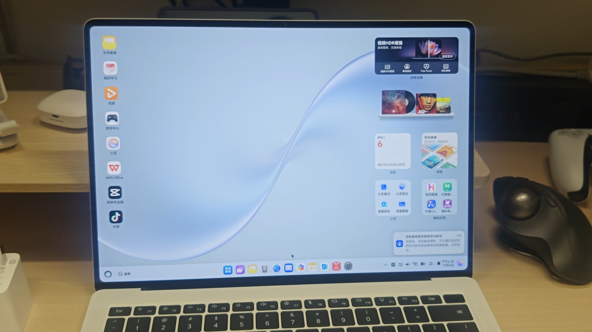

忠实记录如上。说实在有些强奸眼球，这些东西后面肯定得自己动手删减一番。

### 3.2 更新系统，把桌面收拾成自己的样子

10 月 6 日到手，迫不及待打开设置，当当，出厂是 HarmonyOS 6.1.0，API 版本 24。第一时间当然是更新到鸿蒙 7，安装包 18.24GB，真是很大了。接下来这段时间还陆续收到了更新：10 月 14 日推送 7.0.0.111 SP7，10 月 24 日又有 SP15。我这几天前一个版本的体验还没写完呢，颇有种养成系统的感觉。

SP15 加入了滚动截屏、状态栏实时网速，以及三指横滑切换最近应用窗口，都是我很满意的更新点。滚动截屏会自动帮你往下滚，体验不错，只是当时没找到快捷键，需要从控制中心启动。实时网速也终于可以显示在音量和 Wi-Fi 图标之间了，不像 Windows 的 Traffic Monitor 那样自由，但有总比没有好。

预装了不少图像视频编辑、短视频游戏娱乐、CAD、思维导图。本人不是视频图像艺术工作者，从电子信息专业视角来看的我通通用不着，框框一顿删除。删完一看还有 87/512GB 占用，原来大头是系统、虚拟内存和休眠文件。无妨，存储空间对我来说完全够用。应用自启动也能在系统设置里统一管理，至少不用像以前在 Windows 上那样，一边找自启动入口一边担心软件自己偷偷跑起来。

接下来就是布置桌面了。深色模式 OLED 友好，到手自然设置起来。鸿蒙 7 主推的沉浸光感，我盯着图标看了好几秒，也没发现几种样式有啥区别；个人其实对这些耗能视效不感兴趣，既然系统主推，我就拉满好了。删除通知和桌面卡片的时候还有粒子随风消散的特效，很有《复仇者联盟》响指之后的感觉。虽然动画不算短，但是好看。

想起安卓手机可以在开发者选项调整动画速度，我用小艺搜索一搜，果然找到了“过渡动画缩放”。改成 0.5x，动画速度加倍，体感更加流畅。

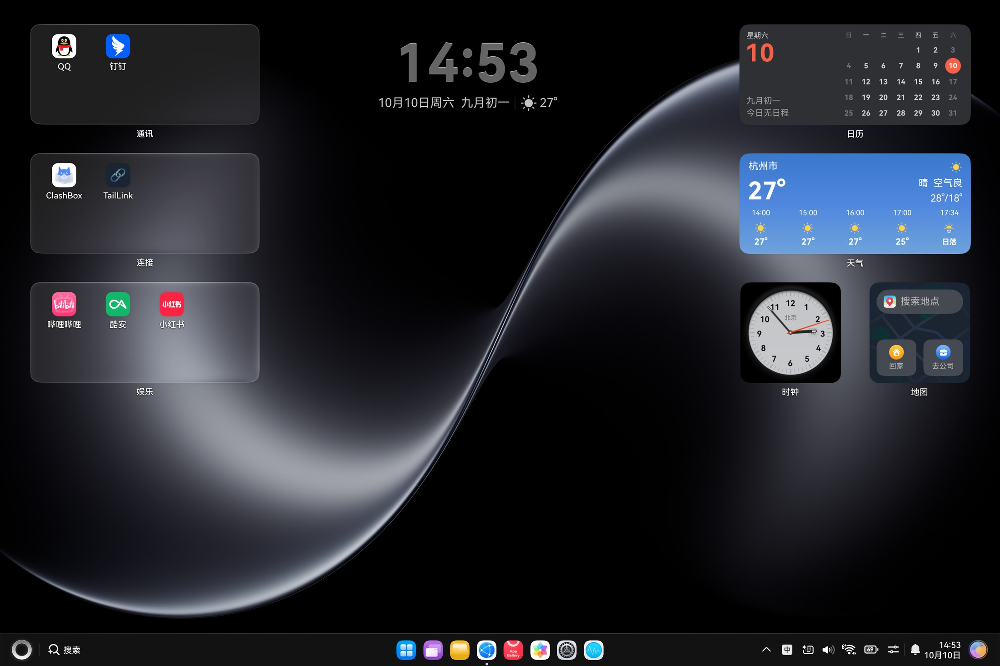

在 Windows 上多年，我一直习惯桌面完全空着只欣赏壁纸，应用全部交给开始菜单和任务栏。鸿蒙倒是让我有些舍不得清空桌面了：除了应用图标，还能放服务卡片、小组件，以及可以直接点击内部图标的大收纳夹。我的理解是鸿蒙想把桌面本身做成一个信息面板，而不仅仅是壁纸和应用启动入口。

我保留了数字时钟、圆形表盘时钟、天气和日历。比较尴尬的是服务卡片有网格，但数字时钟无法居中对齐，偏左一些。我只能安慰自己：如今这样的数字时钟，是跟键盘的 F、J 键输入位置居中对齐的。

### 3.3 从 Windows 过来：窗口和触控手势都能很快上手

窗口的最小化、最大化、关闭都在右上角，减号代表最小化、叉叉代表关闭，跟 Windows 一样，谁上手都知道。光标放到最大化按钮上还能选择窗口显示在左侧或右侧。鸿蒙键加左右方向键是左右分屏，加上方向键是全屏，加下方向键则依次退出全屏、最小化。鸿蒙键加 D 回到桌面，跟 Windows 的习惯也能平滑衔接。

触屏操作同样直观：手指拖着窗口顶部，贴到屏幕顶部或左右边缘，就可以最大化或分屏。它没有 Windows 那些四象限贴靠和拖动窗口时出现的更多预设布局，窗口怎么摆更多还是自己掌握。此前我在小屏幕 Surface 上经常误触 Windows 的布局提示，鸿蒙这里倒也清净。

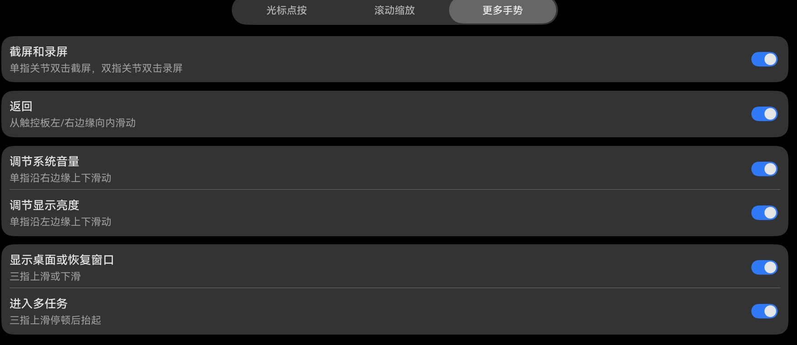

触控板单指左键、双指右键、双指滚动这些基本操作都没问题。默认滚动方向和 Windows 一致，也可以切换成自然滚动。我还关掉了触控板右下角的右键，只保留双指点按或轻点，这样整块触控板手势统一，不用担心手指的位置。

三指上滑是回到桌面，动画有种把所有应用往上推出去的感觉，比较符合直觉，只是跟我习惯的 Windows 三指下滑看桌面反过来了。三指上推并停顿进入多任务视图。SP15 新增的三指横滑切换应用，我实测感觉逻辑怪怪的：全屏应用可以按多任务界面的顺序切换，但非全屏小窗会一起被收在一侧，一起滑出或隐藏。我原本以为会像 Alt+Tab 那样循环选择，多少需要重新适应。

最可惜的是，我一开始以为三指点击没有鼠标中键！以前在 Windows 上习惯三指点击关闭浏览器标签页，到了鸿蒙还得去点那个小小的叉，麻烦。用了这么多年形成肌肉记忆，突然没了还真有点难受。

——后期惊天大发现！关闭浏览器标签页时无意间三指触发成功，突然意识到可能是三指摸了两下。立马找了个在线鼠标测试网站检测，实锤了：**三指轻触两下就是触控板的隐藏鼠标中键**，在新标签页打开超链接也实测能用。顺手问了呆呆的小艺 AI，它也不知道这个功能。鸿蒙啊鸿蒙你藏的可够深😅

鸿蒙自己还设计了一套系统快捷键，基本跟 Windows 类似，也有些要重新记：鸿蒙键 + A 打开应用中心，+ N 是通知中心，+ C 是控制中心，+ F 是文件管理器。我就按 Application、Notice、Control、File 这么记，还蛮顺口。不过 Windows 的 Win + E 到这里可就得改习惯了。

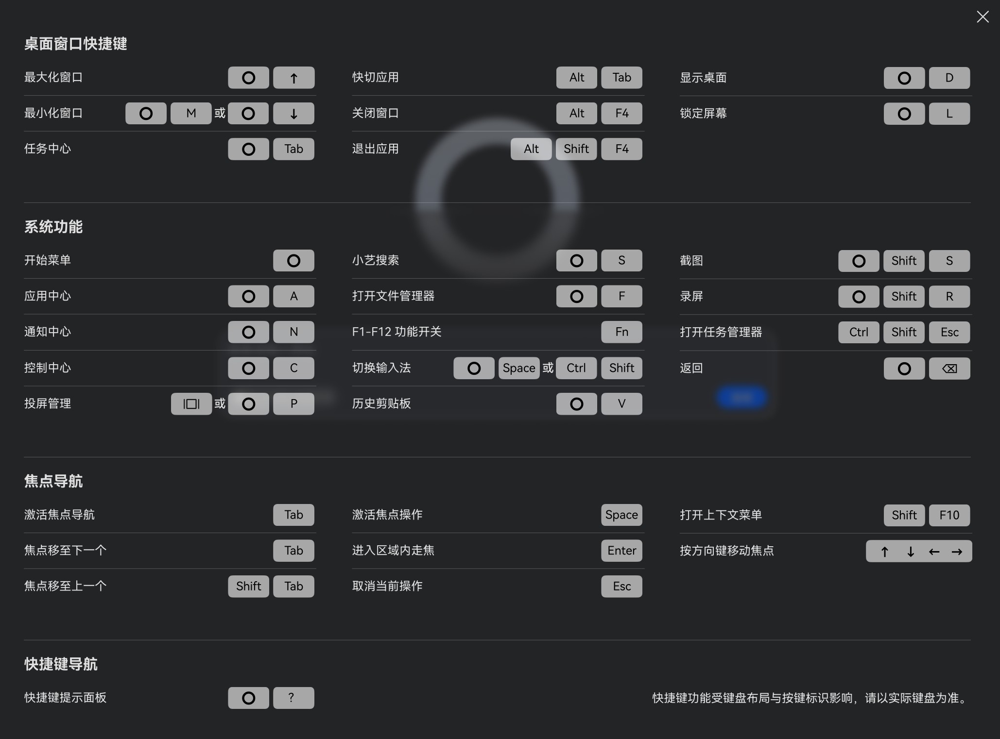

快捷键提示面板标的是“鸿蒙键 + ?”，虽然问号很直观，实际上按的是“鸿蒙键 + / ”；你要是通过 Shift 按上层的问号，反而呼唤不出来。这个设计好像又不是很直观哈哈。

当然也不是所有习惯都搬得过来。我平时习惯交换 Caps Lock 和 Esc，Windows 下改一次注册表就能生效；到了这台鸿蒙 PC，我暂时没找到满意的系统级改键办法。明明只是想决定自己键盘上的一个按键应该干什么，却不知道从哪里下手，颇有些无奈。

### 3.4 外接显示器：截图分辨率为什么比屏幕还大？

到工位后先接上显示器。Pro S 只有右侧 USB-C 支持视频输出，插上普通的 Type-C 转 HDMI 拓展坞就成功连接。第一次连接时系统会询问扩展还是复制，F9 和熟悉的鸿蒙键加 P 也可以打开投屏管理。

最让我意外的是屏幕排列。Windows 的多屏排列通常按照分辨率的相对像素尺寸显示，我的 Windows 台式机上，一块小尺寸 2K 屏和一块 27 寸屏幕的图示位置，看起来就和实际物理位置不太一致。鸿蒙这里在我接 2K 显示器时做了个取巧：两块屏幕显示成相近的宽度，仅长宽比不同。像图中这样，光标从内屏左上角往上移动，刚好从外屏左下角出现，右侧同理，体验蛮独特。

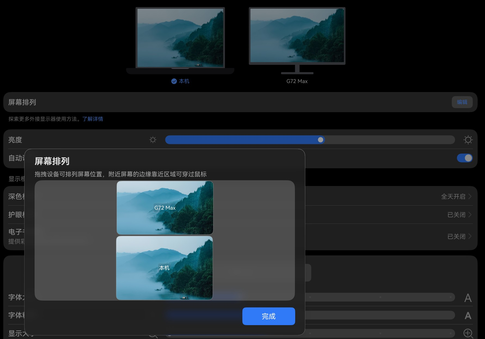

镜像模式下也可以选择以本机或外接屏幕的比例显示。选择 16:9，本机的 3:2 屏幕就会上下留黑边，算是把两块屏幕比例不同的问题考虑进去了。这里有个限制：我的 Pro S 只能再接一块外屏，之前 Surface 那样的多屏办公就别想了。

接着我随手按 F11 截图，发现外接显示器模式下只能选择其中一块屏幕截图，不能像 Windows 那样直接截出包含多屏的联合大图。仔细到图库查看截图分辨率，又发现了一个现象：内屏截图是 **3120×2080**，没问题；外屏截图竟然是 **3120×1755**！明明接的是一块 2560×1440 的 2K 显示器，截出来的画面却比物理像素还大，还是奇数的纵向分辨率呢。

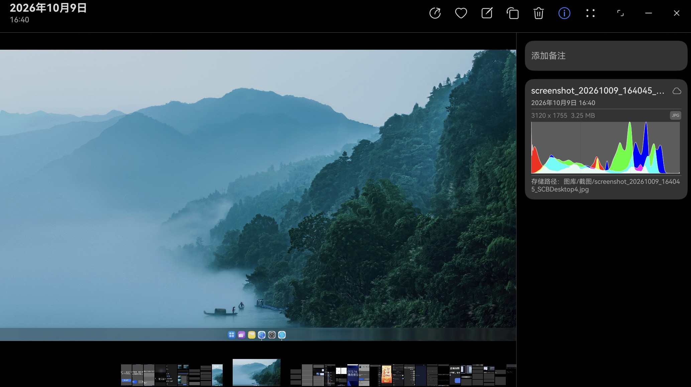

我又换了屏幕排列的位置、用系统 F11 截取铠大师 Windows 11 的画面，连续几次依然是 3120×1755，宽度刚好和内屏的 3120 一致。更神奇的是，Windows 11 虚拟机里还能选 3840×2160。此时从虚拟机到鸿蒙，再到外接显示器，到底怎么转换像素的，越来越有意思了。

最后打开显示器自己的 OSD 菜单，总算看到一个确定的数字：**HDMI 输入是 2560×1440@60Hz**。好嘛，鸿蒙截出来的是 3120×1755，显示器实际收到的却是 2560×1440。两者都是 16:9，截图画布和最终 HDMI 信号显然不是同一个分辨率。

后来查到华为官方的[《鸿蒙电脑有线连接显示器显示模糊》说明](https://consumer.huawei.com/cn/support/content/zh-cn16053957/)，专门提到连接 2K 及以下显示器时采用离屏渲染（Offscreen Rendering），可能导致显示清晰度略有下降。结合这次实测，我猜系统先在 3120×1755 这样的中间画布上渲染，再缩放到 2560×1440 输出，有点像 macOS 的 HiDPI 思路。横向分辨率刚好和内屏的 3120 一致。

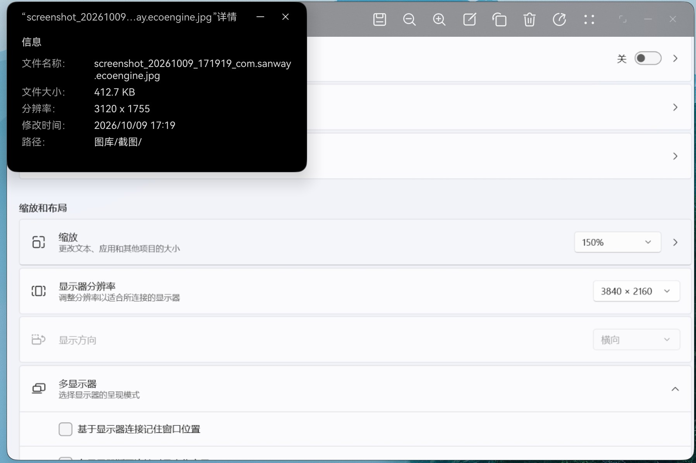

虚拟机提供的 3840×2160 显示模式，最终仍要经过鸿蒙处理，再输出到这块 2K 屏幕。

后来我又补测了 1080p 显示器，截图仍然是 3120×1755；群友的 4K 显示器截图则显示 3840×2160，屏幕排列也不像我接 2K 时那样等宽。看来低于内屏分辨率的外屏，可能统一走了与内屏宽度有关的高分辨率画布，4K 则另有处理。个人认为蛮好，系统给低分辨率屏幕兜底，渲染端就尽量清晰。

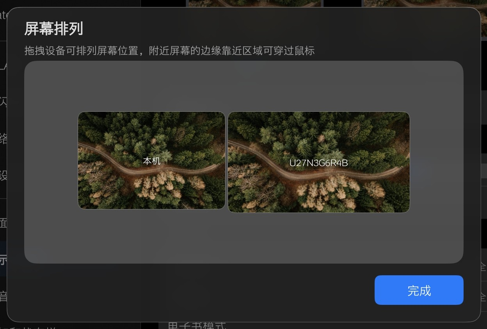

### 3.5 文件、输入和打印：普通工作能不能顺利做起来？

鸿蒙 PC 的文件管理器吸收了移动端和 Windows 的一些长处。智能分类可以把不同类型的文件聚合起来查找，在移动系统上屡见不鲜，桌面系统里初次体验还是蛮新奇。其余方面也有正常的文件树，个人目录下有各类文件夹，不需要像 Windows 那样面对 C 盘、D 盘。实际用下来，对于 PC 系统，我还是更喜欢自己掌握文件的位置和层级关系。

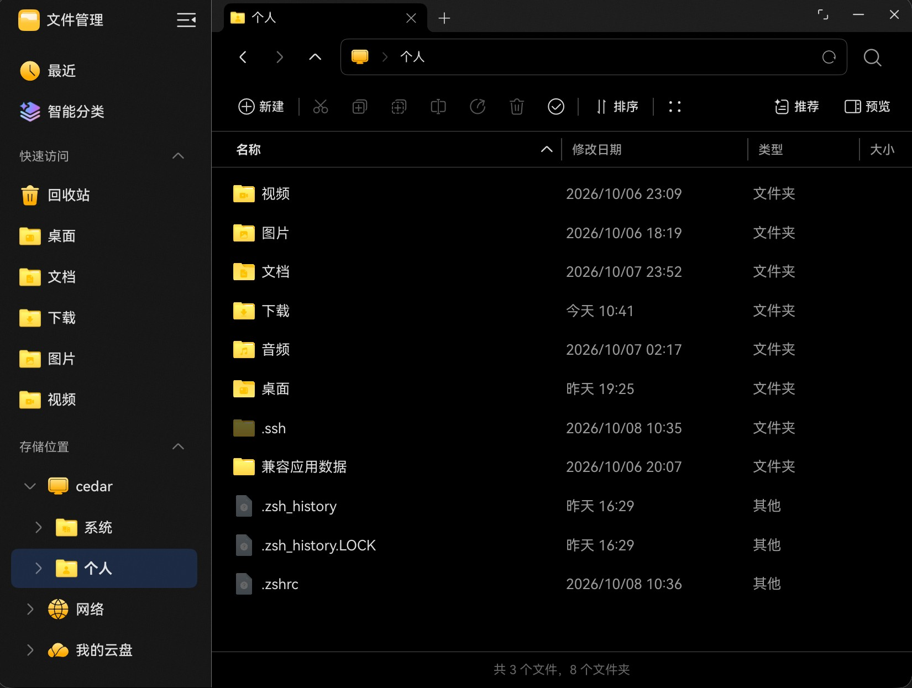

小艺搜索则是新电脑的好帮手。鸿蒙键加 S 弹出独立的搜索浮窗，可以搜设置、文档、慧记记录，还能搜图片中的文字。新系统的设置不熟悉，或者一时想不起来哪张图片放在哪里，多一层搜索总归有好处。我前面找动画速度，就是这么搜到开发者选项的。

小艺对话比我想象的手机厂商 AI 要好用，打开系统软件、问一些鸿蒙设置的问题，初印象还不错。我还设置了“小艺小艺”语音唤醒：打字提问就文字回复，语音提问就语音播报，符合直觉。回想起来家里的老华为智慧音箱，老爹最常用的就是远远喊一句“小艺小艺，明天天气怎么样”，我这六千元笔记本也终于有了这样的体验。

不过用多了还是发现蠢蠢的。问鸿蒙 PC 虚拟键盘的问题，搜索结果混进了一堆其他系统和鸿蒙平板的内容。像触控板隐藏中键，它也没能告诉我。基础模型能力摆在这里，简单的设置问题问问还行，更复杂的问题还是交给我自己折腾吧。

小艺输入法整体简洁，基本模式不联网；全量模式提供词库、语音输入等功能。实测语音输入准确，还能导入专业名词，挺方便。但 AI 预测对我来说纯纯负作用，一点也不智能，还是自己老老实实拼音输入来得快。更好玩的是二、三候选词默认分配给左右 Ctrl：你难道不知道这台机器根本没给我右 Ctrl 吗！完全被小艺键顶掉了。

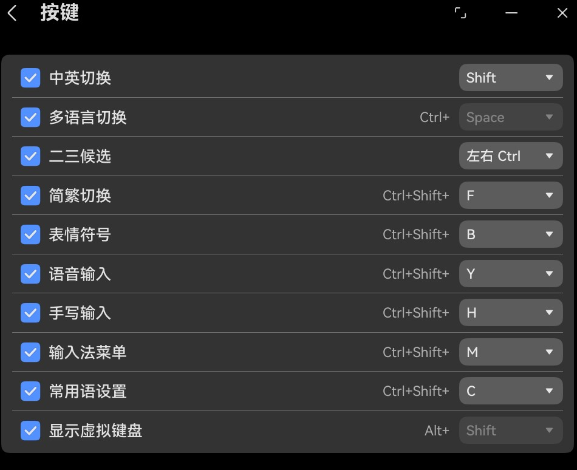

买之前担心的打印机，也终于迎来了实测。需要打印时，我抱着电脑和拓展坞走到工位的惠普 OfficeJet Pro 9020 前，USB 一插，系统立马弹出设备列表，选中后几秒钟就完成了配置，WPS 文档顺利打印。系统同时发现了其他 WLAN 打印机，也提供连接 Windows 共享打印机的入口；我这次实际打印的是 USB 连接的这一台。

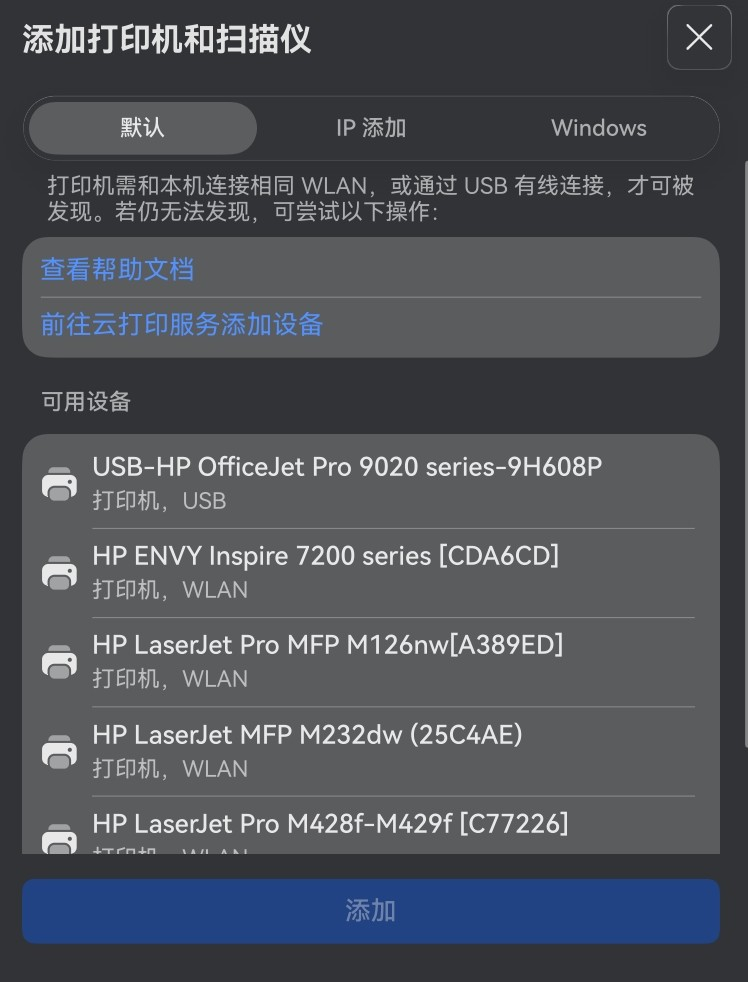

顺便看了一眼 WPS，发现文档有字体不兼容：Times New Roman 被替换为 FT Thymes，宋体替换为书宋-简。不同字体的字宽、字距和行高可能影响换行甚至分页。我这次只是临时交个表，问题不大；如果是需要严格保持版式的材料，还是得检查一下再打印。

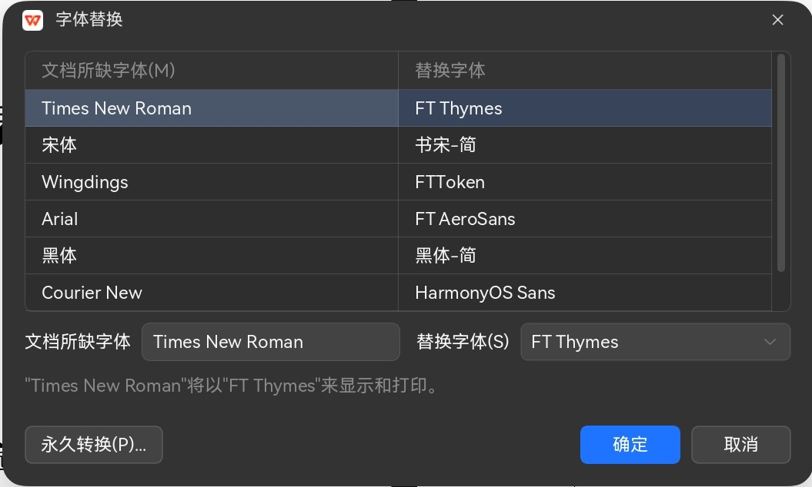

### 3.6 应用市场、元服务，还有一点大屏的乐趣

应用市场左侧分栏清晰，搜索应用也方便；评分、安装次数、开发者、评论和功能建议这些信息都有。作为 Windows 用户，我对 Microsoft Store 的印象一直不算好，鸿蒙这边找软件的体验至少让我愿意经常打开看看。

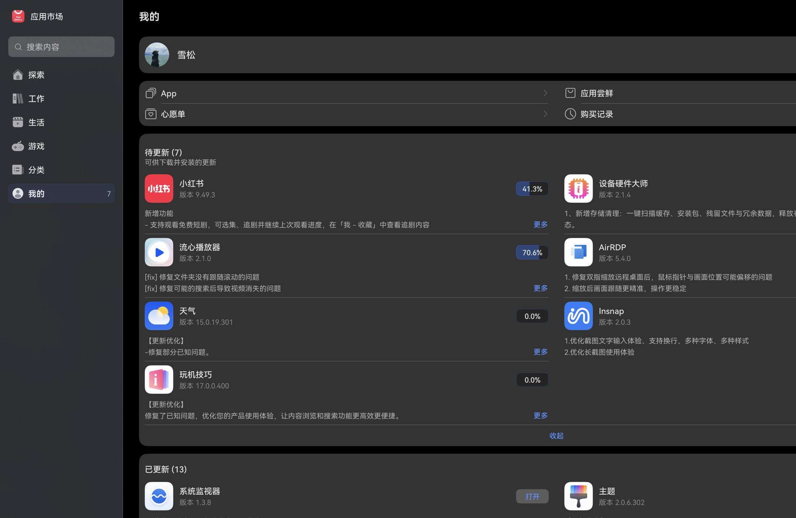

逛着逛着发现一些图标上半部分是虚线半圆，点进去不用自己下载安装就能打开，这就是鸿蒙的元服务。日历订阅服务和 Petal One 用过之后，也能在系统的“应用和元服务”里看到。对我来说，可以先把它理解为系统管理的轻量服务：省去了手动安装的步骤，但它仍然有自己的入口和管理位置。

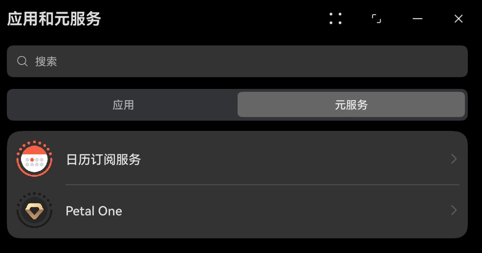

不过元服务窗口右上角的按钮比普通窗口更小，关闭按钮也从叉叉变成了圆圈里一个减号。这是很严重的认知割裂——抑或是产品区分？刚熟悉的窗口操作，到这里又得重新看一眼。

鸿蒙从移动端生长而来，应用运行在各自的沙箱里，访问图库、位置、相机、麦克风这些数据和设备，都可以由系统统一管理。连浏览器读取剪贴板时也会询问权限，刚从 Windows 过来还有点不习惯，但谁访问了什么，系统里都能找到入口查看。密码保险箱也可以在多处应用里填充，比我平时只装在 Edge 里的 Bitwarden 插件更省心。

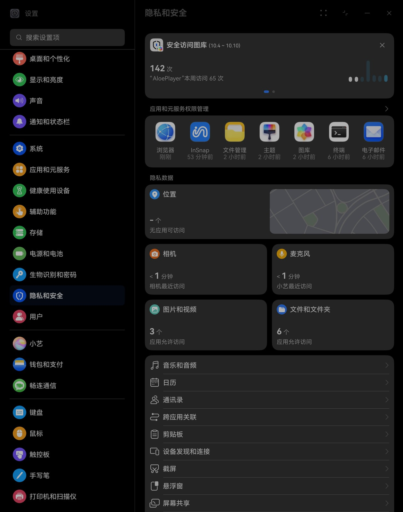

应用市场负责安装更新，自启动和权限也在系统设置里统一管理，这套体验对于普通用户确实友好。只不过权限收得紧，也让全局生效的小工具和小脚本不那么容易做；从 GitHub 下载软件自己安装的习惯，到了鸿蒙也要另想办法。这些折腾留到后面再细说。

系统自带应用里，天气让我有些意外。大屏查看天气，各个卡片随意编辑，满屏信息扑面而来别提多爽！桌面小组件还会推荐花期指数，提醒我到了赏桂花的时节；晚上又提示朝霞时刻、朝霞概率、日出时间，连西泠桥的拍照点都推荐出来了，蛮不错。后来长按编辑才发现，原来选的是智能推荐，内容会轮播。卡片生态值得夸奖。

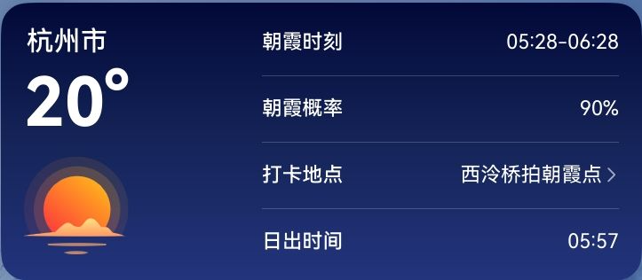

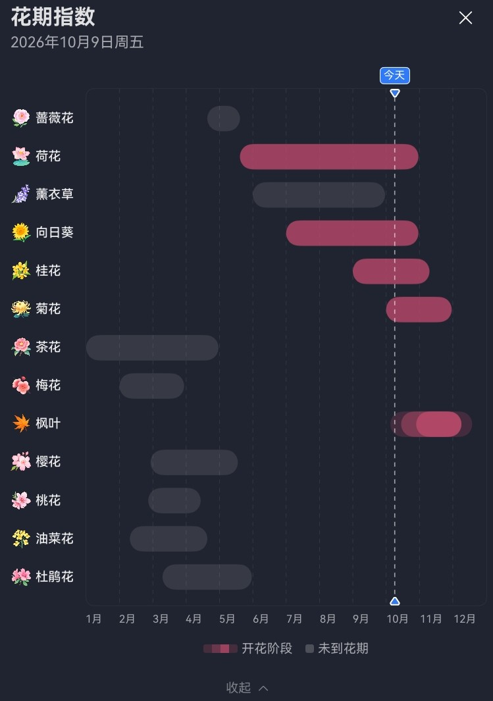

花瓣地图也很适合这样的大屏幕：深浅色可以跟随昼夜切换，图层能够选择，还有旅游、休闲和运动场所指引。之前在 Windows 笔记本上只能用网页地图凑合看看，现在点开应用就能大大方方地看。地图就应该在大屏幕上看！

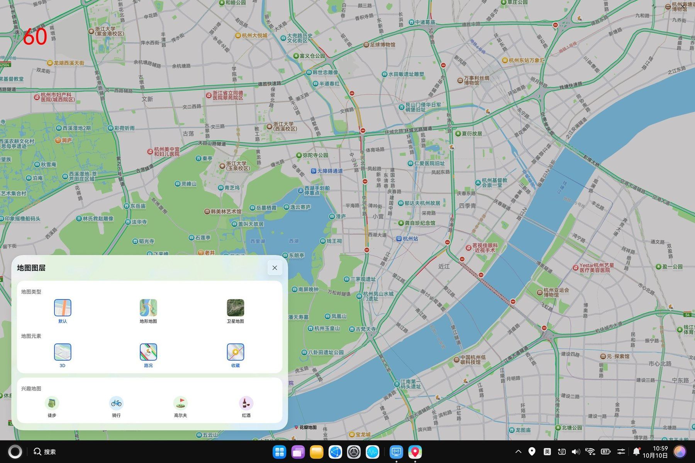

图库这边倒是有个让我困惑的地方。在文件管理器里双击 JPG，首先打开的是文件预览；我想换成图库，就从右上角更多选项里选择其他应用。找到了图库，系统却提醒：“无法确定图库是否可以打开 JPG 类文件。”鸿蒙的 PM 你们看看这像话么！图库还无法确定能不能打开 JPG？

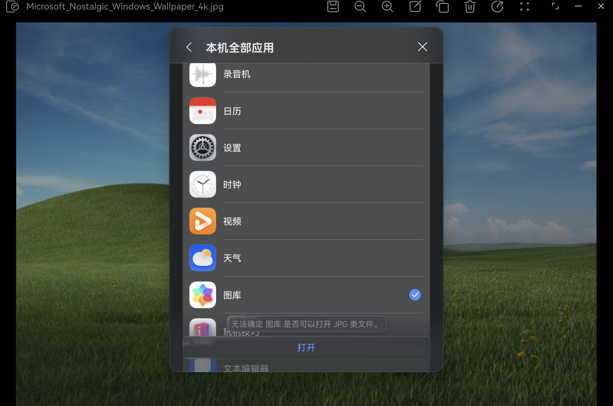

手写笔则是在华为店里体验的，我自己暂时没有买。星闪配对之后，华为笔记支持无界画布、各种画笔和字迹调整，基本还原了我曾经 Surface + OneNote 的体验，甚至更加流畅。不禁感叹要是我读书那会儿有这玩意儿该多爽！不过 Pro S 屏幕无法像 Surface 那样放低摊平，长时间在屏幕上书写不太方便；触控板倒是可以当数位板写，还有悬空光标提示位置。只是现在我早就不常手写记笔记了，这支笔还是先让它留在店里吧。

### 3.7 浏览器、办公和通讯：我的日常软件迁移

桌面熟悉之后，接下来要把常用软件找回来。首先是浏览器：默认搜索引擎是百度，也可以选 360，上手先改成 Bing。此前用 Edge 习惯了垂直标签页、只在新标签页显示收藏夹，这两个功能在华为浏览器里暂时没找到。不过 Notion 网页版能打开，够我继续写这篇文章了。

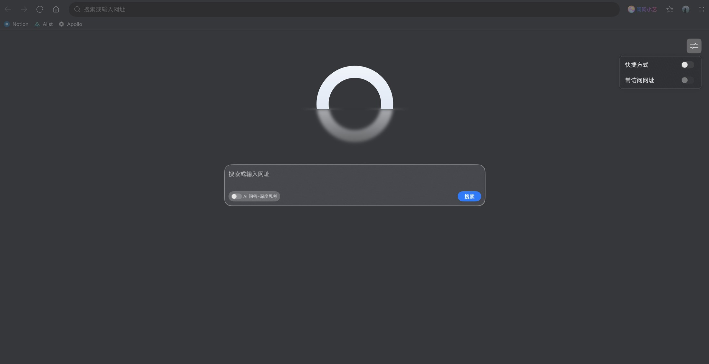

这么多厂商自带浏览器用下来，鸿蒙这个是最简洁漂亮的。首页的快捷方式和常用网址一关，只剩鸿蒙 Logo 和搜索框，简直完美！F12 开发者工具能用，也能安装一部分插件，Ctrl + Shift + Tab 切换标签页的习惯也还在，日常浏览对我来说蛮够用了。

文档办公则轮到 WPS。说实在的，我一直是 Office 选手，对 Windows 下的 WPS 印象不太好；到了鸿蒙 PC，WPS 却成了日常文档的重要入口。我偶尔打开 CSV、PDF、DOCX，查看、复制和打印都很流畅，WPS AI 也没有强制弹窗当牛皮癣，姑且好评。

鸿蒙 QQ 好久没用过这么流畅的了！此前在 Android 和 Windows 上用的 TIM 老旧、强制浅色，还会卡顿；鸿蒙 QQ 不仅流畅，触屏也友好，又回到了四五年前快乐水群的感受。各种设置可以自由调整，还能捧着 laptop 视频通话，总体好评。

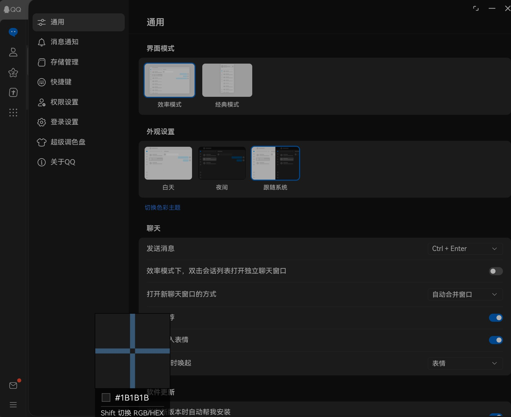

微信的流畅度也不错，高分辨率屏幕上看着甚至感觉比 Windows 端舒服。但它占的是电脑登录位置，我在鸿蒙 PC 登录之后，Windows 端就被顶掉了，没法像手机、平板和电脑那样一起在线。台式机是主力，手机也一直随身，总不能为了新笔记本把常用设备的微信挤下去吧。

触屏体验也没跟上：手指拖聊天框容易把私聊窗口拎出来，却无法像手机那样上下滑动聊天记录。对于在意聊天记录完整一致性的我来说，还是让最常用的 Windows 和 Android 设备一直在线吧。

该分屏分屏，该找文件找文件，工位打印机接上也能用，日常操作慢慢顺了起来。

接下来，就得看看自己用惯的工具和工作流能不能搬过来了。

## 4 需要折腾：重新搭建自己的工作流

日常应用安顿好了，接下来就该把我用惯的截图、监控、网络和终端工具一个个找回来。

### 4.1 截图与硬件监控：寻找趁手的工具

截图是迁移到鸿蒙 PC 后很快遇到的一个小缺口。Windows 上我已经从 PixPin 迁移到了 [Snow Shot](https://snowshot.top/)。实测下来，Snow Shot 满足常用需求的同时，内存占用更低、界面更简洁，而且免费开源，于是欣然替换。我的需求很朴素：窗口吸附、UI 元素级选区，省得自己微调像素，再加上形状标注和模糊打码。功能够用之后，优先轻量、简洁、免费！

鸿蒙系统自带 F11 全屏截图，鸿蒙键 + Shift + S 可以矩形框选。截下来是没问题了，要更方便地选窗口、标注、贴图，还得去找趁手的工具。首先在应用市场找到了 InSnap：鼠标指向窗口会高亮边界，点击即可选中，长截图、标注、延时、OCR、取色和历史记录都有，功能相当丰富。

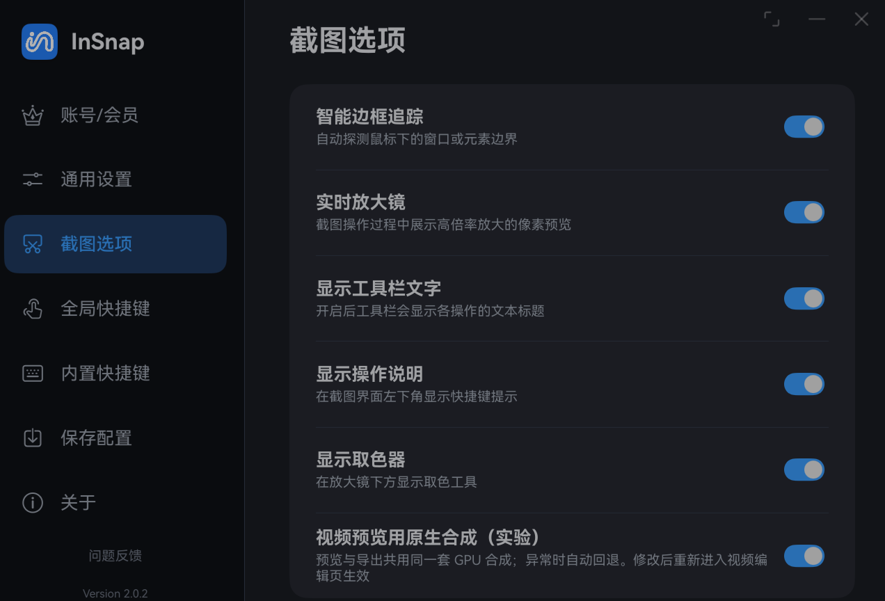

不过实际使用下来，我还挺介意它不能用滚轮放大 UI 区域来精确定位，偶尔又遇到全屏黑屏、卡顿，部分功能还需要 VIP。于是继续寻找——隆重介绍：X截图精灵！这才是目前最符合我需求的鸿蒙 PC 截图软件。应用市场 4.9 分，果然非同凡响。

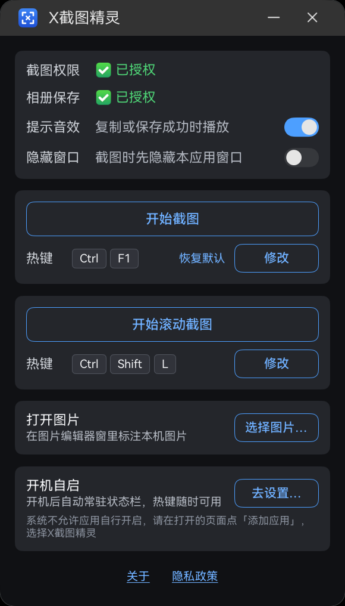

它的界面简单、轻量、启动快，窗口识别准确，免费提取文字也很实用。截图、标注、OCR、置顶贴图和图片编辑，常用操作基本都能一站完成。去设置里卸载 InSnap 的时候还留意了一下，设置里显示它的存储占用约 100MB，X截图精灵仅有 2MB。对我这个追求轻量工具的人来说，高下立判。

接着是硬件监控。Windows 有 HWiNFO，Linux 有 btop，Android 还有大名鼎鼎的 Scene。CPU、GPU 频率和负载、温度、电池功耗这些，平时总想随手看一眼。到了鸿蒙 PC，系统任务管理器能看基础资源占用，硬件信息就相当有限了。所以先 Ctrl + Shift + Esc 的任务管理器凑合吧～看不到温度就没有性能焦虑，耶✌

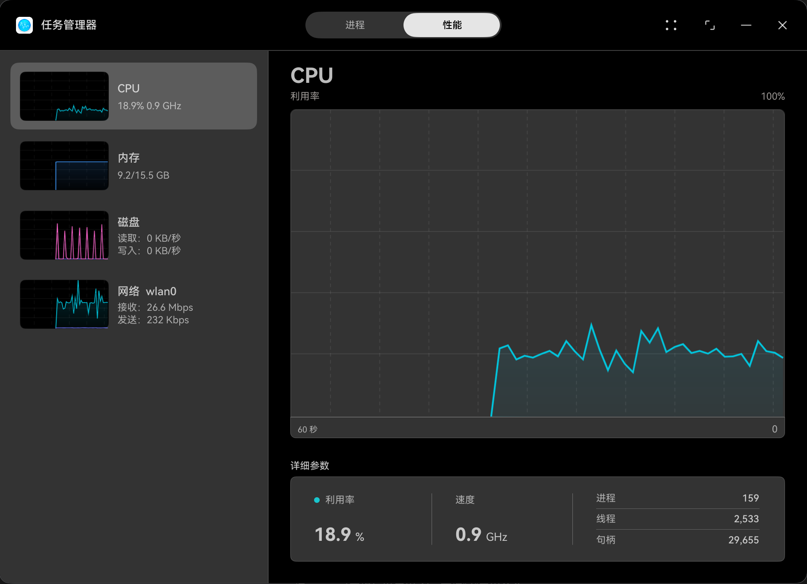

后来在应用市场找到“系统监视器”，信息多了不少，还适配深色模式，真棒。CPU 能看每核心使用率和频率；GPU 的频率与负载，从任务管理器里的看不到变成了能看；电池的电压、电流也能拿来换算功率。我在轻办公时看到过 2～5W 的电池取电功率，难怪续航这么舒服。各类传感器、网络信息也有不少，只是 CPU 温度、电压这些我想看的细节还是没找到。

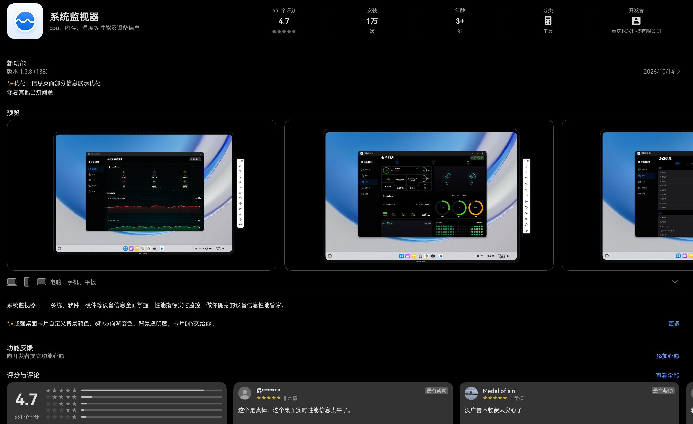

### 4.2 ClashBox：一个小小的点，怎么把订阅搞挂了？

代理这块我原先挺担心的，毕竟 Windows、Android、Linux 上一直都是 Clash 用户。群友推荐 ClashBox，GitHub 项目看起来很完善；但我当时在美区网络下没能从应用市场搜到，折腾了一番地区网络之后，终于、终于找到了大名鼎鼎的 ClashBox。整体 UI 非常美观漂亮😍

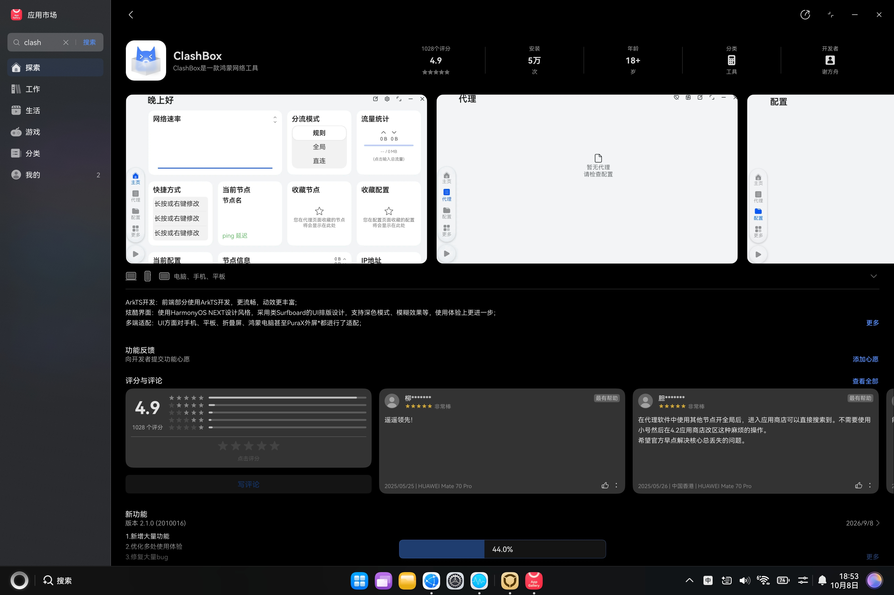

装上只是第一步，真正导入我一直在用的 GLaDOS 订阅，才发现事情没那么顺利。GLaDOS 提供传统 Clash 和 Mihomo / Clash Meta 两种订阅。我以前一直偷懒用 Clash Standard，这次想着 ClashBox 底层既然是 Mihomo，那就老老实实换成 Mihomo 订阅。结果输入 URL，配置下载下来了，下一步直接给我一个 `invalid domain`。换回 Clash Standard 不行，自定义 UA 也不行。好不容易装上了，先给我来个不能用。

一开始自然怀疑是 GLaDOS 的 YAML 跟不上新版 Mihomo。刚好电脑旁边就是 Windows + WSL，我把订阅文件下载下来，又从 Mihomo Release 拉了 1.19.30 内核准备本地检查。先 `grep` 一圈通配符，原始 YAML 里的 `*.lan`、`*.local` 看着都挺正常；再对照新版域名校验逻辑，也没找到明显的非法项。

事情到这里就有点奇怪了：浏览器直接下载的配置看着没问题，ClashBox 却坚称 `invalid domain`。于是换个思路，不再盯着 GLaDOS，直接把 **ClashBox 实际保存下来的配置**导出来对比。然后一眼就破案了！

原始规则里本来有：

```yaml
- DOMAIN-SUFFIX,.internal,DIRECT
- DOMAIN-SUFFIX,.intranet,DIRECT
```

到了 ClashBox 处理后的 `dns.fake-ip-filter`，居然变成：

```yaml
- "*..internal"
- "*..intranet"
```

两个点，当然不是合法域名。ClashBox 会把一部分 `DIRECT` 域名同步进 `fake-ip-filter`：普通的 `qq.com` 前面加 `*.`，变成 `*.qq.com` 没问题；但原规则已经以 `.internal` 开头，再直接加一个 `*.`，就变成了 `*..internal`。Mihomo 1.19.30 的域名检查正好不接受这种写法，一个不起眼的 leading dot，成功把整个配置干趴下。

更有意思的是，我后来又试了“导入本地文件”。想着既然 URL 下载会出问题，那我自己把 YAML 修好再导进去总行了吧？结果 ClashBox 连本地文件也会重新加工一遍。翻源码才发现，无论 URL 还是本地文件，保存前都会走配置后处理链。怪不得怎么喂都能给我重新加工坏，呵呵。

好在应用里还藏着一个“编辑配置内容”：这条路径直接修改 ClashBox 保存的最终配置，不再经过同一套导入处理。我把所有 `*..xxx` 改成 `*.xxx`，保存，重新启用。好了！后来索性直接把原始 `glados.yaml` 全文复制进去，省得一个个修补；只不过订阅更新时还得自己留意。

一个不起眼的小 bug，让我从订阅配置一路翻到了 ClashBox 源码。顺手在已有的 [Issue #165](https://github.com/xiaobaigroup/ClashBox/issues/165) 下面补了复现和定位，希望后面版本顺手修掉。

反过来说，这一圈让我对 ClashBox 的印象反而好了不少。至少出了问题还能看源代码捉虫，不至于只能对着一个“配置加载失败”干瞪眼。它也不只是套着 Mihomo 内核的开关：日志、请求、连接、规则编辑都有，“测试与检测”里还有连通性测试、测速、DNS 查询等一堆工具。以前得开浏览器找网站，或者自己 `curl`、`ping`、`dig` 一通，现在直接在客户端里点几下就行。功能已经很像一个成熟的 Mihomo 前端了，边角兼容性还带着点年轻鸿蒙软件的味道。

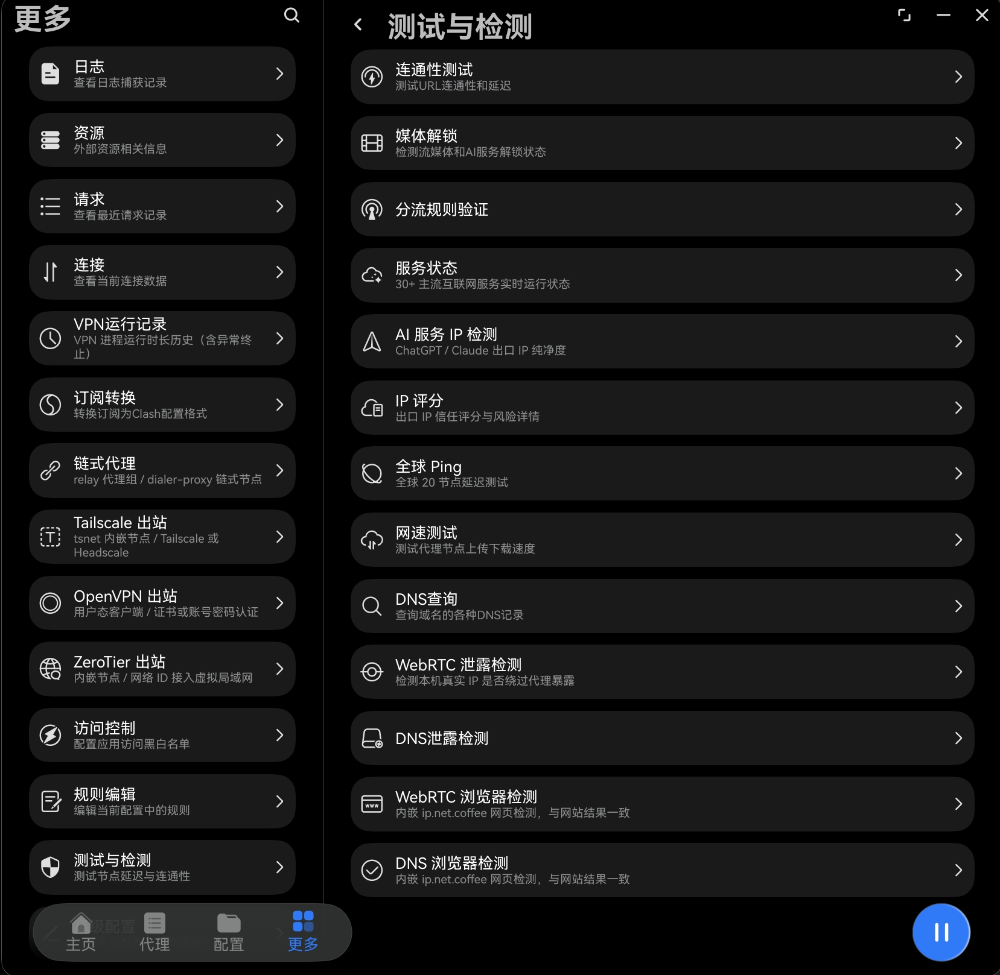

本以为到这里就算搞定，没想到后面折腾 Tailscale，又让 ClashBox 出了点问题。

### 4.3 TailLink 与 SMB：把鸿蒙接回我的设备网络

Windows 台式机、笔记本、Android 手机和电视，平时都是用 Tailscale 连在一起的。鸿蒙应用市场里找到了 TailLink，登录原来的账号，鸿蒙 PC 也加入了 Tailnet，分到一个独立的 `100.*` 虚拟 IP。打开时会弹出系统 VPN 授权，连上之后，原来那一堆设备终于又凑在一起了。

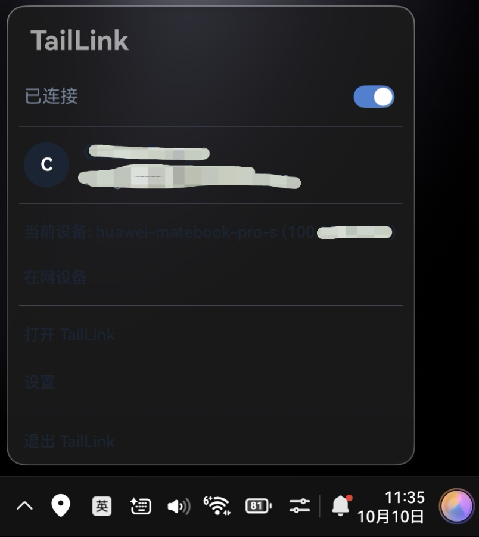

不过深色模式下展开菜单，深蓝色字体配深色背景几乎看不清，切回浅色才正常。无妨，不影响用途。真正麻烦的是它跟前面的 ClashBox 打架：TailLink 挂着时，ClashBox 配置能加载、本地代理能启动、节点也能连通，但 VPN 始终建不起来。试着把 TailLink 关掉，ClashBox 立刻就能接管网络。原来不是机场又出了问题，是两个软件在抢系统 VPN。

这就有点难绷了。我在 Windows 上一直是 Tailscale 后台常驻、Clash 使用系统代理，两边各干各的，从来不用操心。仔细想想，VPN 和代理本来也不是一回事，ClashBox 没必要非得再占一个 VPN。

于是最终保留 TailLink 负责组网，ClashBox 用原始 GLaDOS YAML 和 Rule 模式启动本地代理，再去鸿蒙系统设置里手动填上 `localhost:7890`。还真就这么跑通了：Google、普通国内网站、校内 CC98 都能打开，Tailnet 里的设备也能访问。ClashBox 日志能看到请求，首页网速曲线却一直是一条直线，跟没流量似的。

多日体验下来，TailLink 也有点小脾气：十几个小时或者到了次日，应用里明明显示已连接，Tailscale 网页端却显示鸿蒙设备离线。单纯在软件里开关连接无效，得从任务管理器结束整个应用再重启。TailDrop 文件分享也用不了。好在组网这条路是接上了，接下来试试能不能直接访问台式机里的文件。

鸿蒙文件管理器里有“网络邻居”，首次使用时下载对应服务，就能添加 SMB 共享。对我这种把个人文件都放在 Windows 台式机上的人来说，实用程度相当高。一开始自然想直接走校园网：台式机插网线，鸿蒙 PC 连 Wi-Fi，两个网段互相 Ping 没问题，之前测过的 WebDAV 端口也能连上，偏偏 SMB 用的 TCP 445 一直超时。同一 Wi-Fi 下的 Android 手机测 445 也不通，连账户密码验证都还没轮到。

Windows 防火墙、端口映射这些东西也琢磨过，后来想想何必呢。既然 TailLink 已经加入现成的 Tailscale 网络，直接用台式机的 `100.*` 地址访问不就好了？果然，445 通了。Windows 这边把需要的目录设成普通 SMB 共享，鸿蒙文件管理器里填上 Tailnet 地址、共享目录和 Windows 账户，就能直接浏览了。不用额外安装第三方文件管理器，也不用向公网开放 445。Win NAS 启动！

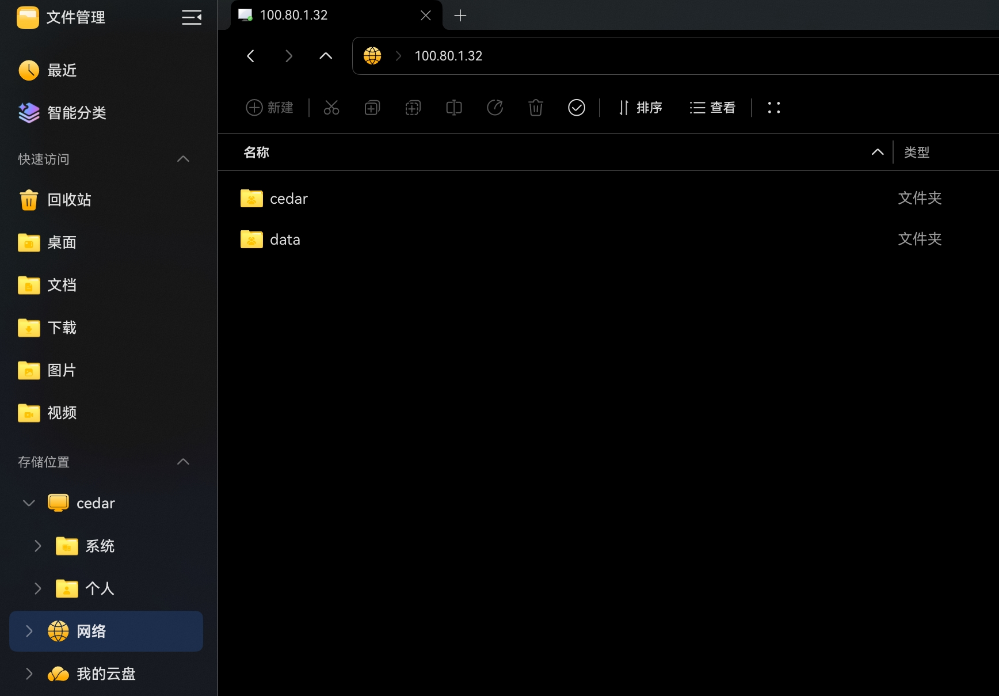

这么一看，前面宁愿让 ClashBox 退回系统代理，也要把 VPN 留给 TailLink，倒是很值得。跟随时访问台式机文件比起来，ClashBox 首页那条不动的速率曲线也就随它去了。

说到校园网，应用市场里还有深信服 aTrust。早年 Windows 上的 EasyConnect 在我心里已经留下了卸载不干净、到处留服务的印象，我对这家公司一直抱有偏见。自己写过的 [zju-connect Android 版](https://github.com/Cedar17/zju-connect-android) 不到 10MB；鸿蒙端 aTrust 我刚下载还没打开，就已经占了 865MB。难以想象有多少屎山被塞了进去，还是敬而远之吧。有生之年高低要试试鸿蒙开发，把自己的 zju-connect 也移植过来！

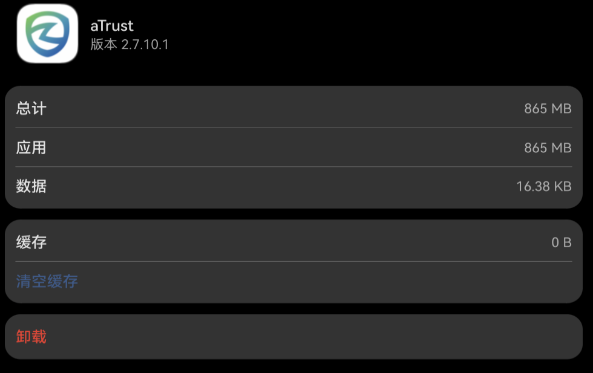

### 4.4 HiShell、SSH 与 Linux：熟悉的命令行回来了多少？

网络和文件有了着落，终端这一面自然也不能落下。打开 HiShell，先套用我探索陌生 Unix 系统的上手六件套：`uname -a`、`cat /etc/os-release`、`lscpu`、`free -h`、`lsblk`、`df -h`。这套命令一通敲下去，很遗憾几乎只有 `uname -a` 的体验完整。屏幕上显示的是 HarmonyOS、HongMeng Kernel 和 aarch64。

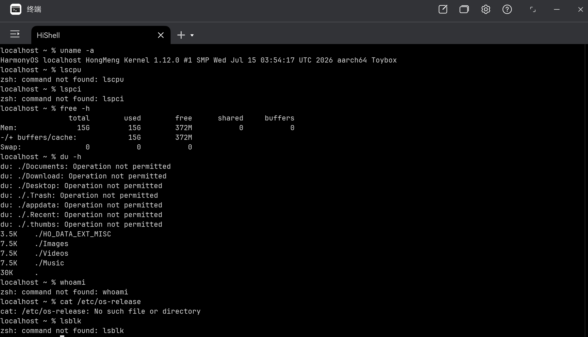

系统终端本身倒是挺不错，普通 SSH、Shell 和彩色命令行能用，256 色、真彩色和 btop 这样的动态界面看起来也流畅。默认终端可以在 HiShell、openEuler 和上一次终端之间选择，有点 Windows Terminal 统一管理 PowerShell、CMD 和 WSL 的感觉。最大的遗憾是不能自定义字体，我心爱的 Nerd Font 图标只能有些显示、有些变成方框。这可是大缺憾！

SSH 也给了我一个下马威：默认读取 `~/.ssh/config` 时，报 `Bad owner or permissions`，常用的 `chmod` 在这里也没能把问题解决。最后用 `ssh -F ~/.ssh/config` 显式指定配置文件，绕开了默认配置文件的那道权限检查，算是先把连接方式找了回来。系统后来增加了密钥管理，但我遇到的配置权限问题仍在。

第三方终端又试了一圈，最后留下的是 Term。第一个发现支持 Nerd Font 的！就凭这一点已经很戳我了。SSH、SFTP、快捷键和 TUI 软件用起来都挺顺，设置也丰富。

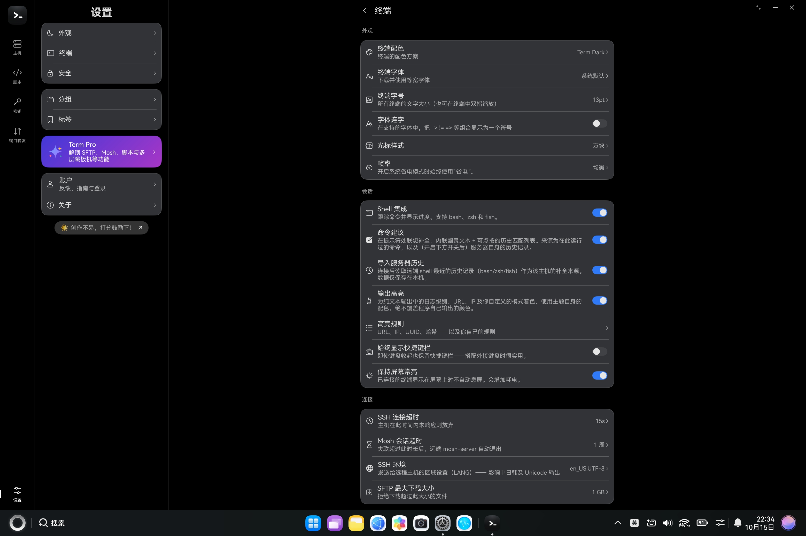

接下来试试 [Harmonybrew](https://harmonybrew.atomgit.com/)，把 Homebrew 的包管理思路带到鸿蒙上。看到 `brew install` 终于又能一通安装工具：`yazi`、`ripgrep`、`fzf` 等都可以找一找。但原来那套软件包列表不能照搬，一些包名不存在；好不容易装上 `yazi`，启动又报缓存目录所有权不匹配。包能装上，离自己的命令行工作流完全跑起来还差一步，权限问题又来刷存在感了。

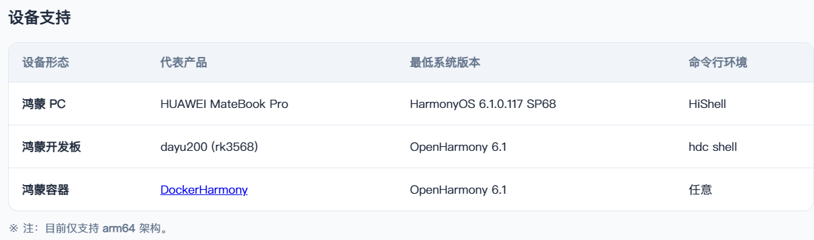

鸿蒙还有另一条路：通过“融合开发引擎”运行 openEuler Linux。默认分配 4 核 CPU 和 4GB 内存，终端一打开，`uname`、`lscpu`、`free` 这一套命令又能正常敲了。不愧是完整的 Linux，熟悉的感觉又来了！

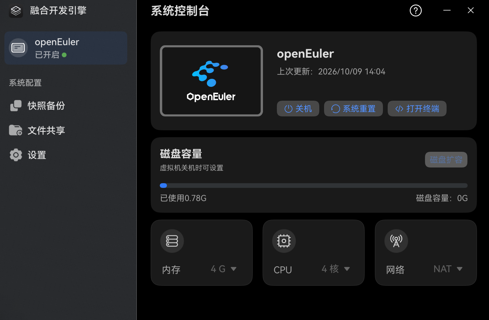

进系统先装我心爱的 Fastfetch，结果 `dnf` 仓库里居然搜不到。改去下载官方 ARM64 RPM，openEuler 内访问外网又不太顺畅，于是先在鸿蒙侧下载，再通过两边共享的个人文件夹交给 Linux，最后 `sudo dnf install`。一番折腾，总算成功见到蓝白色六边形 OS 的 Logo。

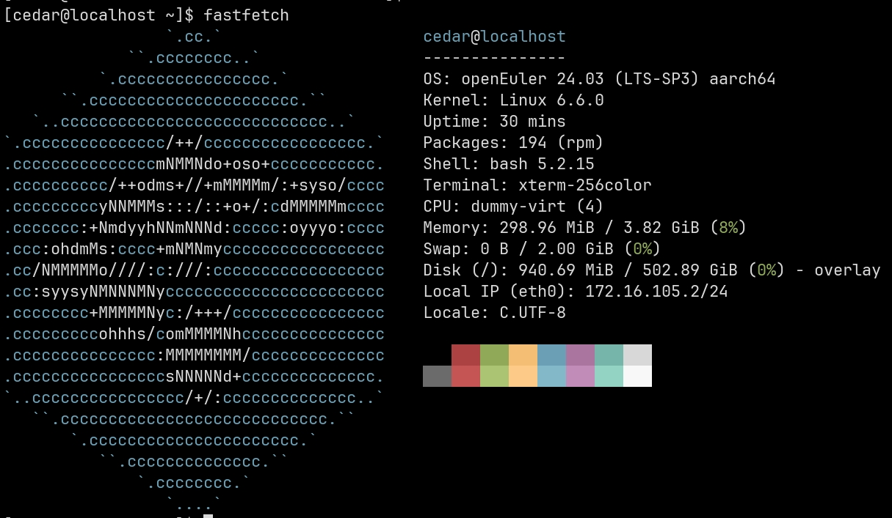

还有一个好玩的命令——`loh`，真就对标 WSL 了。从 HiShell 可以直接调用 Linux 子系统里的命令，不用手动切换终端；我试了 `loh` 的帮助、状态和 Fastfetch，图形也正常显示。融合开发引擎还支持 localhost 端口转发，我在 Linux 里运行 HTTP 服务，再从鸿蒙侧访问，实测体验良好。

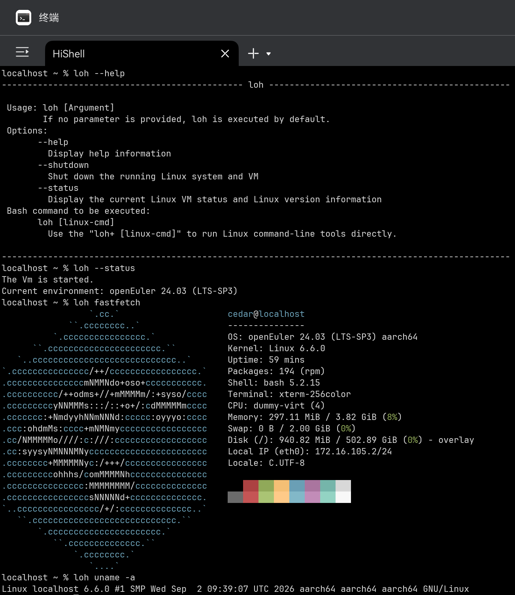

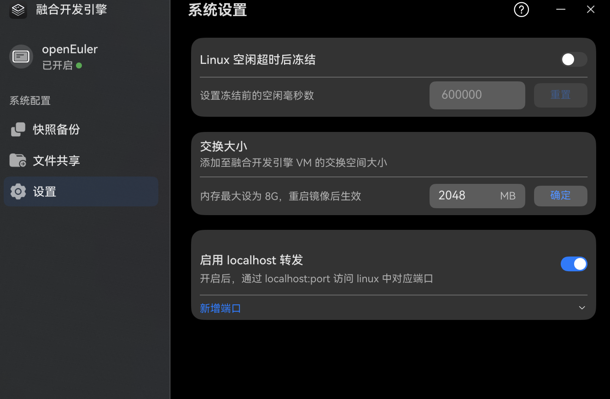

### 4.5 路接通了，真正的考验才开始

这一圈折腾下来，截图、监控、上网、组网和文件，总算都有了自己的位置。Win NAS 启动了，终端也能接回服务器，鸿蒙里甚至还能打开一套熟悉的 Linux。期间也有报错、权限和软件兼容的小脾气，但查来查去、试出办法的过程，倒是让这台机器越来越像一件好玩的极客数码玩具了。

不过，台式机的文件能看到，和真正用上台式机的软件与算力，还是两回事。我买 Pro S 时最在意的需求还没接受考验：远程桌面能不能像 Surface 上那样，把熟悉的 Windows 工作环境完整地带到身边？

## 5 核心考验：它能成为理想的轻量终端吗？

### 5.1 理想的远程桌面：像给台式机接了一块屏幕

MateBook 到手后折腾了这么多远程桌面软件，也让我重新想清楚了自己的需求。以前用 Surface 连台式机，其实就是典型的 Thin Client（瘦客户端）用法：资料和软件留在同一台主机上，通过网络把屏幕、键盘、触控板接过去，所谓“网络化的 KVM”。

理想情况下，体验就应该像给台式机直接接了一块高分辨率触摸显示器，再配上键盘和压感触控板。Pro S 的 3120×2080 屏幕要能全屏用上，Windows 的 DPI 缩放可以调到舒服的大小，键鼠、触控板和常用快捷键能正常送到远端。局域网里输入延迟和窗口动画也要足够流畅，连接最好稳定，断了能够方便重连。

多点触控、剪贴板、文件与音频传输也都是加分项。至于背后走 RDP 还是 Moonlight，对我来说都可以——能在多大程度上让我忘记自己是在远程操作，才是最重要的。

### 5.2 从 mstsc 到鸿蒙 RDP：熟悉的协议，陌生的小脾气

先拿老朋友当标杆：在铠大师 Windows 虚拟机里打开 `mstsc.exe`，连接自己的台式机。除了虚拟机最高只有 2562×1708、60Hz，无法用满 Pro S 的原生屏幕，其他体验基本完美。配合铠大师的四指手势，RDP 留在右侧虚拟桌面，鸿蒙留在左侧，手指一划就能切换。

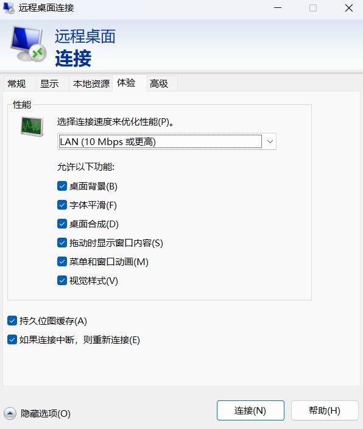

不过为了一个远程桌面先开一台 Windows 虚拟机，总觉得有点绕。鸿蒙应用市场里已经有不少 RDP 客户端了，接下来一个个装起来试试。

装软件之前我还让 ChatGPT 帮忙扫了一圈 GitHub，顺着仓库、fork 和上游 PR 看了看。FreeRDP 的鸿蒙移植已经有好几位开发者在做，[RemoteDeskHarmonyOS](https://github.com/Mydstiny/RemoteDeskHarmonyOS) 还把 RDP、SSH、VNC 等协议放到了一套界面里，看着很有野心。另一个 [hFreeRDP 的上游 PR](https://github.com/FreeRDP/FreeRDP/pull/12761) 也挺有意思：开发者试图把鸿蒙客户端加入 FreeRDP，维护者认真 review 后，因为缺少设备和长期维护人手，建议客户端独立维护。移植能跑起来和进入上游长期维护，确实是两回事。

翻几个项目的提交记录，还能看到空格、Delete、输入焦点和触控等修复。原来成熟的 RDP 协议到了新系统，光把屏幕、键盘和鼠标接好，就有这么多细节要磨。仓库文档和开发进度看着让人期待，实际用起来如何，还是得自己试。

我先后装了木枢、AirRDP、RemoteDesktop、碧虎、DeskGo、拾风和 electerm。每个软件多少都有些自己的长处，也都有些遗憾：有的不能真正全屏，有的分辨率选择受限；AirRDP 设置很丰富，快捷键捕获也不错，但窗口拖动时画面会撕裂、分块刷新；RemoteDesktop 把多协议整合在一起，测试时快的时候延迟只有几十毫秒，慢的时候却能到 900ms。看起来“能连上”和“坐下来舒服地用”还真不是一回事。

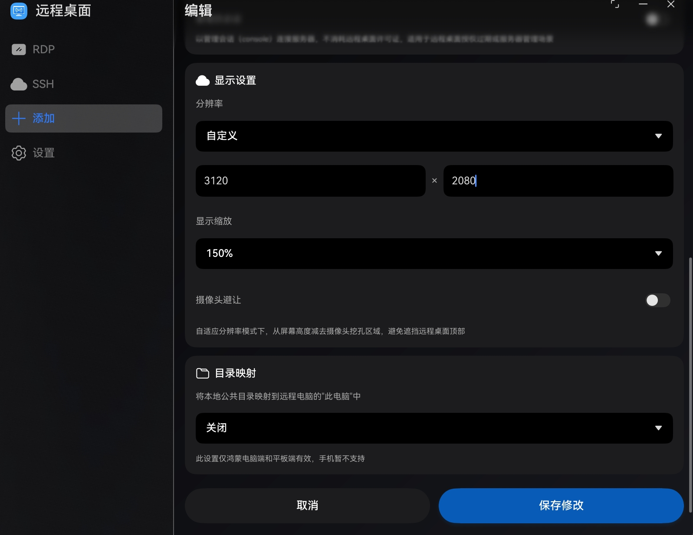

DeskGo 的界面简洁，专注 RDP 和 SSH，也没有会员内购。分辨率和显示缩放都可以自定义，系统快捷键居然也能被应用捕获，很合我的胃口。文本剪贴板正常，临时切到鸿蒙应用还能短暂后台保活，断线后也可以一键重连。就是会出现本地和远端两个鼠标指针；触屏更多是发送鼠标点击，手指滑动页面会变成选中文字。总体用下来延迟能接受，已经够用了。

拾风远程桌面则让我对流畅度有了惊喜。这么多软件里，它是我测试时唯一能稳定在几十毫秒延迟的，UDP 加速免费，还有 H.264 图形编码。调整几下之后，也能以 3120×2080 撑满整块屏幕，而且没有双鼠标光标，窗口动起来很舒服。

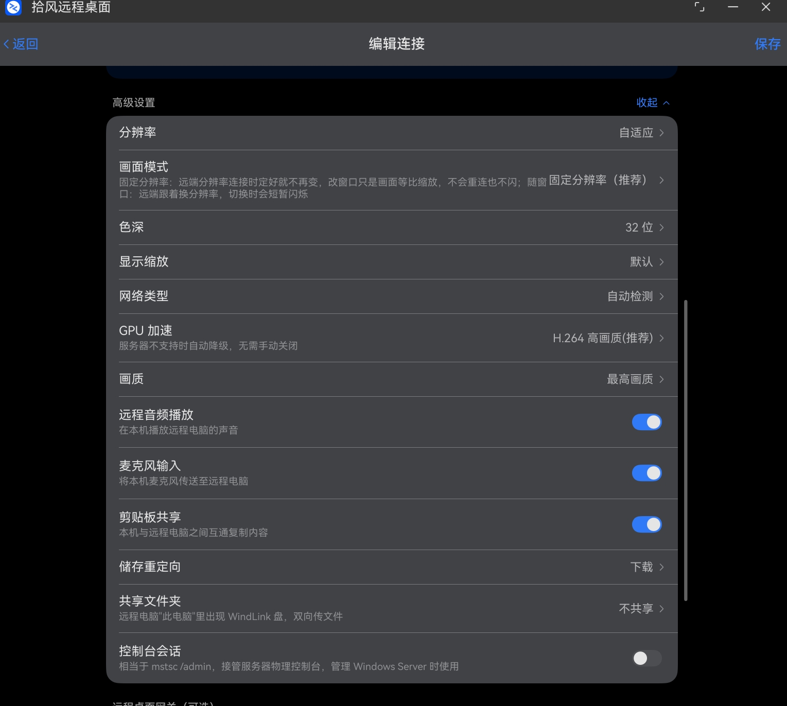

最大的遗憾是 DPI：它虽然支持调整显示缩放，但我测试时看到的效果是降低远端分辨率后再把画面放大，而不是在原生分辨率下调整 Windows 自己的 DPI。比如我想要 3120×2080、Windows 150% 缩放，既保留画面细节又让 UI 大小合适，在当时的版本里没找到实现方式，远端实际仍是 100% 缩放。触控模式也比较简单，单击可以，拖动窗口和滚动页面就不太顺手。希望后续版本能继续改进！

几个客户端试下来，像 DeskGo 这样的鸿蒙原生 RDP 方案已经可以承担我日常连接台式机的需求。但对比 Windows 自家的 mstsc，分辨率、缩放、触控、快捷键和流畅度还需要各自权衡，没有哪一个让我觉得所有细节都齐活了。既然如此，接下来试试下单前就看好的另一条路。

### 5.3 Apollo + Moonlight：终于把台式机装进了背包

Sunshine + Moonlight 大家可能更熟悉游戏串流：把主机画面编码成视频，在另一台设备上低延迟显示，再把操作传回去。我这里主要用它远程办公，浏览器、VS Code、Terminal 都能这样用。

以前在 Android 上就用过 Apollo + Artemis，台式机的 Apollo 和虚拟显示器早就配置好了，不需要依赖台式机的实体显示器。把虚拟屏设为 3120×2080，Windows 自己调到 150% DPI，再让 Moonlight 按同样的分辨率全屏显示，正好避开了前面 RDP 客户端里让我纠结的远端缩放问题。

应用市场里搜到的 [Moonlight（by 李快）](https://appgallery.huawei.com/app/detail?id=com.xiaobai.moonlight&channelId=SHARE&source=appshare)，纯黑界面简洁清爽，看着就喜欢。结果手动输入台式机 IP，软件却提示防火墙失败；HiShell 里 `ping` 一下又明明能通。我在寝室接连换了几个 Moonlight 客户端，结果都不行，心里还纳闷这又是哪一层出了问题。

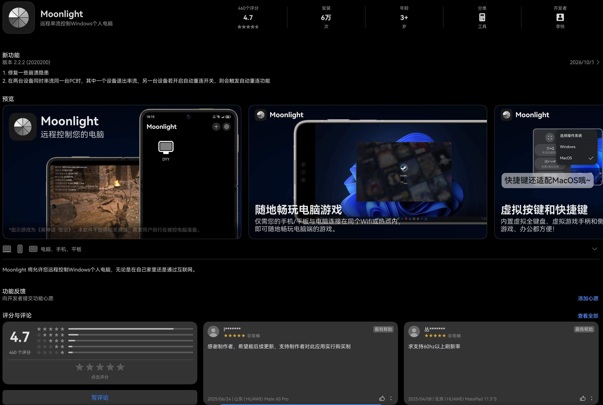

翌日到了工位再试，校园网环境下居然正常连接了。回头一看，原来是之前开着的代理网络影响了连接。前面刚折腾完 ClashBox 和 TailLink，这里又碰上一回网络设置。总算连上了，接下来好好看看体验。

设置里有一键调优的高画质影音办公模式，分辨率、帧率和码率也都可以自己设置，还提供 120 帧和 HDR 等选项。性能信息能像官方 Moonlight 客户端那样显示几行，虽然少了网络带宽，对我来说无伤大雅。

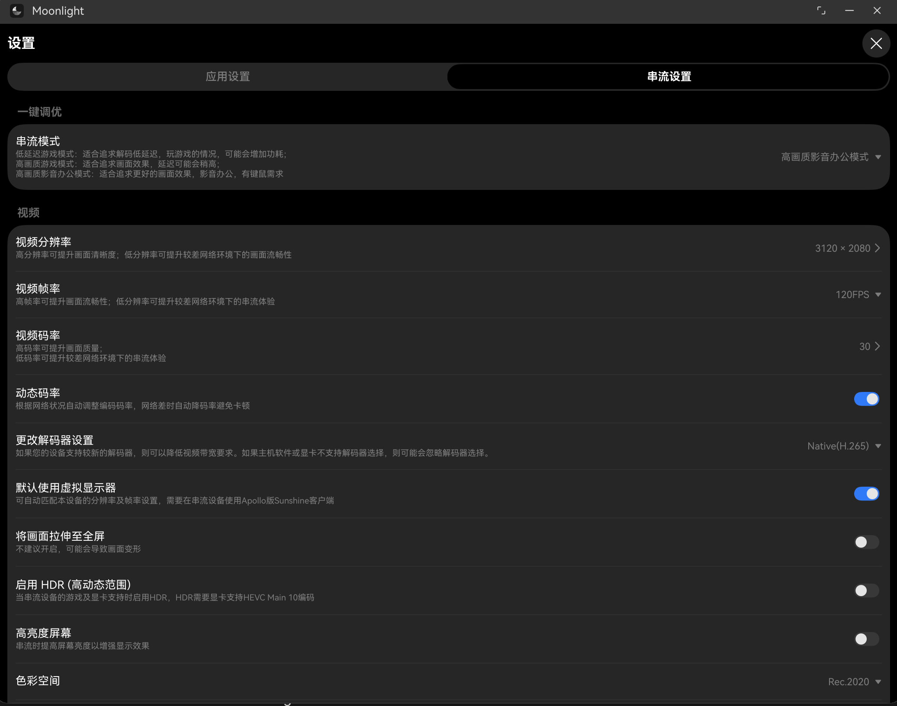

键盘、鼠标、触控板和多点触控都正常，可以舒服地操控 Windows 桌面了。起初 Esc 被默认用作连接时的侧边栏控制键，作为经常用 Esc 的人自然不能忍；翻一圈设置，发现可以改成左 Alt + 右 Alt 这样的组合键。如此一来，常用按键也回来了，完美！

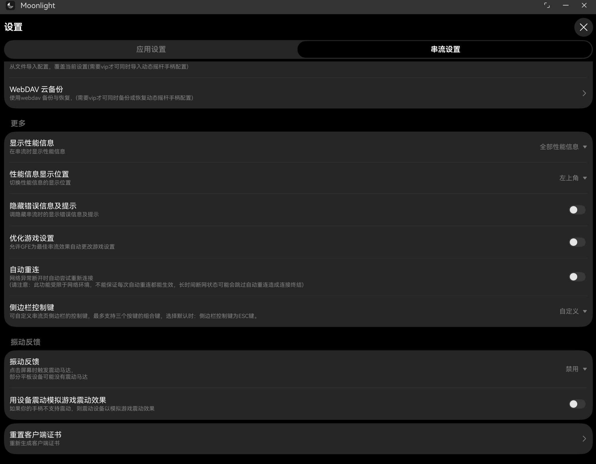

我也试了其他几个鸿蒙 Moonlight 客户端。MoonlightOH 更偏手机平板，测试时不能全屏，触控板滚动也不顺；月光·阿西西界面和连接信息做得挺用心，但我遇到了 Win 键捕获和触控板滚动问题；Moonlight V+ 有连接诊断统计，我这边却遇到 Tab 按下后无法正常发送抬起的问题。我要用键盘和触控板长时间操作 Windows 桌面，这些细节就很难忽略了。

最后留下的还是 Moonlight（by 李快）。界面黑白简洁，功能又符合我的需求，连接台式机之后，熟悉的工作环境就铺满了 Pro S 的大屏幕。那块买之前心心念念的 OLED，加上全尺寸键盘和压感触控板，和台式机上的软件、文件与算力凑到了一起。对我来说，这套串流体验非常好用！

### 5.4 留在工位的多屏愿望

当然，跟 Surface 原来的用法比起来，还有一件事没有搬过来：工位上的多屏远程桌面。以前 Surface 连上外接显示器，再通过 RDP 把台式机的工作环境展开到多块屏幕上，用起来很像给台式机直接接了几块显示器。Windows 对 Windows 的 `mstsc`，这方面确实强无敌。

Pro S 本机接外屏的体验，前面已经试过；那是鸿蒙自己的桌面扩展。要让远端 Windows 也像原来一样分配到多块屏幕，又是另一回事。买之前就知道目前没法照搬 Surface 的多屏方案，这次折腾也没有把它变出来。

移动时用一块 14.2 英寸屏幕连接台式机，已经比当年挤在 Surface 的小屏幕里舒服太多了。多屏暂时不强求，等以后鸿蒙远程桌面的支持更成熟了，再回来折腾也不迟。

### 5.5 购买目的，基本实现！

回过头来看，下单时最大的疑问有了答案。RDP 没有达到 Windows 原生客户端那样面面俱到的程度，日常连接已经够用；Moonlight 则让我找到了非常满意的单屏串流体验。个人文件、熟悉的软件和台式机算力，都能通过网络带到这台轻量电脑上。

Surface 和 Pro S 也各自有了位置：一个留在工位接着用多屏，一个装进包里随身走。原本为这套轻量显示与输入设备买单的目的，基本实现了！

## 6 跨过生态边界：在鸿蒙上运行 Android 和 Windows

鸿蒙原生应用已经让我把大部分日常需求安顿好了，远程桌面也能接回自己的 Windows 台式机。那如果想直接在 Pro S 上打开 Android 或 Windows 软件，又会是什么体验？应用市场里还真有几条路可以试试。

Android 应用可以通过卓易通、出境易这样的兼容环境运行；Windows 则是通过铠大师、Oseasy 启动 Windows 11 ARM 虚拟机。两边的体验还挺不一样，先从我熟悉的 APK 开始。

### 6.1 卓易通：先把 Android 应用装起来

原来卓易通不是华为亲自下场开发的，而是第三方公司的作品。打开应用市场一看，评分只有 1.9，评论区相当热闹。先装起来看看究竟怎么个事。

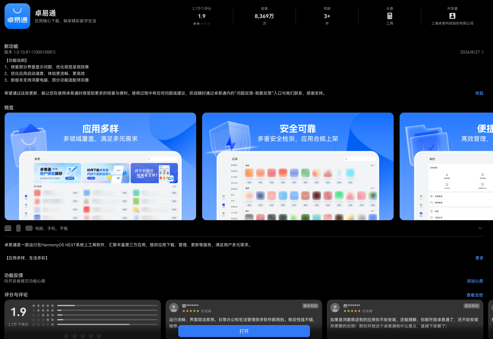

评论区里还有这样的反馈：

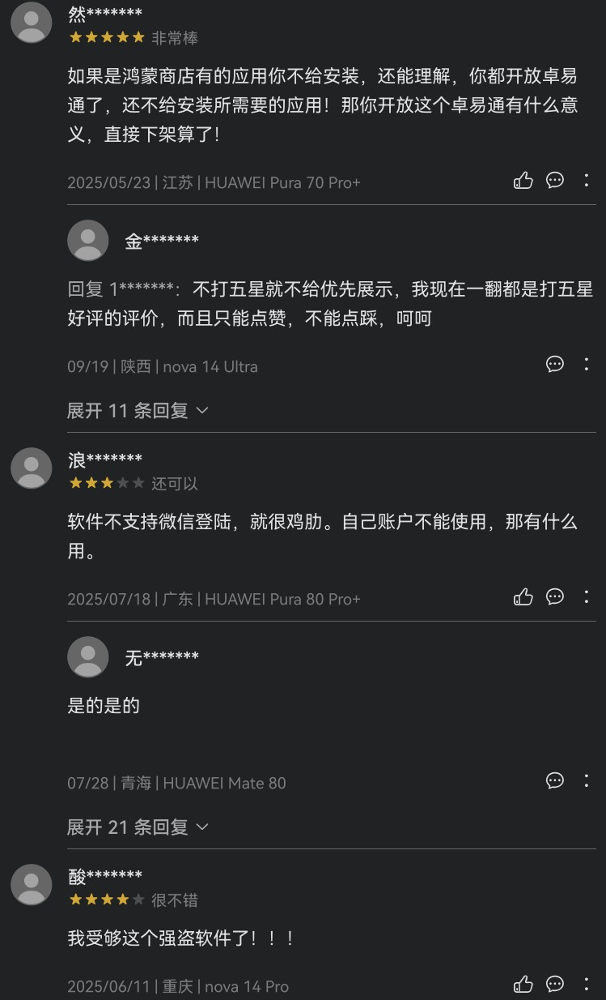

第一次打开默认全屏，没找到窗口化的办法，加载还要读条等十几秒。接下来试着安装自己下载的 APK，系统弹出了风险检测提示，好在还是能继续安装。安装之后，卓易通里又提醒了一次风险。

未知风险、恶意行为、隐私保护、欺诈检测、安全建议这几项看上去都是绿色勾勾，那我请问它到底检测到了什么风险？笑😂。我猜可能是对非商店来源的 APK 提醒用户注意，但提示没有把风险性质讲清楚，容易让人以为真的发现了某项恶意行为。

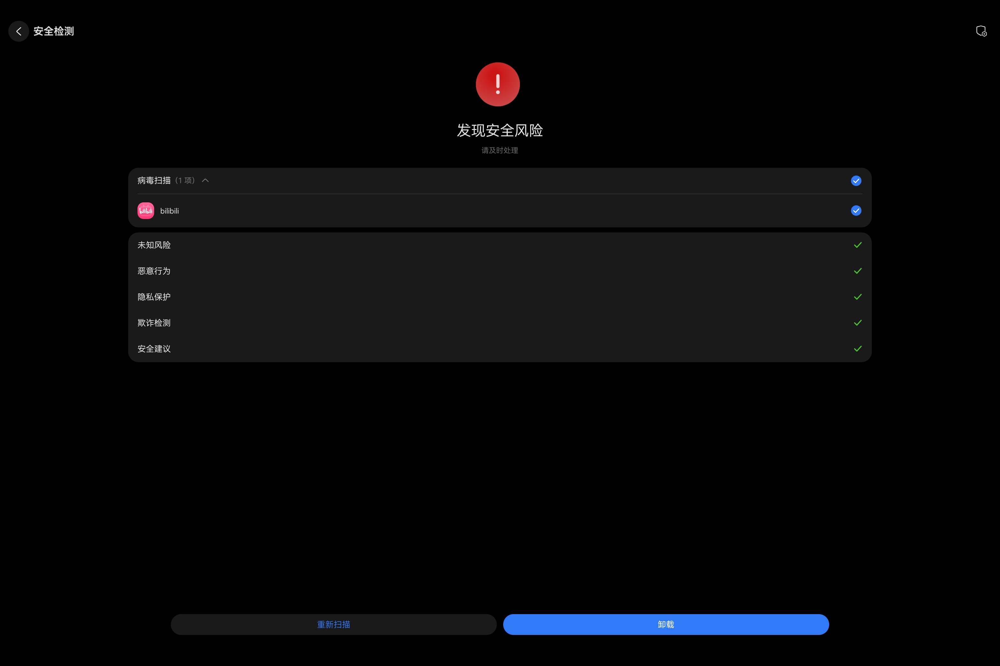

我装了一个哔哩哔哩 APK 试试，能正常打开，默认是手机那样的长条窗口。画面可以拉大，但到了宽屏上会怎么样，还得看应用自己有没有适配。我也没有在这台电脑上跑 Android 游戏或跑分的需求，能多一个打开应用的选择，总归不错。

### 6.2 出境易与 Edge：顺着 APK 翻进文件夹

之前一直想在鸿蒙 PC 上试试原版 Android 浏览器。我专门翻了 Edge 近两年的 APK 发行记录，挑了 2025 年 8 月的 Edge 138.0.3351.121，想着旧版能少一些臃肿的新功能。结果安装时系统提示，这个应用可能需要出境服务框架，建议先装“出境易”。

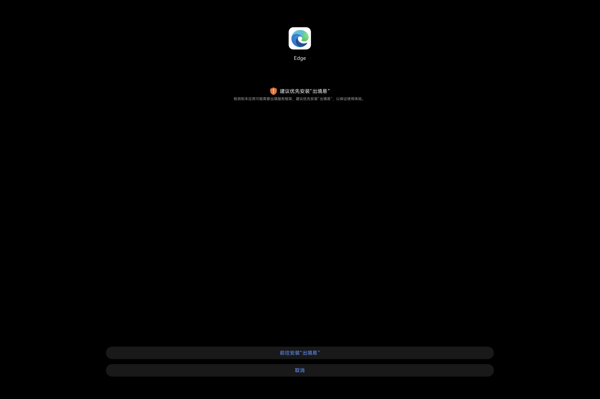

又发现一个之前不知道的第三方软件。出境易也有应用商店，主要提供海外应用。搜索 Edge，居然直接就有，152.6MB，下载完自动安装。


原以为这就结束了，没想到打开又弹出“应用运行组件下载安装中，请稍后使用”，进度条跑了好久才总算进入浏览器。登录微软账号，收藏夹等同步功能正常。打开“关于”一看，装上的是 Edge 153.0.4234.32，2026 年 9 月发布的版本。

这时候想起最初的 Edge 138 还没试成功，于是回到鸿蒙文件管理，双击 APK 重新安装。结果提示“系统已经存在较高版本，此安装包无法安装”。新版先到一步，旧版进不去了。


实际用起来，Android Edge 横向铺在大屏幕上，默认显示桌面网站，也可以切换手机网站。`Ctrl + L`、`Ctrl + W`、`Ctrl + T` 等快捷键都能用，基本键盘操作不错。不过鼠标中键的行为有些奇怪：我原本习惯中键点链接在后台打开、点标签页关闭，这里却似乎成了返回。暂时还没弄清是 Edge 自己的处理，还是兼容环境的鼠标事件映射问题。总之，移动端浏览器拉到大屏上之后，桌面交互还有些不一样的地方，我还是更习惯鸿蒙自带浏览器。


接下来试试文件互通。我在 Edge 里下载了一个 PDF，在鸿蒙文件管理器中找到了它：个人文件夹下面有“兼容应用数据”，里面的 Download 就是下载位置。再往上一层翻，DCIM、Pictures、Android、Movies 这些目录都是安卓老熟人了！

目录都找到了，当然要继续翻下去。打开 `Android/data`，看到 `com.microsoft.emmx`、`tv.danmaku.bili` 等几个包名，Edge 和 B 站居然都在这里。一个来自出境易，一个来自卓易通，鸿蒙文件管理器却把它们的数据目录呈现在同一棵目录树下。


有意思的是，卓易通和出境易自己的应用管理列表并不完全互通；前面重新安装 Edge 时，安装器又能识别已存在的高版本。

### 6.3 运行环境在哪里？任务管理器里找不到它

翻完文件，又想看看这些兼容应用占了多少资源。打开鸿蒙任务管理器搜索，居然找不到卓易通、出境易和 Android 应用对应的进程！Windows 虚拟机起码还能看到铠大师或 Oseasy 的宿主进程，这边的 CPU、内存消耗又算到了哪里？

顺着这个问题查了查。[卓易通官方 FAQ](https://www.droitong.com/CommonQues.html) 提到应用依赖其提供的运行环境，首次使用还需要安装服务工具；出境易除了应用分发，也有自己的服务框架，我在它的应用管理里看到了约 110MB 的“出境服务框架”。至于打开 Edge 时等待下载的“应用运行组件”具体包含什么，我还不知道。

社区也有人通过抓包、解包发现 Android 运行镜像和容器相关线索，还有鸿蒙 PC 用户提取过兼容环境镜像。相关探索可以看看[这篇 Android 容器技术拆解](https://imgeek.net/article/825368529)和[鸿蒙 PC 镜像提取记录](https://hu60.net/q.php/bbs.topic.107434.html)。这些资料给了我一些理解方向，但我没有找到厂商公开的完整架构说明，也不能据此确定自己这台机器上两个入口究竟如何共享或区分运行环境。

### 6.4 Windows 11 ARM：在鸿蒙里再开一台电脑

应用市场里的 Windows 虚拟机有铠大师和 Oseasy，两者都能自动安装 Windows 11 ARM，不过同一时间只能启动其中一个。之前群友推荐了 Oseasy，我给它分配了 6 核、6GB 内存和 128GB 存储，先尝尝鲜；铠大师也装起来试了一圈。

铠大师的安装界面更简洁现代一些。安装时我电量只剩 13%，它提醒需要连接电源，倒也合理。安装完成之后，硕大的弹窗立马邀请我登录领会员，本性总算暴露出来了哈哈。登录华为账号可以领几天超级会员，正好用来体验一下那些功能。


进入 Windows，先看屏幕设置：Pro S 内屏上最高能选到 2562×1708，刷新率为 60Hz。铠大师还能让 Windows 显示在外接屏幕上，启动时可以选择目标显示器；在外屏上的 Windows 显示设置里，最高可以选到 3840×2160。


Oseasy 的界面有点古早 Windows 贴片弹窗的感觉，跟鸿蒙整体的设计美学不太搭。不过功能用起来很实在：我测试时可以选择把 Windows 放在内屏或外屏，内屏同样是 2562×1708，外屏也有 4K 模式。


更让我满意的是两边的文件互通。Windows 和鸿蒙之间双向复制文字、图片、文件都没问题，用 Windows 的截图工具截完，回到鸿蒙写文章直接粘贴，特别方便。

对照了一下，2026 年 10 月体验时，Oseasy 免费提供外屏显示、桥接网络和文件打开方式关联，也不需要登录华为账号；铠大师的部分对应功能需要会员。铠大师还有应用通知等功能，我平时通知都不开，就用不上了。按我当时的需求，Oseasy 这套免费功能更合适。

### 6.5 代理、桥接和内存：两套系统一起跑的代价

铠大师还有一个会员功能：把 Windows 虚拟机里的代理同步给鸿蒙。安装 Clash 之后，软件检测到代理，弹窗问我要不要共享给鸿蒙使用。先试试！


一开始网络时通时不通，鸿蒙和 Windows 都没能稳定访问。后来重启系统、刷新代理订阅，两个环境都能正常使用了。再开关“同步代理与 VPN”对照，发现它会根据 Windows 的代理设置，帮鸿蒙配置虚拟机的地址和代理端口。这个自动同步省了一些操作；不充会员的话，手动设置也能达到类似效果。

接着又试了试 NAT 和桥接。简单说，NAT 是虚拟机借宿主机的网络访问外部；桥接则尝试让虚拟机作为独立设备接入局域网。默认 NAT 模式下，Windows 虚拟机能够访问校内网络，正常上网对我来说已经够用了。

切换到铠大师会员提供的桥接模式后，`ipconfig` 却显示网卡拿到了 `169.254.*` 地址，没有默认网关；鸿蒙宿主机的校园网地址还在，说明宿主机网络本身没断。校园网认证、额外设备准入或 DHCP 策略都有可能影响桥接，但这次还不足以确定是哪一种。翻到铠大师的[网络问题处理手册](https://kaidashi.helplook.net/docs/xu-ni-ji-wang-luo-wen-ti-chu-li-shou-ce)，发现官方也列了类似情况和几种排查办法。我暂时不准备拿虚拟机当局域网服务器，NAT 够用，桥接就先试到这里。

最后看看内存。Oseasy 分配 6GB 内存后，虚拟机空载，鸿蒙侧再开一些浏览器和小工具，任务管理器里已经显示 **13.8/15.5GB** 使用中，操作也明显卡顿了。截图时还显示已压缩 1.5GB、已缓存 3.7GB、已换出 9.2GB。我这台 16GB 最低配同时带着两套系统办公，压力确实不小。


折腾下来，鸿蒙 PC 对 Android 和 Windows 生态的兼容能力比我最初想象的丰富：Android 应用能安装运行，Windows 虚拟机也有外屏、剪贴板和文件互通。前者还带着一些移动端的交互习惯，后者则要占用不少内存。对我来说，平时继续用鸿蒙原生应用和远程桌面，偶尔需要时再把它们搬出来，就挺合适。

## 7 意料之外的收获

买这台电脑的时候，我想得很明确：轻量、大屏、触屏，再通过远程桌面接回自己的台式机。折腾了一圈，这个目的基本实现了。接下来慢慢发现，即使不连接台式机，鸿蒙 PC 本身也有不少让我喜欢的地方。

798g 的大屏幕，随手就能端起来，像抱着一块大平板。看视频、刷熟悉的移动应用，或者玩一会儿触屏小游戏，都是以前的 Surface 不太能给我的体验。后来带着它开组会，小艺慧记又给了我一个新的工作流。

### 7.1 抱着大屏看视频：HDR 好看，链路还想看个明白

买屏幕送电脑，总得让这块 OLED 发挥一下吧！我平时更喜欢自己找资源，用本地播放器看。先拿手头视频试试，`.ts` 文件居然用系统自带播放器打不开。于是去应用市场装了流心播放器和 AloePlayer，两家的整体思路很像，都提供系统播放、MPV 等播放路径，还可以选择 HDR 相关模式。


拿三星 HDR 演示片测试，两个播放器都能正常播放，2.5 倍速以内也很流畅。OLED 的 true black 配合 HDR 高光确实震撼：黑的地方直接融进边框，高亮区域又真的能亮起来。这块屏幕总算不是白买了！

后来又试了 B 站鸿蒙客户端的 HDR 视频，HEVC 格式直接拉到 3 倍速居然还是流畅，任务管理器里 CPU 长期只有 30% 左右，风扇也没怎么闹腾。这套播放器和系统组合能把 HEVC HDR 三倍速稳稳播起来，XE90 拿来当视频终端看来绰绰有余。

不过继续折腾下去，我开始不满足于单纯能播放了。在 Windows 上已经被 MPC-HC、LAV、MPC Video Renderer、MediaInfo 这套惯坏了。一个片源扔进去，codec、profile、bit depth、实时码率、硬解后端、pixel format、色域、transfer function、renderer、掉帧都能看，配合 ReShade HDR Analysis 还能看看画面里不同区域大概多少 nit。

到了鸿蒙这边，播放器给我几个“系统”“MPV”“MPV-HDR”的选项，画面正常出来，就没下文了。MediaInfo 级别的文件详情没有，实时码率看不到，当前到底哪个硬件 decoder 在工作、输出是不是 P010、BT.2020 / PQ 怎么交给系统 HDR compositor，也找不到一个地方告诉我。我这种喜欢刨根问底的人，总觉得少了点什么。

后来和 ChatGPT 一起梳理了一遍，我想确认的链路大概是：

`HEVC Main10 → 硬件解码 → 10-bit / P010 → BT.2020 + PQ → HDR metadata → renderer / system compositor → OLED`

简单说，就是视频解码之后，以怎样的位深和色彩信息交给渲染器、系统合成器，最后如何呈现在屏幕上。屏幕还需要根据自身亮度能力做映射，我不指望字面上的完全直通。现在画面看着漂亮，CPU 占用也不高，但中间各环节到底走成了什么样，播放器没有告诉我。说起来 mpv 本身就有挺详细的 stats，codec、hwdec、色彩参数、掉帧、码率等等都能查，要是鸿蒙播放器也能给我一个查看入口就好了。

HEVC HDR 顺利之后我又试了 AV1。从 YouTube 下载的《战神》新作预告片是 4K60 AV1，结果在我试的播放器里一倍速就把 CPU 顶到 80% 以上，风扇也起来了，体验基本不可用。和前面的 HEVC 三倍速简直两个世界！至少这次测试的播放链路没有顺利跑通 AV1 硬解，至于 XE90 硬件本身的能力，以后有机会再研究。

杜比视界这块我暂时也没找到让自己放心的播放方案，下载片源时还是先选标准 HDR10 吧。流心和 AloePlayer 的基础功能免费，高级功能都有 VIP；两家功能和播放路径有不少相似之处，现在最希望看到的是格式兼容、解码信息这些基础体验继续完善。能在这块屏幕上看漂亮的 HDR 已经很开心了，接下来就等播放器把更多细节交到用户手里。

### 7.2 大屏刷熟悉的移动应用

这台机器带来的另一个惊喜，是以前主要在手机上刷的应用，现在能舒舒服服地铺在电脑大屏上。轻量机身加上触屏，捧起来用的时候又有点像一个大平板。

小红书就是很明显的移动端主导了。界面跟手机平板保持一致，没什么学习成本，信息流还能双指缩放。全屏打开帖子时左边看图、右边看文字和评论；窗口缩窄到半屏长条，又能及时调整成手机一样的布局，适配良好。


酷安更让我开心：总算解锁了大屏幕刷酷安的体验！以前酷安桌面网页早就废除了，我想在电脑上刷只能手机投屏。现在鸿蒙有原生应用，直接打开就好；如果不习惯横版比例，还可以自己把窗口调成类似手机的细长比例。酷安近期新版本也弄了液态玻璃，跟鸿蒙系统的沉浸光感很搭。


哔哩哔哩就没有这么合心意了。鸿蒙客户端活脱脱把平板 UI 拿过来，底部栏按钮很小，也没怎么适配系统字体和 UI 缩放，在系统代理的情况下还直接罢工、网络不连接。前面看 HEVC HDR 视频时播放倒是很流畅，但日常浏览体验还是不太合我胃口。算了，B 站是为数不多网页版还在更新维护的兴趣社区，投稿中心也支持网页端；反正 Windows 上我也不用客户端，就继续用网页版吧！


除了刷信息流，我还想起了在华为店里 MateBook Fold 展示机上玩过的一款榫卯解谜游戏——《匠木》。现在自己有大屏触屏电脑了，立马下载来完整体验，340MB 的大小中规中矩。


画风精湛，锁 60 帧，没有什么恼人的贴片和内购弹窗。拆解、组合榫卯，考验空间想象能力，果真如评论区所说大人小孩都适合，打发时间挺不错。这类游戏才是发挥了触屏的优势。我的主要游戏还是在台式机上，偶尔捧着这台轻电脑玩玩休闲单机，也有另一番乐趣。

### 7.3 小艺慧记：组会结束，还有一份逐字稿

之前看评测视频说小艺的会议记录很厉害，想着下次有空体验一下。后来直接拿研究生组会试了试——体验完毕，简直会议神器。

以前开组会经常只记得大致讨论了什么，就算当场过半小时，也很难把导师的点评全部回忆起来。这次会议 40 多分钟，主要是我们两位同学各自汇报，穿插导师随时打断的点评。我原以为小艺慧记的设置会很复杂，结果选好默认的云端模型，一键开启录音就好了。屏幕右上角有个闪烁的橙色指示点，电脑用自带麦克风收音，边录音边产生逐字稿。


会议结束之后，录音、发言人区分、段落速览和 AI 生成的会议纪要都在。逐字稿带时间戳，哪里没看明白，点回去听原始录音就行。一次会议最多 5 小时，每天无次数限制，对我这每周的组会来说相当友好。

当然准确率还谈不上完美：三个男人的发言被识别出了 11 个发言人，估计音色接近、说话时又有重叠，给模型增加了难度。中英混杂的专业学术术语也有一些识别错误，好在总体意思大多能看懂，关键地方再配合录音回听。

回想起来，Pro S 轻薄的机身里还有六颗麦克风。这次在安静会议室里，导师坐在对面大约两米远，同学紧挨着我，电脑自带麦克风就记录下了这场讨论。收音清晰和 AI 正确区分发言人毕竟是两回事，我也没和其他电脑做同条件对比；但从收音到转写、会议记录这样一套功能，打开就能用，确实让我满意。

小艺慧记还给我展开了新的工作流思路。前面已经说过，小艺的基础模型回答复杂问题时不太让我放心，那就各取所长：先让慧记把语音转成带时间戳的文字，遇到识别错误再回听；需要总结分析时，把文本交给更熟悉我科研工作流的 ChatGPT。以前散在脑海里的组会讨论，现在有了一份可以回看、继续整理的材料。

本来买这台电脑主要就是图轻薄、大屏和远程桌面，没想到影音娱乐、熟悉的移动应用，还有组会里的慧记，都成了我愿意直接打开鸿蒙使用的理由。我已经很喜欢这台电脑了，但这些天的探索，也让我开始思考另一个更根本的问题。


## 8 鸿蒙 PC 之我见：从移动设备到通用计算平台

回看最近的软件、系统折腾，鸿蒙其实已经具备了不少专业能力。浏览器能开F12、装插件；HiShell、openEuler甚至跨环境调用的loh都能用；第三方系统监控器可以读取GPU状态、电池功率和十几种传感器；FreeRDP也有好几拨开发者在移植。这些进展都值得肯定。可另一方面，CapsLock/Esc交换和触控板手势自定义找不到入口，截图软件无法识别窗口内部UI元素，HDR播放器也不展示完整的解码渲染链路。连安卓兼容应用的资源占用都很难在任务管理器中直观辨认；硬件上那块优秀的压感触控板，似乎也还没有完全发挥出深度交互的潜力。具体是应用功能没做、系统接口不足，还是权限限制，得逐个研究，不能一股脑怪罪鸿蒙。

其中最有意思的反差，恰好来自ClashBox。之前遇到`invalid domain`，我能导出配置、追查Mihomo规则、翻源码找到问题，最后跑去GitHub反馈。一个小小的bug，虽然折腾了半天，至少自己有办法查清楚、修好它，还可能顺手帮到其他用户。可是遇到系统层面的问题，情况就不一样了。想把键盘上的两个按键交换、自由映射触控板手势，反而无从下手。

由此我开始重新理解桌面操作系统。显然，系统开发者不可能事先想到所有人的使用习惯和需求。Windows、Linux发展这么多年，积累下来的大量小工具和脚本，起点往往就是某个人觉得系统默认功能不顺手，自己动手补了一个。用户先要能观察和理解系统的行为（可观测性），才能决定如何调整（控制权）；现有功能不够，就通过公开接口开发工具（扩展权）；做好了还能分享出去，让更多人安装、维护、继续改进（分发权）。这几件事连起来，软件生态就有了持续生长的空间。哪怕官方暂时没有开发某项功能，也不必所有人一起干等着。

**我认为这正是鸿蒙 PC目前的主要矛盾：移动操作系统延续下来的平台预设、统一管理的能力供给方式，与桌面通用计算不断产生新需求、需要用户自行探索和扩展的使用方式之间的矛盾。**

系统开发者总归只能照顾大多数人的需求，但每个人的使用习惯、工作流程千差万别，怎么可能全都提前考虑周全？HarmonyOS已经有了窗口、任务栏、键鼠、多任务等桌面交互，HiShell、Linux子系统也逐渐完善，可用户对鸿蒙宿主系统的观察、修改和扩展能力仍然有限。桌面功能做得再丰富，如果遇到预设之外的需求往往就只能等官方更新，多少还是有些遗憾。

回望个人计算机操作系统的发展历史，这种矛盾或许并非偶然。早期 Windows、Mac OS、Linux 都首先扎根于传统桌面计算，后来逐渐适应电池供电的移动设备。2001 年，Windows XP 让消费级 Windows 正式转向已有的 NT 技术路线，Mac OS X 则以 Unix 技术底座取代经典 Mac OS。两者虽然技术路径不同，却都没有舍弃既有桌面计算生态。反倒是微软在 2012 年尝试以 Windows RT 引入更加封闭的应用模式，最终未能获得市场的广泛认可。历史至少说明了一点：移动计算可以继承桌面计算的能力，但为移动设备设计的交互方式和应用管理逻辑，并不能直接地覆盖传统桌面的全部需求。

消费级鸿蒙 PC 恰好选择了另一条起步路线：它从移动鸿蒙生态出发，2025年5月最初的产品是电池供电的笔记本与折叠屏电脑，截至2026年10月还没有类似 Mac mini、iMac 的消费级固定式台式机。这当然不能直接证明系统架构存在缺陷，却反映了产品发展的重心。鸿蒙已经证明，移动设备的省电、安全、流畅和软硬件协同完全可以带进笔记本；接下来更值得观察的，是传统桌面计算所要求的长期稳定的后台运行、精细控制、底层可观测性和自主扩展能力，能否同样融入鸿蒙的设计哲学。

当然，开放得太随意，又容易重蹈Windows流氓软件横行的覆辙。交换键位、读取硬件状态、访问其他应用窗口、修改系统核心，风险显然各不相同，也没道理一股脑放开。鸿蒙完全可以坚持自己的应用沙箱、安全管理和软硬件协同路线，同时为高级需求提供公开稳定的接口、明确的权限说明、按需授权和撤销机制。默认体验继续保持简单安全，需要更多控制权的人也有正规渠道可走。甚至可以借此做出比传统桌面OS更完善的权限管理。

**一个成熟的桌面操作系统，不应该要求所有用户都成为专家，但应该允许愿意成为专家的用户深入探索。** 普通用户需要安全省心的默认体验，专业用户则需要透明的信息、可靠的扩展接口和自主选择权。对于大多数消费者而言，鸿蒙 PC 已经逐渐具备成为一台优秀电脑的条件。但对从 Windows、Linux 迁移过来的 Geek User 而言，它还需要走完从「好用的桌面设备」到「真正属于用户的通用计算平台」的一段关键的路。

说到底，**一台电脑的价值，除了能完成系统开发者预先设想的任务，还在于允许用户创造开发者没有预想到的使用方式。** 软件数量可以随着开发者加入慢慢增长，功能缺失可以随着版本迭代逐渐补齐；但操作系统究竟愿意为用户自己的探索留下多少空间，恐怕从一开始就是一道更根本的选择题。
