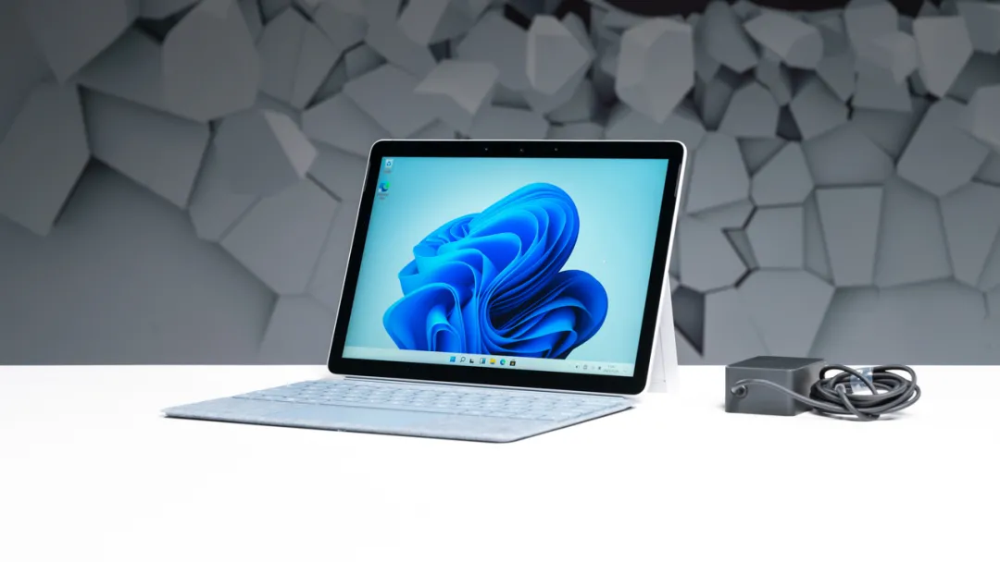
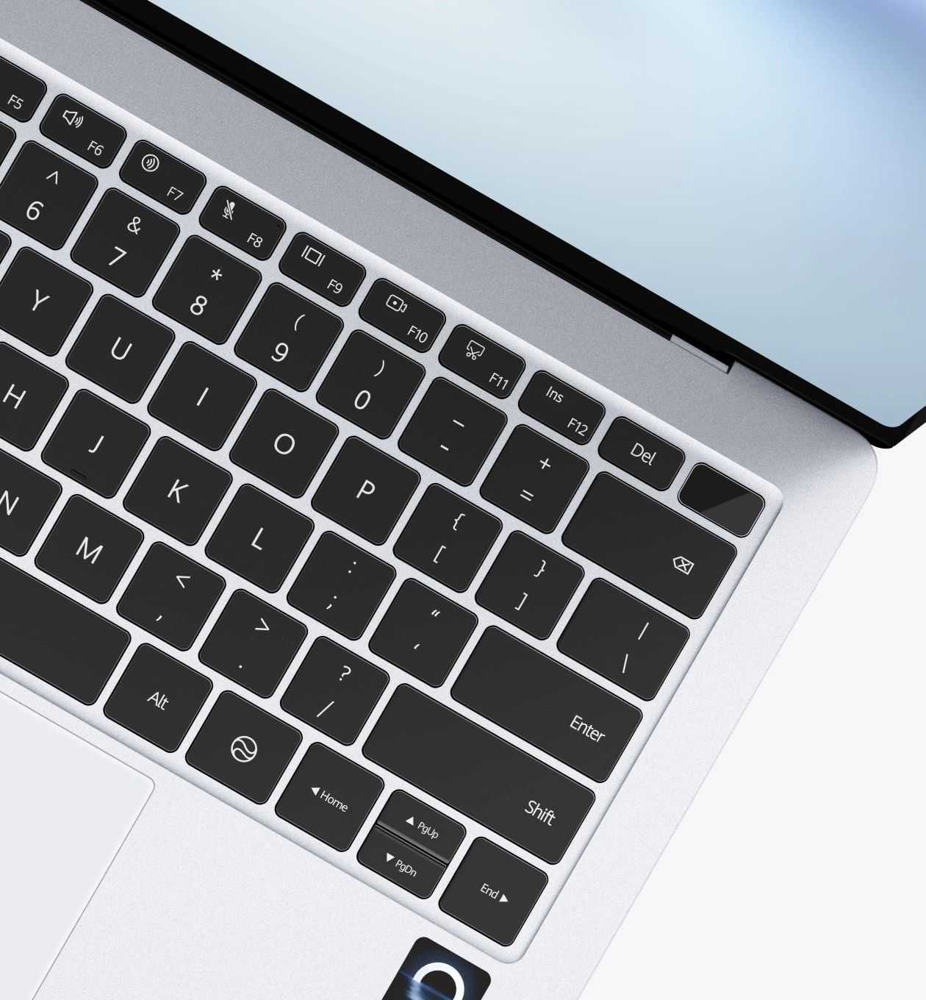

---
# Generated from README.md by scripts/split_chapters.py.
layout: "chapter"
title: "1 从 Surface 到 MateBook：我的移动终端需求"
nav_title: "第1章"
chapter: 1
permalink: "/1/"
previous_url: "/"
previous_title: "序章"
next_url: "/2/"
next_title: "第2章"
---
## 1 从 Surface 到 MateBook：我的移动终端需求

### 1.1 我的 All in One 主机

这一两年我的主力设备一直是 9700X + 9070 XT 的 Windows 台式机，个人社交软件、文件管理、上网冲浪、单机游戏、影视存储全在上面。配合 WSL2 开发等等，实际上构成了我的 All in One 系统。

随时随地访问个人资料与高性能算力，便成了自然而然的需求。外出设备只要能通过网络连接台式机，就能接着用熟悉的软件和文件，不必在两台电脑之间来回同步。

### 1.2 Surface Go 3 陪我走过的四年

2022 年，为了外出上课和 OneNote 手写记笔记，我花了四千元高价买入了电子垃圾 Microsoft Surface Go 3。奔腾 6500Y、8+128GB，磕磕绊绊撑过了我的本科和硕士初期。

500 多克的重量，11 寸不到的面积，又是精致模具微软大厂出品，携带体验确实很好。无级调节支架、触屏、手写笔，加上纯血第一方原生 Windows，它也成了我最爱的 RDP 远程桌面启动器。到工位后插上网线，双击 RDP 文件连接台式机，浏览器、Terminal、微信、VSCode 和个人文件都在远端，Surface 本地的 Windows 几乎没有存在感。

但一旦外出在桌面前坐下，小屏幕总觉得 UI 挤在了一起，眼馋同学们 14–16 英寸的正常笔记本。被动散热模具烫手，屏幕只有 60Hz，续航 5 小时不到，键盘盖也不是 19mm 标准键距，触控板玻璃手感虽好但面积狭小。偶尔想在本地多开几个浏览器标签页、Terminal，或者播放视频，羸弱的 Surface 连这些都做不好了。

### 1.3 从移动算力，到移动显示与输入

尤其是后两年不再需要手写记笔记、备考之后，微软的手写笔几乎一直闲置在机器边上。倒是触屏一直在享受。被微软下场做的触摸桌面系统惯坏了之后，轻量化的移动设备倘若没有触屏，总感觉缺了些交互体验。毕竟在不用频繁键盘输入的时候，手指指哪儿打哪儿、滑动缩放，还是很流畅的。

我逐渐意识到，我的需求其实已经从“移动算力”变成“移动显示与输入”。在背包尺寸的限制下，我想要更轻、更大的屏幕，还有舒服的键盘和触控板。需要高性能或者个人文件资料时，再通过 RDP 或 Sunshine-Moonlight 串流到自己的台式机上完成。

MateBook Pro S 恰好戳中了这些需求。相比 Surface，重量略增，换来了压感触控板、主动散热、120Hz 高分辨率超高亮度放眼全笔记本行业说一不二的顶级 OLED 屏幕、评测超越 MacBook Air 的续航，以及终于手指不再拥挤的全尺寸键盘输入体验。总体来看，硬件堪称完美，至于这套模具实际用起来怎么样，后面再慢慢说。

### 1.4 带着妥协下单

唯一的缺点与不确定因素，甚至可以是某种折腾玩乐的因素——鸿蒙 PC 操作系统。实体店里体验过，动效流畅系统直观，能超过臃肿充满历史包袱的 Windows。简单搜了一圈，得益于 AI Agent 的发展和一年多的时间积累，鸿蒙商店里已经有不少 RDP 应用了，再不济还有完整的 Moonlight 兜底，远程连接这个最大的需求看起来能搞定。Win 虚拟机虽说有网卡直通，Win on Arm 也有 mstsc.exe，但我没抱太大希望。一开始担心鸿蒙 OS 的打印机兼容性，搜了很多测评视频，都说单位公司的打印机兼容没遇到问题，我想一年多了华为应该也主动或被动解决了不少。

下单前也知道，像 Surface 那样外接多个显示器、连接台式机后多屏办公，目前鸿蒙还做不到。至于 UFS 闪存，Surface 的 128GB SSD 我至今没用超过 60GB，笔记本上不存资料，容量和速度对我都无所谓。双 USB-C 接口被不少人嫌少，但作为 Surface 用户的升级，多出一个 C 口已经很满意了，原来的拓展坞也能继续用。之前的 Surface 高温 LCD 屏幕在高对比度界面停留久了之后也会有残影，OLED 长期来看总是有烧屏风险的，但可以在两三年危险到来之前转手，姑且相信华为的屏幕防烧屏能力（x

既然是为模具体验买单，首选就应该是最低配。16+512GB？跟我当年刚上大学买的拯救者一样，够了够了。也纠结过 24GB 内存，但 Windows 虚拟机不是我的重点，还是相信华为对 16GB 的优化能力与我自己良好的后台清理习惯。

颜色原本想选有个性的黄色，紫色要 24GB 起步。后来国庆期间在京东发现优惠，6200 元不到买到了全新丝绒白。拆开之后立马觉得：数码产品还得是白色！曾经在店里只能体验片刻的轻薄感，现在完全属于我咯～

