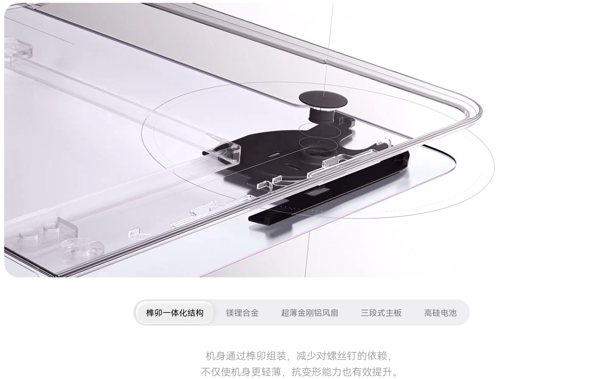
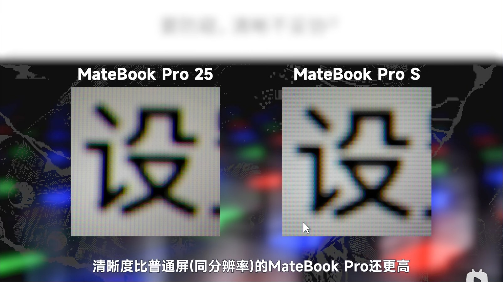
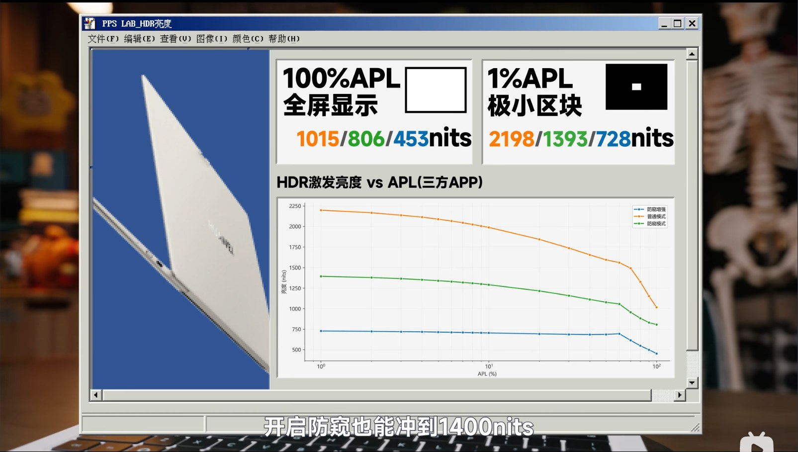
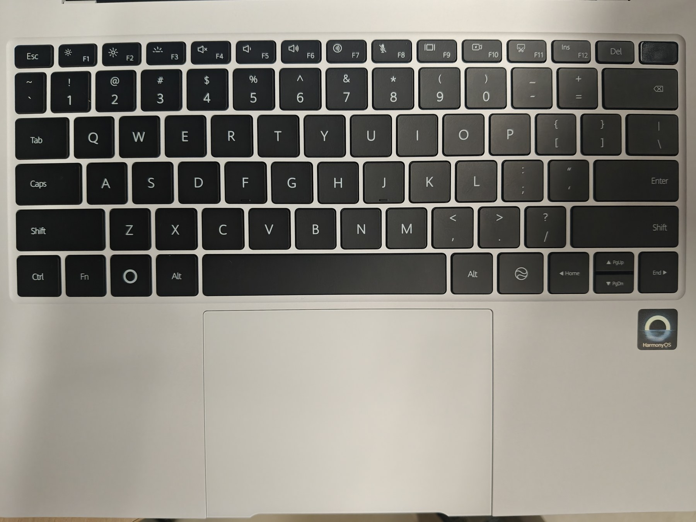
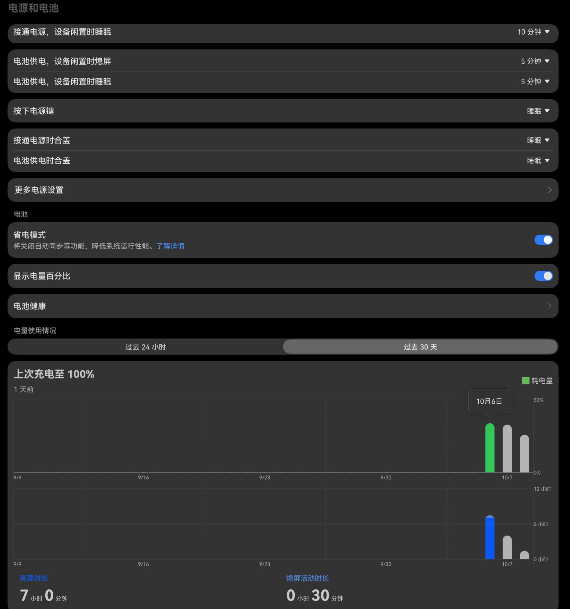
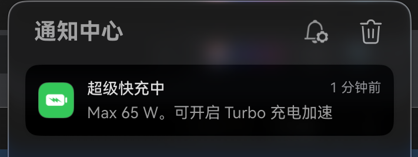
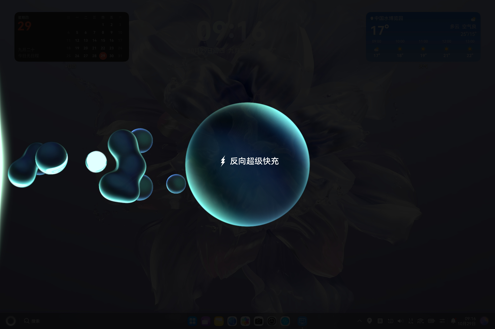
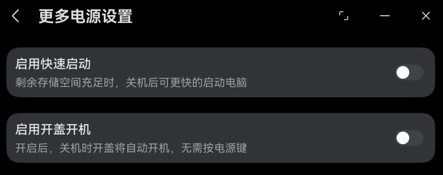
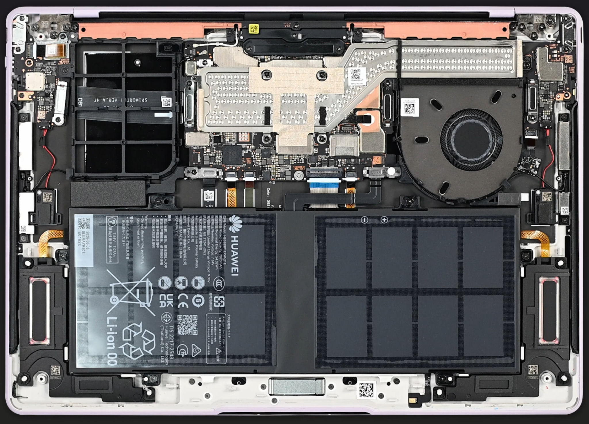
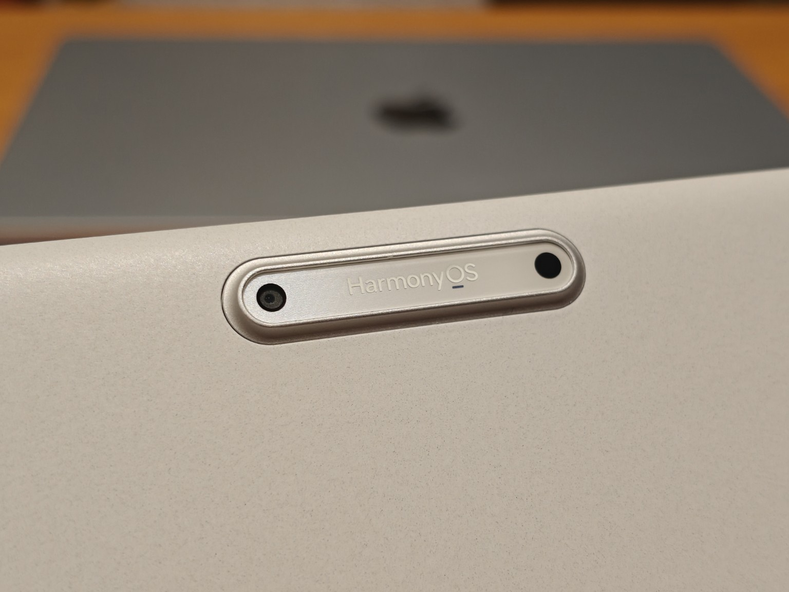

---
# Generated from README.md by scripts/split_chapters.py.
layout: "chapter"
title: "2 硬件先赢一次：798 克的精致模具"
nav_title: "第二章"
chapter: 2
permalink: "/2/"
previous_url: "/1/"
previous_title: "第一章"
next_url: "/3/"
next_title: "第三章"
---
## 2 硬件先赢一次：798 克的精致模具

### 2.1 798g：轻到改变使用姿势

最重要的轻量化，798g 的实力无需多言，给身边所有人上手端一下，第一反应全都是：“哇哦这么轻！”

这种能单手、甚至两三个手指头拿起来的笔记本，真的体验会质变！就算在桌前也可以瘫在椅子上，各种姿势使用，想挪个位置随手就能拿起来。试了一下跟视频博主那样单手拿着，像纸板一样给自己扇风当扇子，手力足够的话完全可行。

用了自己这台超轻薄电脑一两周，再去商场掂量 Xiaomi Book Pro 14、Lenovo Yoga Air 14 Ultra 以及 MateBook Pro 这些 1kg 级别的机器，都感觉坠手了。

这么轻的同时，屏幕和键盘仍然保持了足够的刚性，当然跟 Surface、拯救者那样的硬度没法比。

### 2.2 屏幕：买屏幕送笔记本电脑

3120×2080 的高清分辨率，264 PPI，在我眼里已经和手机屏幕一样看不出像素点了，毕竟 15cm 以内盯着像素点也根本不是使用场景。

屏幕有圆角，跟机身是和谐的。假如这是 Windows，那一定是缺点，毕竟 Windows 系统和许多传统软件没有考虑圆角，角落可能留着按钮或其他内容。但到了鸿蒙，由于软硬件协同，而且脱胎于移动系统，UI 在角落留出了空间，整体协调合理。

字体默认大小和粗细都挺好，我只把显示大小改成了最小。毕竟 Surface 上的 1080p、125% 缩放我也是盯着看下来了，习惯小一点的 UI，容纳更多内容。同时，电脑端终于也有了手机一样的注视不熄屏体验。

刷新率一开始直接 120Hz 拉满，反正续航不错。后来又测试了系统默认的智能切换，闲置时恢复 60Hz，移动一下就回到 120Hz。我尝试自己盲测，肉眼无法区分，那还是改成智能刷新率以省电了。谁不想续航更长一些呢？总归不用过 Surface 的苦日子了。

后来看到穷玩组的 [MateBook Pro S 防窥版屏幕测试报告](https://www.bilibili.com/video/BV1g8Y46VEpE/)，更加感叹这块屏幕：标准 RGB Stripe 排列用在量产 OLED 笔记本上，力大砖飞，没有对像素排列和算法的奇技淫巧，只有极致的发光材料和巧夺天工的制造技术。测试里的同分辨率文字对比，Pro S 也比 MateBook Pro 更清晰。

EOTF 亮度映射完美贴合，RGB 灰平衡一条通天大直线，色准强无敌。HDR 极小区域亮度超过 2000 nit，响应时间也很出色。华为出品无需担心！好到了一个几乎“没有意义”的地步。总体来看，也算是一种买屏幕送笔记本电脑了。

当然也有遗憾。虽然做了 AR 抗反射，玻璃覆盖难免反光，背后有强光时还是会照镜子，指纹多了就拿布擦一擦。个人不愿贴膜，Surface 用户自适应。转轴平时能单手开合并正常停住，但手指点击触屏时屏幕会明显晃动，作为触屏笔记本还是挺影响体验的。最大开合角度约 135°，无法 180° 展平。鸿蒙 PC 也不能把屏幕画面旋转 180°，不然还可以试试将 A 面放在桌面、键盘本体朝上，倒过来当平板使用。

### 2.3 键盘：手指终于不再拥挤

从 Surface Go 3 的小键盘换到全尺寸键盘，最直接的变化就是手指终于不再拥挤。查了一圈参数才发现挺有意思：我那台厚重的拯救者 R9000P 2021，TrueStrike 原感键盘同样只有 1.5mm 键程；以键盘手感著称的 ThinkPad，如今 X1 Carbon 等高端机型也普遍缩到了 1.5mm，与本机器一致。前任 MateBook Pro 的模具则是 1.8mm。传统机械键盘动辄 3～4mm 的行程自然没法比，但在现代轻薄本里面，还能维持与厚重游戏本相同的 1.5mm 键程，已经相当够用了。

不过，纸面上的 1.5mm 键程只决定了手指能按多深，实际敲起来是脆还是肉、触底震不震手、回弹干不干脆，全看胶碗调校、键帽弧面和底板刚性。Pro S 轻按重按手感一致，段落反馈很干脆，触底柔和，没有 MacBook 敲击钢板的体验。键帽稳定性很好，中心四角都能触发，也没什么晃动与倾斜。但单论每个按键的敲击手感，我仍觉得逊于 Surface Type Cover，遑论 Surface 键盘盖自带的角度和整体回弹感受。快速连续输入时，Pro S 的键盘太平整、没有斜度，跟手腕处于一个平面，手指要下探得更深。

一个糟心细节是 F、J 两个按键的定位凸起位置太靠下，正常标准指法下食指归位时根本摸不到。等摸到凸起，手指都已经在接缝处、无法按下了。我百元廉价键盘的 F、J 凸起位置都合理，这点细节不应该疏忽啊～

右上角是指纹电源键二合一，不是我习惯的最右上角 Del。好在电源键下沉、手感也不一样，摸上去就会意识到它左边才是 Del，大概几天就能适应。Home、End、Page Up、Page Down 没有独立按键，分配给了 Fn 加方向键；这点比不上微软的 Surface，即使小小的也给了独立编辑键。

底下一行的右 Ctrl 被舍弃，换成了略长于 1U 的小艺 AI 键。按下时背光会有流光炫彩 RGB，跟屏幕右下角的小艺呼应，还蛮好看。默认顶排是多媒体功能，按下 Fn 亮灯后才输入 F1～F12，能看出取舍是多媒体优先。背光对我来说能亮就行，真有需要时按 F3 临时开启。

### 2.4 压感触控板：一整块都能按下去

压感触控板是我选购这台机器时非常看重的配置之一。以前用过的 Surface Go 3 是传统机械触控板，面积不大，主要只有底部左右两侧容易按下去，所以我平时也不怎么按压，都是轻点代替点击。老拯救者游戏本的触控板更是用了几年还掉漆。

MateBook Pro S 这块巨大的玻璃触控板，光是面积和表面质感就舒服太多了。通过压力检测识别点击，再利用线性马达模拟按键反馈，整个表面都能按压。系统里可以调节按压灵敏度和振动强度：灵敏度靠左变得更硬、更难按动，肌无力的我还是选择拉到最右边；振感强度也拉到最右，让大马达充分发挥。全域按压加上马达振感，手感确实顶级，相比 Surface 是相当明显的升级。

目前鸿蒙 PC 产品线里，除了定位相对入门的 MateBook 14，MateBook Pro、Pro S、Fold 的键盘以及大部分 MatePad 的键盘基本都配备了压感触控板，系统也专门设计了不少配套手势。这倒有点早年苹果的味道了：MacBook 的 Force Touch 配合 macOS 多指手势，也是软硬件一起设计才能有这样的体验。华为现在也逐渐走上了这条路线。

但是但是！同样对比苹果，鸿蒙目前似乎还没充分发挥压感的潜力。单指轻点和实际按下都是普通左键，只是后者多了马达反馈，没发现类似 MacBook Force Click 那样的二级深按操作。之前还翻过鸿蒙开发文档，API 确实有读取压力值的接口，但 Pro S 有没有把触控板的连续压力数据开放给第三方应用还不知道。硬件都做到这份上了，系统交互还可以再挖掘挖掘。

### 2.5 续航、充电与散热

续航强无敌！10 月 6 日晚上 19 点充满电，体验系统、捣鼓软件、装虚拟机五六个小时，中途出去玩自然睡眠，几乎不掉电。7 日又进行影音娱乐、码字了许久，直到 8 日上午 11 点半还有 10% 的电量。这期间有睡眠时间，不是连续亮屏；其中一两个小时还外接了 27 寸 2K 显示器持续输出画面。低电量时自动打开省电模式，也没让我感觉到性能卡顿。

总体来看，这体验让我完全无需电量焦虑，一两天充一次电足矣～自带的华为 66W 适配器体积和重量都比较小巧轻便，原配 C to C 线支持 6A，系统提示 65W 超级快充，还可以在控制中心开启 Turbo 充电加速。

我在约 50% 电量、亮屏状态下用第三方“系统监视器”看了一下，电池充电功率在 50W 左右；到了 60% 多则降到 30W 左右。奇怪的是，无论开不开 Turbo，似乎都没什么区别。后来翻到[充电头网的 MateBook Pro S 充电评测](https://www.chongdiantou.com/archives/1789350534972.html)，才发现原装 66W 充电器远不是这台电脑的充电上限：媒体用 POWER-Z 测得原装输入约 61W（UFCS），而换用华为 140W 充电器，峰值居然能达到 96.8W！0～50% 的充电时间也从 34 分钟缩短到 22 分钟。我猜系统里的 Turbo 就是为这种 100W 级别的高功率充电准备的，手头只有 60W 级别的充电头，自然看不出什么差别。

顺手把现有充电头也试了一圈。小米 67W 适配器配合原装魔改 A to C 线，居然也能激活超级快充！这是小米在 USB-A 接口和线材上额外加了触点，把 PD 的 CC 通信也引了过去。[充电头网早在 2021 年就测过这套 67W 充电器](https://www.chongdiantou.com/archives/79690.html)，虽然顶着一个 USB-A 口，实际上支持 20V 3.25A、最高 65W 的 PD 输出。反倒是 OPPO 90W 充电器没能触发超级快充，系统监视器里只看到 2A 左右的电池充电电流，乘上 8V 多的电池电压，也就 17W 上下的电池充电功率。好在 Pro S 对标准 PD 的支持不错，充电头网实测苹果、绿联、闪极的高功率 PD 充电器都能输入 60W 出头，日常混用不成问题。

另外还有个没想到的功能：Pro S 居然支持最高 66W 的有线反向超级快充，媒体实测给华为手机充电时输出超过 52W。798g 的电脑自己续航够长，必要时还能给手机当充电宝用，这下是真正的双向快充了。

更多电源设置里头有快速启动和开盖开机这俩功能。猜前者类似 Win 的 shutdown /h 休眠模式，会把内存的数据写硬盘，导致关机不彻底。一查文档果然如此。反正现在硬盘速度很快了，开机也不差这几秒。这个默认开启的快速启动还会导致关机约 20 秒很慢很浪费时间。

在 Win 上，合盖休眠可以防止 S3 睡眠或者什么 modern standby 睡眠意外唤醒（我的 Surface 就有一次放在背包里意外睡醒巨烫无比进不了系统售后重新换了一台……）。华为的电源管理跟苹果一样令人放心，就普通睡眠模式放背包都可以。

大部分情况下风扇不工作，只有高负载时才启动，避免散热鳍片长期积灰。虽然评测说风扇很安静，独处的室内还是能听到；也好，提醒自己此时负载压力过大，适当停下让 Pro S 喘口气，风扇声就会消失。媒体实测满载性能释放约 20W，对我来说完全是好事情：发热不大，键盘面和底壳都只有温热。相比被动散热的 Surface，还多了主动风扇来应付临时高负载，我已经知足了。

重点不是跑分，XE90 已经能完全满足我本地轻负载的需求。之前让 AI 调研后估计过：它的单核、多核性能大致相当于我不开睿频的老拯救者 R7-5800H，后者陪伴了我本科三四年的电路设计、仿真、程序编译，显然够用了。

### 2.6 其他让我喜欢的细节

前后双摄！对于一台笔记本来说还是太超模了。1080p 摄像头对比手机肯定不够看，但在平板和电脑领域仍然不错，很多机器还是 720p。试着拿它拍人像，有种拿着大平板拍照的有趣感觉。不过照片是 16:9，转 90 度拍摄时也没有识别旋转，最终还是横版照片。

A 面的摄像头凸起，网上有人嫌它无用、破坏整体设计。我实际发现它是一个很好的握持抓手点，不然机身整体太光滑，很难靠摩擦力稳定拿住。前后都有环境光传感器，比 Surface 的单侧好多了，我完全信赖自动亮度调节。人脸解锁也很快，开盖的一秒钟就搞定。非接触认证的含金量，我的台式机可是特意买了个 Windows Hello 摄像头呢～

扬声器放在桌面上的时候特别优秀，我这种木耳朵都听起来比手机、拯救者、Surface 要好；但一旦拿起举在手中，声音就差了些。感觉设计时充分考虑了桌面声场反射，音量上限也很大，开 20% 左右就足够正常使用。机身里还有六颗麦克风，配合会议记录也给了我惊喜，后面再细说。

只有右边能 DP 视频输出，但左右两边都能插外设，原来的 SSD 拓展坞也能跑到 100～200MB/s，对我而言已经足够了。

冲着轻量大触屏和输入体验下单，这套模具算是值回票价了。硬件先赢一次，接着就轮到当初最大的变数——鸿蒙 PC 系统本身了。

