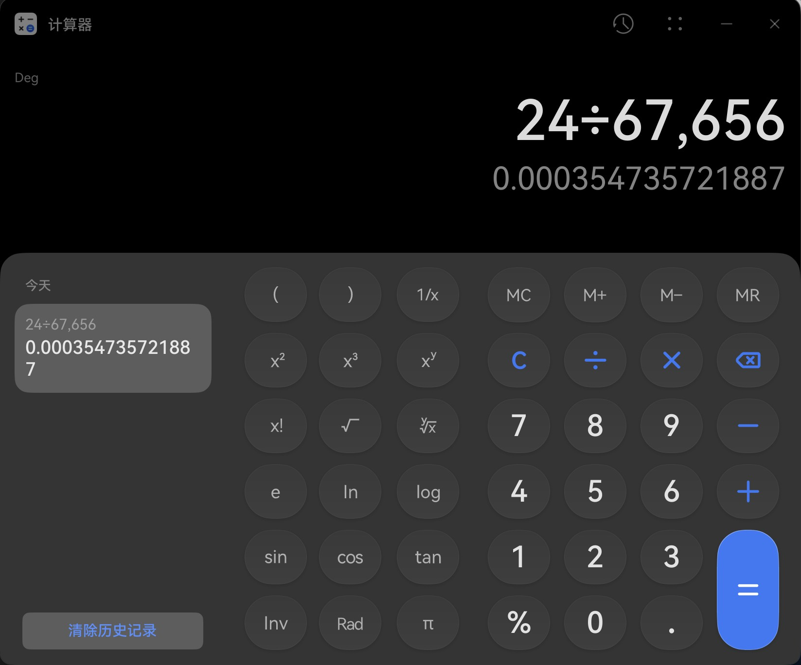

---
# Generated from README.md by scripts/split_chapters.py.
layout: "chapter"
title: "3 初入鸿蒙：一套逐渐顺手的桌面系统"
nav_title: "第3章"
chapter: 3
permalink: "/3/"
previous_url: "/2/"
previous_title: "第2章"
next_url: "/4/"
next_title: "第4章"
---
## 3 初入鸿蒙：一套逐渐顺手的桌面系统

### 3.1 第一次开机：先联网，再进桌面

开箱的时候特意拍了视频记录。选择语言、地区、协议与声明，保护数据隐私，这些我都默认直接过。到了连接网络这一步，我没找到跳过选项。ZJUWLAN 会弹出浏览器认证页面，倒是没有系统外观割裂感；不过我尝试不认证直接下一步，激活就超时了。还是得乖乖输入网络账号密码，完成联网激活。

创建用户默认就是管理员，锁屏密码倒是可以留空跳过。然后强制跳出恢复密钥，类似 Windows 的 BitLocker 吧，我向来不太喜欢这种需要额外保管一串密钥的环节，但也只能继续，还提醒我记录复杂的 64 字符。之后登录华为账号也是必经的一步，还好我早年就创建过。增强服务与用户体验改进的选项一大堆太长不看，倒是很贴心地给了一个一键关闭所有的按钮，留着进系统之后再慢慢探索。

最后点下“立即体验”，丝滑进入桌面。默认浅色，背景和丝绒白配色应该是对应的。左侧文件管理、我的华为、视频、游戏中心、小艺、WPS、剪映、抖音都是预装；右侧又摆满了 HDR 增强、音乐、日历、阅读、小艺和精品应用等卡片。

忠实记录如上。说实在有些强奸眼球，这些东西后面肯定得自己动手删减一番。

### 3.2 更新系统，把桌面收拾成自己的样子

10 月 6 日到手，迫不及待打开设置，当当，出厂是 HarmonyOS 6.1.0，API 版本 24。第一时间当然是更新到鸿蒙 7，安装包 18.24GB，真是很大了。接下来这段时间还陆续收到了更新：10 月 14 日推送 7.0.0.111 SP7，10 月 24 日又有 SP15。我这几天前一个版本的体验还没写完呢，颇有种养成系统的感觉。

SP15 加入了滚动截屏、状态栏实时网速，以及三指横滑切换最近应用窗口，都是我很满意的更新点。滚动截屏会自动帮你往下滚，体验不错，只是当时没找到快捷键，需要从控制中心启动。实时网速也终于可以显示在音量和 Wi-Fi 图标之间了，不像 Windows 的 Traffic Monitor 那样自由，但有总比没有好。

预装了不少图像视频编辑、短视频游戏娱乐、CAD、思维导图。本人不是视频图像艺术工作者，从电子信息专业视角来看通通用不着，框框一顿删除。删完一看还有 87/512GB 占用，原来大头是系统、虚拟内存和休眠文件。无妨，存储空间对我来说完全够用。应用自启动也能在系统设置里统一管理，至少不用像以前在 Windows 上那样，一边找自启动入口一边担心软件自己偷偷跑起来。

接下来就是布置桌面了。深色模式 OLED 友好，到手自然设置起来。鸿蒙 7 主推的沉浸光感，我盯着图标看了好几秒，也没发现几种样式有啥区别；个人其实对这些耗能视效不感兴趣，既然系统主推，我就拉满好了。删除通知和桌面卡片的时候还有粒子随风消散的特效，很有《复仇者联盟》响指之后的感觉。虽然动画不算短，但是好看。

想起安卓手机可以在开发者选项调整动画速度，我用小艺搜索一搜，果然找到了“过渡动画缩放”。改成 0.5x，动画速度加倍，体感更加流畅。

在 Windows 上多年，我一直习惯桌面完全空着只欣赏壁纸，应用全部交给开始菜单和任务栏。鸿蒙倒是让我有些舍不得清空桌面了：除了应用图标，还能放服务卡片、小组件，以及可以直接点击内部图标的大收纳夹。我的理解是鸿蒙想把桌面本身做成一个信息面板，而不仅仅是壁纸和应用启动入口。

我保留了数字时钟、圆形表盘时钟、天气和日历。比较尴尬的是服务卡片有网格，但数字时钟无法居中对齐，偏左一些。我只能安慰自己：如今这样的数字时钟，是跟键盘的 F、J 键输入位置居中对齐的。

### 3.3 从 Windows 过来：窗口和触控手势都能很快上手

窗口的最小化、最大化、关闭都在右上角，减号代表最小化、叉叉代表关闭，跟 Windows 一样，谁上手都知道。光标放到最大化按钮上还能选择窗口显示在左侧或右侧。鸿蒙键加左右方向键是左右分屏，加上方向键是全屏，加下方向键则依次退出全屏、最小化。鸿蒙键加 D 回到桌面，跟 Windows 的习惯也能平滑衔接。

触屏操作同样直观：手指拖着窗口顶部，贴到屏幕顶部或左右边缘，就可以最大化或分屏。它没有 Windows 那些四象限贴靠和拖动窗口时出现的更多预设布局，窗口怎么摆更多还是自己掌握。此前我在小屏幕 Surface 上经常误触 Windows 的布局提示，鸿蒙这里倒也清净。

触控板单指左键、双指右键、双指滚动这些基本操作都没问题。默认滚动方向和 Windows 一致，也可以切换成自然滚动。我还关掉了触控板右下角的右键，只保留双指点按或轻点，这样整块触控板手势统一，不用担心手指的位置。

三指上滑是回到桌面，动画有种把所有应用往上推出去的感觉，比较符合直觉，只是跟我习惯的 Windows 三指下滑看桌面反过来了。三指上推并停顿进入多任务视图。SP15 新增的三指横滑切换应用，我实测感觉逻辑怪怪的：全屏应用可以按多任务界面的顺序切换，但非全屏小窗会一起被收在一侧，一起滑出或隐藏。我原本以为会像 Alt+Tab 那样循环选择，多少需要重新适应。

最可惜的是，我一开始以为三指点击没有鼠标中键！以前在 Windows 上习惯三指点击关闭浏览器标签页，到了鸿蒙还得去点那个小小的叉，麻烦。用了这么多年形成肌肉记忆，突然没了还真有点难受。

——后期惊天大发现！关闭浏览器标签页时无意间三指触发成功，突然意识到可能是三指摸了两下。立马找了个在线鼠标测试网站检测，实锤了：**三指轻触两下就是触控板的隐藏鼠标中键**，在新标签页打开超链接也实测能用。顺手问了呆呆的小艺 AI，它也不知道这个功能。鸿蒙啊鸿蒙你藏的可够深😅

鸿蒙自己还设计了一套系统快捷键，基本跟 Windows 类似，也有些要重新记：鸿蒙键 + A 打开应用中心，+ N 是通知中心，+ C 是控制中心，+ F 是文件管理器。我就按 Application、Notice、Control、File 这么记，还蛮顺口。不过 Windows 的 Win + E 到这里可就得改习惯了。

快捷键提示面板标的是“鸿蒙键 + ?”，虽然问号很直观，实际上按的是“鸿蒙键 + / ”；你要是通过 Shift 按上层的问号，反而呼唤不出来。这个设计好像又不是很直观哈哈。

当然也不是所有习惯都搬得过来。我平时习惯交换 CapsLock 和 Esc，Windows 下改一次注册表就能生效；到了这台鸿蒙 PC，我暂时没找到满意的系统级改键办法。明明只是想决定自己键盘上的一个按键应该干什么，却不知道从哪里下手，颇有些无奈。

### 3.4 外接显示器：截图分辨率为什么比屏幕还大？

到工位后先接上显示器。Pro S 只有右侧 USB-C 支持视频输出，插上普通的 Type-C 转 HDMI 拓展坞就成功连接。第一次连接时系统会询问扩展还是复制，F9 和熟悉的鸿蒙键加 P 也可以打开投屏管理。

最让我意外的是屏幕排列。Windows 的多屏排列通常按照分辨率的相对像素尺寸显示，我的 Windows 台式机上，一块小尺寸 2K 屏和一块 27 寸屏幕的图示位置，看起来就和实际物理位置不太一致。鸿蒙这里在我接 2K 显示器时做了个取巧：两块屏幕显示成相近的宽度，仅长宽比不同。像图中这样，光标从内屏左上角往上移动，刚好从外屏左下角出现，右侧同理，体验蛮独特。

镜像模式下也可以选择以本机或外接屏幕的比例显示。选择 16:9，本机的 3:2 屏幕就会上下留黑边，算是把两块屏幕比例不同的问题考虑进去了。这里有个限制：我的 Pro S 只能再接一块外屏，之前 Surface 那样的多屏办公就别想了。

接着我随手按 F11 截图，发现外接显示器模式下只能选择其中一块屏幕截图，不能像 Windows 那样直接截出包含多屏的联合大图。仔细到图库查看截图分辨率，又发现了一个现象：内屏截图是 **3120×2080**，没问题；外屏截图竟然是 **3120×1755**！明明接的是一块 2560×1440 的 2K 显示器，截出来的画面却比物理像素还大，还是奇数的纵向分辨率呢。

我又换了屏幕排列的位置、用系统 F11 截取铠大师 Windows 11 的画面，连续几次依然是 3120×1755，宽度刚好和内屏的 3120 一致。更神奇的是，Windows 11 虚拟机里还能选 3840×2160。此时从虚拟机到鸿蒙，再到外接显示器，到底怎么转换像素的，越来越有意思了。

最后打开显示器自己的 OSD 菜单，总算看到一个确定的数字：**HDMI 输入是 2560×1440@60Hz**。好嘛，鸿蒙截出来的是 3120×1755，显示器实际收到的却是 2560×1440。两者都是 16:9，截图画布和最终 HDMI 信号显然不是同一个分辨率。

后来查到华为官方的[《鸿蒙电脑有线连接显示器显示模糊》说明](https://consumer.huawei.com/cn/support/content/zh-cn16053957/)，专门提到连接 2K 及以下显示器时采用离屏渲染（Offscreen Rendering），可能导致显示清晰度略有下降。结合这次实测，我猜系统先在 3120×1755 这样的中间画布上渲染，再缩放到 2560×1440 输出，有点像 macOS 的 HiDPI 思路。横向分辨率刚好和内屏的 3120 一致。

虚拟机提供的 3840×2160 显示模式，最终仍要经过鸿蒙处理，再输出到这块 2K 屏幕。

后来我又补测了 1080p 显示器，截图仍然是 3120×1755；群友的 4K 显示器截图则显示 3840×2160，屏幕排列也不像我接 2K 时那样等宽。看来低于内屏分辨率的外屏，可能统一走了与内屏宽度有关的高分辨率画布，4K 则另有处理。个人认为蛮好，系统给低分辨率屏幕兜底，渲染端就尽量清晰。

### 3.5 文件、输入和打印：普通工作能不能顺利做起来？

鸿蒙 PC 的文件管理器吸收了移动端和 Windows 的一些长处。智能分类可以把不同类型的文件聚合起来查找，在移动系统上屡见不鲜，桌面系统里初次体验还是蛮新奇。其余方面也有正常的文件树，个人目录下有各类文件夹，不需要像 Windows 那样面对 C 盘、D 盘。实际用下来，对于 PC 系统，我还是更喜欢自己掌握文件的位置和层级关系。

小艺搜索则是新电脑的好帮手。鸿蒙键加 S 弹出独立的搜索浮窗，可以搜设置、文档、慧记记录，还能搜图片中的文字。新系统的设置不熟悉，或者一时想不起来哪张图片放在哪里，多一层搜索总归有好处。我前面找动画速度，就是这么搜到开发者选项的。

小艺对话比我想象的手机厂商 AI 要好用，打开系统软件、问一些鸿蒙设置的问题，初印象还不错。我还设置了“小艺小艺”语音唤醒：打字提问就文字回复，语音提问就语音播报，符合直觉。回想起来家里的老华为智慧音箱，老爹最常用的就是远远喊一句“小艺小艺，明天天气怎么样”，我这六千元笔记本也终于有了这样的体验。

不过用多了还是发现蠢蠢的。问鸿蒙 PC 虚拟键盘的问题，搜索结果混进了一堆其他系统和鸿蒙平板的内容。像触控板隐藏中键，它也没能告诉我。基础模型能力摆在这里，简单的设置问题问问还行，更复杂的问题还是交给我自己折腾吧。

小艺输入法整体简洁，基本模式不联网；全量模式提供词库、语音输入等功能。实测语音输入准确，还能导入专业名词，挺方便。但 AI 预测对我来说纯纯负作用，一点也不智能，还是自己老老实实拼音输入来得快。更好玩的是二、三候选词默认分配给左右 Ctrl：你难道不知道这台机器根本没给我右 Ctrl 吗！完全被小艺键顶掉了。

买之前担心的打印机，也终于迎来了实测。需要打印时，我抱着电脑和拓展坞走到工位的惠普 OfficeJet Pro 9020 前，USB 一插，系统立马弹出设备列表，选中后几秒钟就完成了配置，WPS 文档顺利打印。系统同时发现了其他 WLAN 打印机，也提供连接 Windows 共享打印机的入口；我这次实际打印的是 USB 连接的这一台。

顺便看了一眼 WPS，发现文档有字体不兼容：Times New Roman 被替换为 FT Thymes，宋体替换为书宋-简。不同字体的字宽、字距和行高可能影响换行甚至分页。我这次只是临时交个表，问题不大；如果是需要严格保持版式的材料，还是得检查一下再打印。

### 3.6 应用市场、元服务，还有一点大屏的乐趣

应用市场左侧分栏清晰，搜索应用也方便；评分、安装次数、开发者、评论和功能建议这些信息都有。作为 Windows 用户，我对 Microsoft Store 的印象一直不算好，鸿蒙这边找软件的体验至少让我愿意经常打开看看。

逛着逛着发现一些图标上半部分是虚线半圆，点进去不用自己下载安装就能打开，这就是鸿蒙的元服务。日历订阅服务和 Petal One 用过之后，也能在系统的“应用和元服务”里看到。类似鸿蒙系统级的“快应用”：即点即用免安装，但在系统设置里依然有独立的管理入口。

不过元服务窗口右上角的按钮比普通窗口更小，关闭按钮也从叉叉变成了圆圈里一个减号。这是很严重的认知割裂——抑或是产品区分？刚熟悉的窗口操作，到这里又得重新看一眼。

鸿蒙从移动端生长而来，应用运行在各自的沙箱里，访问图库、位置、相机、麦克风这些数据和设备，都可以由系统统一管理。连浏览器读取剪贴板时也会询问权限，刚从 Windows 过来还有点不习惯，但谁访问了什么，系统里都能找到入口查看。密码保险箱也可以在多处应用里填充，比我平时只装在 Edge 里的 Bitwarden 插件更省心。

应用市场负责安装更新，自启动和权限也在系统设置里统一管理，这套体验对于普通用户确实友好。只不过权限收得紧，也让全局生效的小工具和小脚本不那么容易做；从 GitHub 下载软件自己安装的习惯，到了鸿蒙也要另想办法侧载。

系统自带应用里，天气让我有些意外。大屏查看天气，各个卡片随意编辑，满屏信息扑面而来别提多爽！桌面小组件还会推荐花期指数，提醒我到了赏桂花的时节；晚上又提示朝霞时刻、朝霞概率、日出时间，连西泠桥的拍照点都推荐出来了，蛮不错。后来长按编辑才发现，原来选的是智能推荐，内容会轮播。卡片生态值得夸奖。

花瓣地图也很适合这样的大屏幕：深浅色可以跟随昼夜切换，图层能够选择，还有旅游、休闲和运动场所指引。之前在 Windows 笔记本上只能用网页地图凑合看看，现在点开应用就能大大方方地看。地图就应该在大屏幕上看！

图库这边倒是有个让我困惑的地方。在文件管理器里双击 JPG，首先打开的是文件预览；我想换成图库，就从右上角更多选项里选择其他应用。找到了图库，系统却提醒：“无法确定图库是否可以打开 JPG 类文件。”鸿蒙的 PM 你们看看这像话么！图库还无法确定能不能打开 JPG？

再看看计算器：

24/67656 计算准确\[ac01\]

带有鸿蒙 7 沉浸光感特色，按下按键会发光！基础功能反正都有，历史功能好评。在控制中心里面也找到了类似安卓磁贴的快捷方式。

手写笔则是在华为店里体验的，我自己暂时没有买。星闪配对之后，华为笔记支持无界画布、各种画笔和字迹调整，基本还原了我曾经 Surface + OneNote 的体验，甚至更加流畅。不禁感叹要是我读书那会儿有这玩意儿该多爽！不过 Pro S 屏幕无法像 Surface 那样放低摊平，长时间在屏幕上书写不太方便；触控板倒是可以当数位板写，还有悬空光标提示位置。只是现在我早就不常手写记笔记了，这支笔还是先让它留在店里吧。

### 3.7 浏览器、办公和通讯：我的日常软件迁移

桌面熟悉之后，接下来要把常用软件找回来。首先是浏览器：默认搜索引擎是百度，也可以选 360，上手先改成 Bing。此前用 Edge 习惯了垂直标签页、只在新标签页显示收藏夹，这两个功能在华为浏览器里暂时没找到。不过 Notion 网页版能打开，够我继续写这篇文章了。

这么多厂商自带浏览器用下来，鸿蒙这个是最简洁漂亮的。首页的快捷方式和常用网址一关，只剩鸿蒙 Logo 和搜索框，简直完美！F12 开发者工具能用，也能安装一部分插件，Ctrl + Shift + Tab 切换标签页的习惯也还在，日常浏览对我来说蛮够用了。

文档办公则轮到 WPS。说实在的，我一直是 Office 选手，对 Windows 下的 WPS 印象不太好；到了鸿蒙 PC，WPS 却成了日常文档的重要入口。我偶尔打开 CSV、PDF、DOCX，查看、复制和打印都很流畅，WPS AI 也没有强制弹窗当牛皮癣，姑且好评。

鸿蒙 QQ 好久没用过这么流畅的了！此前在 Android 和 Windows 上用的 TIM 老旧、强制浅色，还会卡顿；鸿蒙 QQ 不仅流畅，触屏也友好，又回到了四五年前快乐水群的感受。各种设置可以自由调整，还能捧着 laptop 视频通话，总体好评。

微信的流畅度也不错，高分辨率屏幕上看着甚至感觉比 Windows 端舒服。但它占的是电脑登录位置，我在鸿蒙 PC 登录之后，Windows 端就被顶掉了，没法像手机、平板和电脑那样一起在线。台式机是主力，手机也一直随身，总不能为了新笔记本把常用设备的微信挤下去吧。

触屏体验也没跟上：手指拖聊天框容易把私聊窗口拎出来，却无法像手机那样上下滑动聊天记录。对于在意聊天记录完整一致性的我来说，还是让最常用的 Windows 和 Android 设备一直在线吧。

