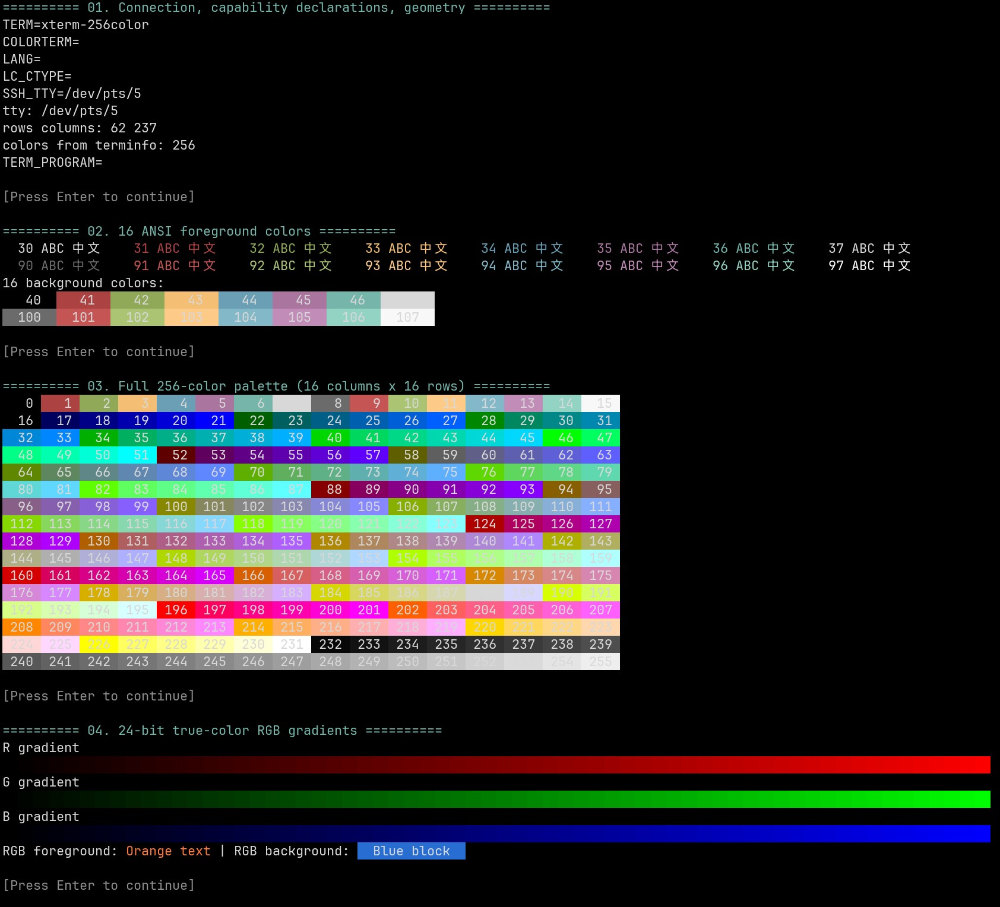
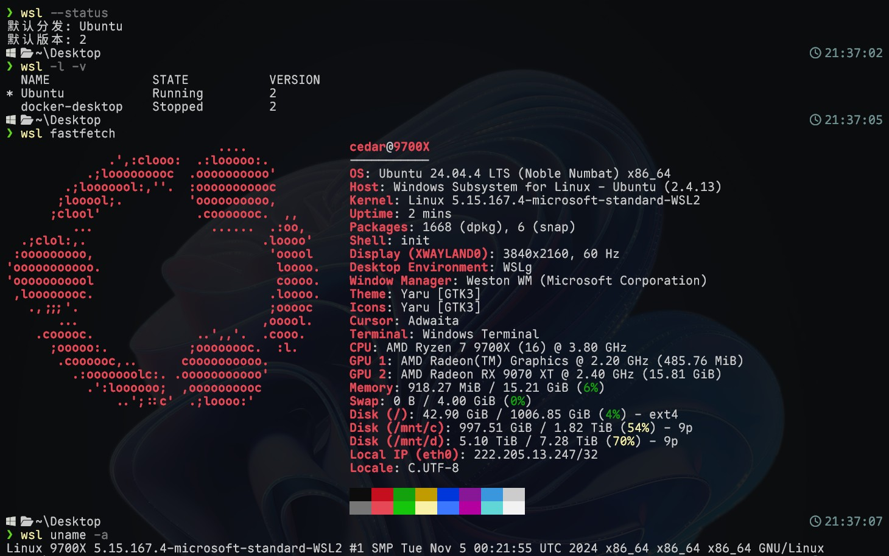
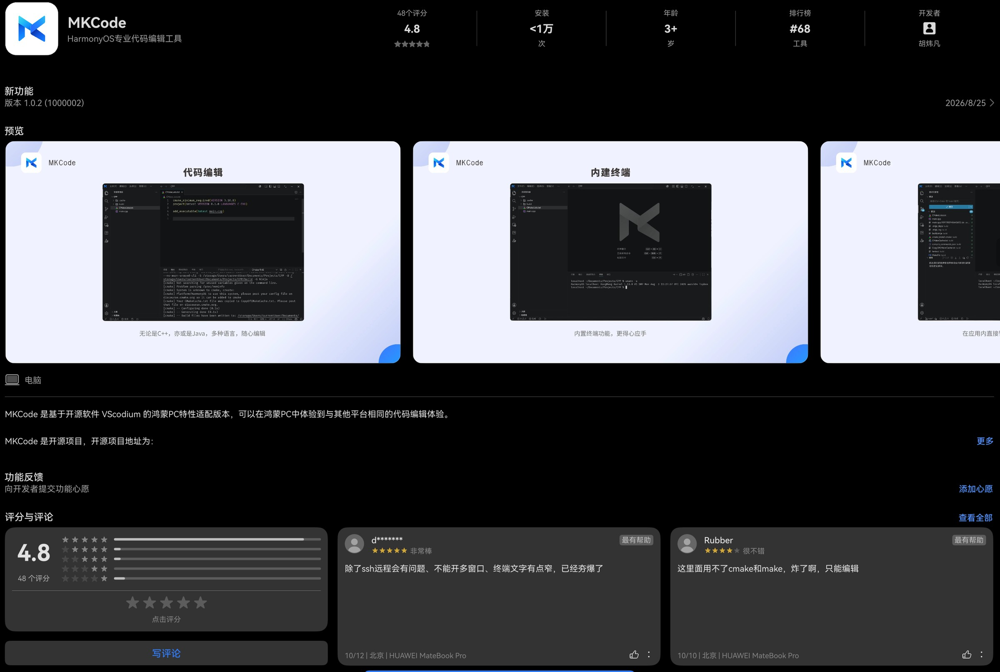
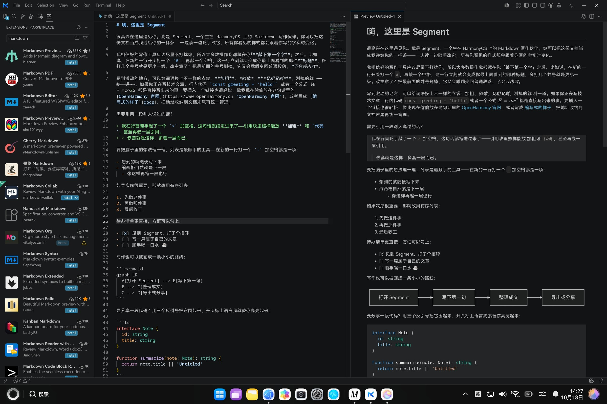

---
# Generated from README.md by scripts/split_chapters.py.
layout: "chapter"
title: "4 需要折腾：重新搭建自己的工作流"
nav_title: "第四章"
chapter: 4
permalink: "/4/"
previous_url: "/3/"
previous_title: "第三章"
next_url: "/5/"
next_title: "第五章"
---
## 4 需要折腾：重新搭建自己的工作流

日常应用安顿好了，就该把我用惯的截图、监控、网络和终端工具一个个找回来。真正的折腾才刚刚开始~

### 4.1 截图与硬件监控：寻找趁手的工具

截图是迁移到鸿蒙 PC 后很快遇到的一个小缺口。Windows 上我已经从 PixPin 迁移到了 [Snow Shot](https://snowshot.top/)。实测下来，Snow Shot 满足常用需求的同时，内存占用更低、界面更简洁，而且免费开源，于是欣然替换。我的需求很朴素：窗口吸附、UI 元素级选区，省得自己微调像素，再加上形状标注和模糊打码。功能够用之后，优先轻量、简洁、免费！

鸿蒙系统自带 F11 全屏截图，鸿蒙键 + Shift + S 可以矩形框选。截下来是没问题了，要更方便地选窗口、标注、贴图，还得去找趁手的工具。首先在应用市场找到了 InSnap：鼠标指向窗口会高亮边界，点击即可选中，长截图、标注、延时、OCR、取色和历史记录都有，功能相当丰富。


不过实际使用下来，我还挺介意它不能用滚轮放大 UI 区域来精确定位，偶尔又遇到全屏黑屏、卡顿，部分功能还需要 VIP。于是继续寻找——隆重介绍：X截图精灵！这才是目前最符合我需求的鸿蒙 PC 截图软件。应用市场 4.9 分，果然非同凡响。


它的界面简单、轻量、启动快，窗口识别准确，免费提取文字也很实用。截图、标注、OCR、置顶贴图和图片编辑，常用操作基本都能一站完成。去设置里卸载 InSnap 的时候还留意了一下，设置里显示它的存储占用约 100MB，X截图精灵仅有 2MB。对我这个追求轻量工具的人来说，高下立判。

接着是硬件监控。Windows 有 HWiNFO，Linux 有 btop，Android 还有大名鼎鼎的 Scene。CPU、GPU 频率和负载、温度、电池功耗这些，平时总想随手看一眼。到了鸿蒙 PC，系统任务管理器能看基础资源占用，硬件信息就相当有限了。所以先 Ctrl + Shift + Esc 的任务管理器凑合吧～看不到温度就没有性能焦虑，耶✌


后来在应用市场找到“系统监视器”，信息多了不少，还适配深色模式，真棒。CPU 能看每核心使用率和频率；GPU 的频率与负载，从任务管理器里的看不到变成了能看；电池的电压、电流也能拿来换算功率。我在轻办公时看到过 2～5W 的电池取电功率，难怪续航这么舒服。各类传感器、网络信息也有不少，只是 CPU 温度、电压这些我想看的细节还是没找到。


### 4.2 ClashBox：一个小小的点，怎么把订阅搞挂了？

代理这块我原先挺担心的，毕竟 Windows、Android、Linux 上一直都是 Clash 用户。群友推荐 ClashBox，GitHub 项目看起来很完善；但我当时在美区网络下没能从应用市场搜到，折腾了一番地区网络之后，终于、终于找到了大名鼎鼎的 ClashBox。整体 UI 非常美观漂亮😍


装上只是第一步，真正导入我一直在用的 GLaDOS 订阅，才发现事情没那么顺利。GLaDOS 提供传统 Clash 和 Mihomo / Clash Meta 两种订阅。我以前一直偷懒用 Clash Standard，这次想着 ClashBox 底层既然是 Mihomo，那就老老实实换成 Mihomo 订阅。结果输入 URL，配置下载下来了，下一步直接给我一个 `invalid domain`。换回 Clash Standard 不行，自定义 UA 也不行。好不容易装上了，先给我来个不能用。

一开始自然怀疑是 GLaDOS 的 YAML 跟不上新版 Mihomo。刚好电脑旁边就是 Windows + WSL，我把订阅文件下载下来，又从 Mihomo Release 拉了 1.19.30 内核准备本地检查。先 `grep` 一圈通配符，原始 YAML 里的 `*.lan`、`*.local` 看着都挺正常；再对照新版域名校验逻辑，也没找到明显的非法项。

事情到这里就有点奇怪了：浏览器直接下载的配置看着没问题，ClashBox 却坚称 `invalid domain`。于是换个思路，不再盯着 GLaDOS，直接把 **ClashBox 实际保存下来的配置**导出来对比。然后一眼就破案了！

原始规则里本来有：

```yaml
- DOMAIN-SUFFIX,.internal,DIRECT
- DOMAIN-SUFFIX,.intranet,DIRECT
```

到了 ClashBox 处理后的 `dns.fake-ip-filter`，居然变成：

```yaml
- "*..internal"
- "*..intranet"
```

两个点，当然不是合法域名。ClashBox 会把一部分 `DIRECT` 域名同步进 `fake-ip-filter`：普通的 `qq.com` 前面加 `*.`，变成 `*.qq.com` 没问题；但原规则已经以 `.internal` 开头，再直接加一个 `*.`，就变成了 `*..internal`。Mihomo 1.19.30 的域名检查正好不接受这种写法，一个不起眼的 leading dot，成功把整个配置干趴下。

更有意思的是，我后来又试了“导入本地文件”。想着既然 URL 下载会出问题，那我自己把 YAML 修好再导进去总行了吧？结果 ClashBox 连本地文件也会重新加工一遍。翻源码才发现，无论 URL 还是本地文件，保存前都会走配置后处理链。怪不得怎么喂都能给我重新加工坏，呵呵。

好在应用里还藏着一个“编辑配置内容”：这条路径直接修改 ClashBox 保存的最终配置，不再经过同一套导入处理。我把所有 `*..xxx` 改成 `*.xxx`，保存，重新启用。好了！后来索性直接把原始 `glados.yaml` 全文复制进去，省得一个个修补；只不过订阅更新时还得自己留意。

一个不起眼的小 bug，让我从订阅配置一路翻到了 ClashBox 源码。顺手在已有的 [Issue #165](https://github.com/xiaobaigroup/ClashBox/issues/165) 下面补了复现和定位，希望后面版本顺手修掉。

反过来说，这一圈让我对 ClashBox 的印象反而好了不少。至少出了问题还能看源代码捉虫，不至于只能对着一个“配置加载失败”干瞪眼。它也不只是套着 Mihomo 内核的开关：日志、请求、连接、规则编辑都有，“测试与检测”里还有连通性测试、测速、DNS 查询等一堆工具。以前得开浏览器找网站，或者自己 `curl`、`ping`、`dig` 一通，现在直接在客户端里点几下就行。功能已经很像一个成熟的 Mihomo 前端了，边角兼容性还带着点年轻鸿蒙软件的味道。


本以为到这里就算搞定，没想到后面折腾 Tailscale，又让 ClashBox 出了点问题。

### 4.3 TailLink 与 SMB：把鸿蒙接回我的设备网络

Windows 台式机、笔记本、Android 手机和电视，平时都是用 Tailscale 连在一起的。鸿蒙应用市场里找到了 TailLink，登录原来的账号，鸿蒙 PC 也加入了 Tailnet，分到一个独立的 `100.*` 虚拟 IP。打开时会弹出系统 VPN 授权，连上之后，原来那一堆设备终于又凑在一起了。


不过深色模式下展开菜单，深蓝色字体配深色背景几乎看不清，切回浅色才正常。无妨，不影响用途。真正麻烦的是它跟前面的 ClashBox 打架：TailLink 挂着时，ClashBox 配置能加载、本地代理能启动、节点也能连通，但 VPN 始终建不起来。试着把 TailLink 关掉，ClashBox 立刻就能接管网络。原来不是机场又出了问题，是两个软件在抢系统 VPN。

这就有点难绷了。我在 Windows 上一直是 Tailscale 后台常驻、Clash 使用系统代理，两边各干各的，从来不用操心。仔细想想，VPN 和代理本来也不是一回事，ClashBox 没必要非得再占一个 VPN。

于是最终保留 TailLink 负责组网，ClashBox 用原始 GLaDOS YAML 和 Rule 模式启动本地代理，再去鸿蒙系统设置里手动填上 `localhost:7890`。还真就这么跑通了：Google、普通国内网站、校内 CC98 都能打开，Tailnet 里的设备也能访问。ClashBox 日志能看到请求，首页网速曲线却一直是一条直线，跟没流量似的。

多日体验下来，TailLink 也有点 bug：十几个小时或者到了次日，应用里明明显示已连接，Tailscale 网页端却显示鸿蒙设备离线。单纯在软件里开关连接无效，得从任务管理器结束整个应用再重启。TailDrop 文件分享也用不了。好在组网这条路是接上了，紧接着试试能不能直接访问台式机里的文件。

鸿蒙文件管理器里有“网络邻居”，首次使用时下载对应服务，就能添加 SMB 共享。对我这种把个人文件都放在 Windows 台式机上的人来说，实用程度相当高。一开始自然想直接走校园网：台式机插网线，鸿蒙 PC 连 Wi-Fi，两个网段互相 Ping 没问题，之前测过的 WebDAV 端口也能连上，偏偏 SMB 用的 TCP 445 一直超时。同一 Wi-Fi 下的 Android 手机测 445 也不通，连账户密码验证都还没轮到。

Windows 防火墙、端口映射这些东西也琢磨过，后来想想何必呢。既然 TailLink 已经加入现成的 Tailscale 网络，直接用台式机的 `100.*` 地址访问不就好了？果然，445 通了。Windows 这边把需要的目录设成普通 SMB 共享，鸿蒙文件管理器里填上 Tailnet 地址、共享目录和 Windows 账户，就能直接浏览了。不用额外安装第三方文件管理器，也不用向公网开放 445。Win NAS 启动！


这么一看，前面宁愿让 ClashBox 退回系统代理，也要把 VPN 留给 TailLink，倒是很值得。跟随时访问台式机文件比起来，ClashBox 首页那条不动的速率曲线也就随它去了。

说到校园网，应用市场里还有深信服 aTrust。早年 Windows 上的 EasyConnect 在我心里已经留下了卸载不干净、到处留服务的印象，我对这家公司一直抱有偏见。自己写过的 [zju-connect Android 版](https://github.com/Cedar17/zju-connect-android) 不到 10MB；鸿蒙端 aTrust 我刚下载还没打开，就已经占了 865MB。难以想象有多少屎山被塞了进去，还是敬而远之吧。有生之年高低要试试鸿蒙开发，把自己的 zju-connect 也移植过来！


### 4.4 HiShell、SSH 与 Linux：熟悉的命令行回来了多少？

网络和文件有了着落，终端这一面自然也不能落下。打开 HiShell，先套用我探索陌生 Unix 系统的上手六件套：`uname -a`、`cat /etc/os-release`、`lscpu`、`free -h`、`lsblk`、`df -h`。这套命令一通敲下去，很遗憾几乎只有 `uname -a` 的体验完整。屏幕上显示的是 HarmonyOS、HongMeng Kernel 和 aarch64。


系统终端本身倒是挺不错，普通 SSH、Shell 和彩色命令行能用，256 色、真彩色和 btop 这样的动态界面看起来也流畅。默认终端可以在 HiShell、openEuler 和上一次终端之间选择，有点 Windows Terminal 统一管理 PowerShell、CMD 和 WSL 的感觉。最大的遗憾是不能自定义字体，我心爱的 Nerd Font 图标只能有些显示、有些变成方框。这可是大缺憾！



SSH 也给了我一个下马威：默认读取 `~/.ssh/config` 时，报 `Bad owner or permissions`，常用的 `chmod` 在这里也没能把问题解决。最后用 `ssh -F ~/.ssh/config` 显式指定配置文件，绕开了默认配置文件的那道权限检查，算是先把连接方式找了回来。系统后来增加了密钥管理，但我遇到的配置权限问题仍在。

第三方终端又试了一圈，最后留下的是 Term。第一个发现支持 Nerd Font 的！就凭这一点已经很戳我了。SSH、SFTP、快捷键和 TUI 软件用起来都挺顺，设置也丰富。


接下来试试 [Harmonybrew](https://harmonybrew.atomgit.com/)，把 Homebrew 的包管理思路带到鸿蒙上。看到 `brew install` 终于又能一通安装工具：`yazi`、`ripgrep`、`fzf` 等都可以找一找。但原来那套软件包列表不能照搬，一些包名不存在；好不容易装上 `yazi`，启动又报缓存目录所有权不匹配。包能装上，离自己的命令行工作流完全跑起来还差一步，权限问题又来刷存在感了。


鸿蒙还有另一条路：通过“融合开发引擎”运行 openEuler Linux。默认分配 4 核 CPU 和 4GB 内存，终端一打开，`uname`、`lscpu`、`free` 这一套命令又能正常敲了。不愧是完整的 Linux，熟悉的感觉又来了！


进系统先装我心爱的 Fastfetch，结果 `dnf` 仓库里居然搜不到。改去下载官方 ARM64 RPM，openEuler 内访问外网又不太顺畅，于是先在鸿蒙侧下载，再通过两边共享的个人文件夹交给 Linux，最后 `sudo dnf install`。一番折腾，总算成功见到蓝白色六边形 OS 的 Logo。


还有一个好玩的命令——`loh`，真就对标 WSL 了。从 HiShell 可以直接调用 Linux 子系统里的命令，不用手动切换终端；我试了 `loh` 的帮助、状态和 Fastfetch，图形也正常显示。


作为对照，Windows + WSL 基本是一样的逻辑：下图是在 PowerShell 里调用 WSL，展示 Ubuntu 的 Fastfetch 信息。



融合开发引擎还支持 localhost 端口转发，我在 Linux 里运行 HTTP 服务，再从鸿蒙侧访问，实测体验良好。


### 4.5 MKCode：熟悉的编辑器也回来了

也看看我常用的编辑器，introducing 最好用的文本编辑器 VS Code，鸿蒙这边有大佬移植——MKCode！



MKCode 基于开源的 VSCodium，适配了鸿蒙 PC。实际打开之后，外观和 UI 布局跟 VS Code 很相似，设置选项、扩展市场也很丰富。最让我满意的是常用的 Markdown 编辑和预览：左边写文本，右边直接看渲染效果，平时的使用习惯完整搬过来了！



不得不说，开发者胡炜凡真是撑起鸿蒙专业应用生态半边天。除了 MKCode，他还做了 MKIDE、MKCapture、MKLab、MKPhoto 和融合开发图像引擎，分别面向开发、录屏、科学计算和图片编辑等需求。应用市场里能找到这些工具，对想在鸿蒙上继续折腾的人来说，多了不少选择。

本地工具链算是勉强齐活了，轮到重头戏——试试把台式机串流过来到底能不能打。

