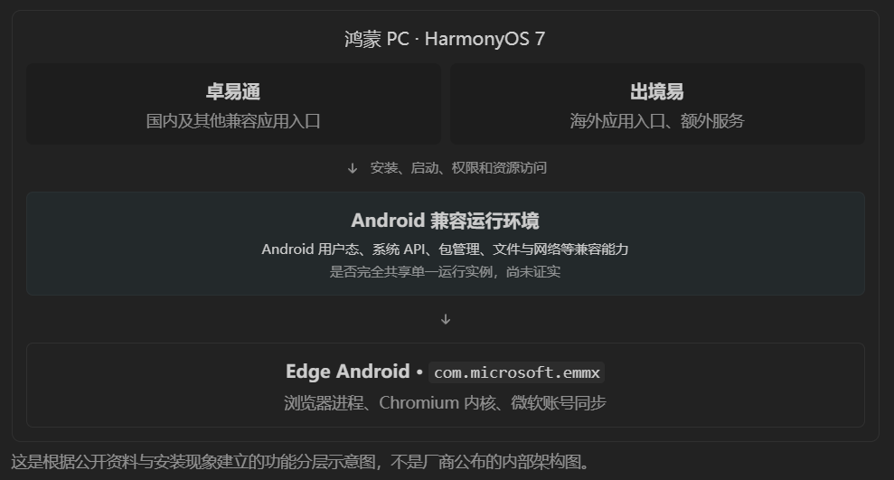

---
# Generated from README.md by scripts/split_chapters.py.
layout: "chapter"
title: "6 跨过生态边界：在鸿蒙上运行 Android 和 Windows"
nav_title: "第六章"
chapter: 6
permalink: "/6/"
previous_url: "/5/"
previous_title: "第五章"
next_url: "/7/"
next_title: "第七章"
---
## 6 跨过生态边界：在鸿蒙上运行 Android 和 Windows

鸿蒙原生应用已经让我把大部分日常需求安顿好了，远程桌面也能接回自己的 Windows 台式机。那如果想直接在 Pro S 上打开 Android 或 Windows 软件，又会是什么体验？应用市场里还真有几条路可以试试。

### 6.1 卓易通：先把 Android 应用装起来

原来卓易通不是华为亲自下场开发的，而是第三方公司的作品。打开应用市场一看，评分只有 1.9，评论区相当热闹。先装起来看看究竟怎么个事。

评论区里还有这样的反馈：

第一次打开默认全屏，没找到窗口化的办法，加载还要读条等十几秒。接下来试着安装自己下载的 APK，系统弹出了风险检测提示，好在还是能继续安装。安装之后，卓易通里又提醒了一次风险。

未知风险、恶意行为、隐私保护、欺诈检测、安全建议这几项看上去都是绿色勾勾，那我请问它到底检测到了什么风险？笑😂。我猜可能是对非商店来源的 APK 提醒用户注意，但提示没有把风险性质讲清楚，容易让人以为真的发现了某项恶意行为。

我装了一个哔哩哔哩 APK 试试，能正常打开，默认是手机那样的长条窗口。画面可以拉大，但到了宽屏上会怎么样，还得看应用自己有没有适配。我也没有在这台电脑上跑 Android 游戏或跑分的需求，能多一个打开应用的选择，总归不错。

### 6.2 出境易与 Edge：顺着 APK 翻进文件夹

之前一直想在鸿蒙 PC 上试试原版 Android 浏览器。我专门翻了 Edge 近两年的 APK 发行记录，挑了 2025 年 8 月的 Edge 138.0.3351.121，想着旧版能少一些臃肿的新功能。结果安装时系统提示，这个应用可能需要出境服务框架，建议先装“出境易”。

又发现一个之前不知道的第三方软件。出境易也有应用商店，主要提供海外应用。搜索 Edge，居然直接就有，152.6MB，下载完自动安装。

原以为这就结束了，没想到打开又弹出“应用运行组件下载安装中，请稍后使用”，进度条跑了好久才总算进入浏览器。登录微软账号，收藏夹等同步功能正常。打开“关于”一看，装上的是 Edge 153.0.4234.32，2026 年 9 月发布的版本。

这时候想起最初的 Edge 138 还没试成功，于是回到鸿蒙文件管理，双击 APK 重新安装。结果提示“系统已经存在较高版本，此安装包无法安装”。新版先到一步，旧版进不去了。

实际用起来，Android Edge 横向铺在大屏幕上，默认显示桌面网站，也可以切换手机网站。`Ctrl + L`、`Ctrl + W`、`Ctrl + T` 等快捷键都能用，基本键盘操作不错。不过鼠标中键的行为有些奇怪：我原本习惯中键点链接在后台打开、点标签页关闭，这里却似乎成了返回。暂时还没弄清是 Edge 自己的处理，还是兼容环境的鼠标事件映射问题。总之，移动端浏览器拉到大屏上之后，桌面交互还有些不一样的地方，我还是更习惯鸿蒙自带浏览器。

接下来试试文件互通。我在 Edge 里下载了一个 PDF，在鸿蒙文件管理器中找到了它：个人文件夹下面有“兼容应用数据”，里面的 Download 就是下载位置。再往上一层翻，DCIM、Pictures、Android、Movies 这些目录都是安卓老熟人了！

目录都找到了，当然要继续翻下去。打开 `Android/data`，看到 `com.microsoft.emmx`、`tv.danmaku.bili` 等几个包名，Edge 和 B 站居然都在这里。一个来自出境易，一个来自卓易通，鸿蒙文件管理器却把它们的数据目录呈现在同一棵目录树下。

有意思的是，卓易通和出境易自己的应用管理列表并不完全互通；前面重新安装 Edge 时，安装器又能识别已存在的高版本。

### 6.3 运行环境在哪里？任务管理器里找不到它

翻完文件，又想看看这些兼容应用占了多少资源。打开鸿蒙任务管理器搜索，居然找不到卓易通、出境易和 Android 应用对应的进程！Windows 虚拟机起码还能看到铠大师或 Oseasy 的宿主进程，这边的 CPU、内存消耗又算到了哪里？

顺着这个问题查了查。[卓易通官方 FAQ](https://www.droitong.com/CommonQues.html) 提到应用依赖其提供的运行环境，首次使用还需要安装服务工具；出境易除了应用分发，也有自己的服务框架，我在它的应用管理里看到了约 110MB 的“出境服务框架”。至于打开 Edge 时等待下载的“应用运行组件”具体包含什么，我还不知道。

社区也有人通过抓包、解包发现 Android 运行镜像和容器相关线索，还有鸿蒙 PC 用户提取过兼容环境镜像。相关探索可以看看[这篇 Android 容器技术拆解](https://imgeek.net/article/825368529)和[鸿蒙 PC 镜像提取记录](https://hu60.net/q.php/bbs.topic.107434.html)。从社区抓包和镜像提取来看，底下八成也是跑了一套共享目录树的容器环境；不过既然官方没放架构白皮书，卓易通和出境易在底层到底是怎么分家或共用的，就留待以后有空再深挖了。

### 6.4 Windows 11 ARM：在鸿蒙里再开一台电脑

应用市场里的 Windows 虚拟机有铠大师和 Oseasy，两者都能自动安装 Windows 11 ARM，不过同一时间只能启动其中一个。之前群友推荐了 Oseasy，我给它分配了 6 核、6GB 内存和 128GB 存储，先尝尝鲜；铠大师也一并装起来。

铠大师的安装界面更简洁现代一些。安装时我电量只剩 13%，它提醒需要连接电源，倒也合理。安装完成之后，硕大的弹窗立马邀请我登录领会员，本性总算暴露出来了哈哈。登录华为账号可以领几天超级会员，正好用来体验一下那些功能。

进入 Windows，先看屏幕设置：Pro S 内屏上最高能选到 2562×1708，刷新率为 60Hz。铠大师还能让 Windows 显示在外接屏幕上，启动时可以选择目标显示器；在外屏上的 Windows 显示设置里，最高可以选到 3840×2160。

Oseasy 的界面有点古早 Windows 贴片弹窗的感觉，跟鸿蒙整体的设计美学不太搭。不过功能用起来很实在：我测试时可以选择把 Windows 放在内屏或外屏，内屏同样是 2562×1708，外屏也有 4K 模式。

更让我满意的是两边的文件互通。Windows 和鸿蒙之间双向复制文字、图片、文件都没问题，用 Windows 的截图工具截完，回到鸿蒙写文章直接粘贴，特别方便。

对照了一下，2026 年 10 月体验时，Oseasy 免费提供外屏显示、桥接网络和文件打开方式关联，也不需要登录华为账号；铠大师的部分对应功能需要会员。铠大师还有应用通知等功能，我平时通知都不开，就用不上了。按我当时的需求，Oseasy 这套免费功能更合适。

### 6.5 代理、桥接和内存：两套系统一起跑的代价

铠大师还有一个会员功能：把 Windows 虚拟机里的代理同步给鸿蒙。安装 Clash 之后，软件检测到代理，弹窗问我要不要共享给鸿蒙使用。先试试！

一开始网络时通时不通，鸿蒙和 Windows 都没能稳定访问。后来重启系统、刷新代理订阅，两个环境都能正常使用了。再开关“同步代理与 VPN”对照，发现它会根据 Windows 的代理设置，帮鸿蒙配置虚拟机的地址和代理端口。这个自动同步省了一些操作；不充会员的话，手动设置也能达到类似效果。

接着又试了试 NAT 和桥接。简单说，NAT 是虚拟机借宿主机的网络访问外部；桥接则尝试让虚拟机作为独立设备接入局域网。默认 NAT 模式下，Windows 虚拟机能够访问校内网络，正常上网对我来说已经够用了。

切换到铠大师会员提供的桥接模式后，`ipconfig` 却显示网卡拿到了 `169.254.*` 地址，没有默认网关；鸿蒙宿主机的校园网地址还在，说明宿主机网络本身没断。校园网认证、额外设备准入或 DHCP 策略都有可能影响桥接，但这次还不足以确定是哪一种。翻到铠大师的[网络问题处理手册](https://kaidashi.helplook.net/docs/xu-ni-ji-wang-luo-wen-ti-chu-li-shou-ce)，发现官方也列了类似情况和几种排查办法。我暂时不准备拿虚拟机当局域网服务器，NAT 够用，桥接就先试到这里。

最后看看内存。Oseasy 分配 6GB 内存后，虚拟机空载，鸿蒙侧再开一些浏览器和小工具，任务管理器里已经显示 **13.8/15.5GB** 使用中，操作也明显卡顿了。截图时还显示已压缩 1.5GB、已缓存 3.7GB、已换出 9.2GB。我这台 16GB 最低配同时带着两套系统办公，压力确实不小。

两套兼容环境都体验过了，Android 应用偶尔打开用用还不错；Windows 虚拟机虽然功能丰富，但 16GB 内存实在吃不消，大概不会再开启了。

