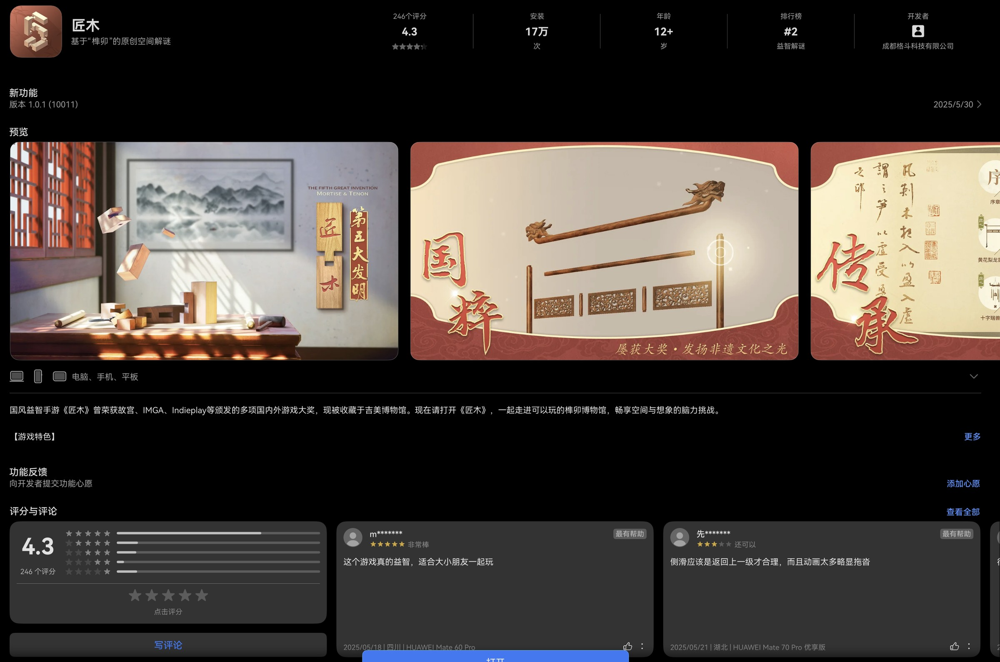

---
# Generated from README.md by scripts/split_chapters.py.
layout: "chapter"
title: "7 意料之外的收获"
nav_title: "第7章"
chapter: 7
permalink: "/7/"
previous_url: "/6/"
previous_title: "第6章"
next_url: "/8/"
next_title: "第8章"
---
## 7 意料之外的收获

当远程桌面跑通之后，我反而越来越喜欢脱离台式机、直接单用这台 Pro S。798g 配上 14.2 寸 OLED 触屏，随手端起来就像一块巨型平板——这种形态上的质变，顺带解锁了不少以前在 Surface 上从未有过的玩法。

### 7.1 抱着大屏看视频：HDR 好看，链路还想看个明白

买屏幕送电脑，总得让这块 OLED 发挥一下吧！我平时更喜欢自己找资源，用本地播放器看。先拿手头视频试试，`.ts` 文件居然用系统自带播放器打不开。于是去应用市场装了流心播放器和 AloePlayer，两家的整体思路很像，都提供系统播放、MPV 等播放路径，还可以选择 HDR 相关模式。

拿三星 HDR 演示片测试，两个播放器都能正常播放，2.5 倍速以内也很流畅。OLED 的 true black 配合 HDR 高光确实震撼：黑的地方直接融进边框，高亮区域又真的能亮起来。这块屏幕总算不是白买了！

后来又试了 B 站鸿蒙客户端的 HDR 视频，HEVC 格式直接拉到 3 倍速居然还是流畅，任务管理器里 CPU 长期只有 30% 左右，风扇也没怎么闹腾。这套播放器和系统组合能把 HEVC HDR 三倍速稳稳播起来，XE90 拿来当视频终端看来绰绰有余。

不过继续折腾下去，我开始不满足于单纯能播放了。在 Windows 上已经被 MPC-HC、LAV、MPC Video Renderer、MediaInfo 这套惯坏了。一个片源扔进去，codec、profile、bit depth、实时码率、硬解后端、pixel format、色域、transfer function、renderer、掉帧都能看，配合 ReShade HDR Analysis 还能看看画面里不同区域大概多少 nit。

到了鸿蒙这边，播放器给我几个“系统”“MPV”“MPV-HDR”的选项，画面正常出来，就没下文了。MediaInfo 级别的文件详情没有，实时码率看不到，当前到底哪个硬件 decoder 在工作、输出是不是 P010、BT.2020 / PQ 怎么交给系统 HDR compositor，也找不到一个地方告诉我。我这种喜欢刨根问底的人，总觉得少了点什么。

后来和 ChatGPT 一起梳理了一遍，我想确认的链路大概是：

`HEVC Main10 → 硬件解码 → 10-bit / P010 → BT.2020 + PQ → HDR metadata → renderer / system compositor → OLED`

简单说，就是视频解码之后，以怎样的位深和色彩信息交给渲染器、系统合成器，最后如何呈现在屏幕上。屏幕还需要根据自身亮度能力做映射，我不指望字面上的完全直通。说起来 mpv 本身就有挺详细的 stats，codec、hwdec、色彩参数、掉帧、码率等等都能查，要是鸿蒙播放器也能给我一个查看入口就好了。

HEVC HDR 顺利之后我又试了 AV1。从 YouTube 下载的《战神》新作预告片是 4K60 AV1，结果在我试的播放器里一倍速就把 CPU 顶到 80% 以上，风扇也起来了，体验基本不可用。和前面的 HEVC 三倍速简直两个世界！

杜比视界这块我暂时也没找到让自己放心的播放方案，下载片源时还是先选标准 HDR10 吧。流心和 AloePlayer 的基础功能免费，高级功能都有 VIP；两家功能和播放路径有不少相似之处，现在最希望看到的是格式兼容、解码信息这些基础体验继续完善。能在这块屏幕上看漂亮的 HDR 已经很开心了，接下来就等播放器把更多细节交到用户手里。

### 7.2 大屏刷熟悉的移动应用

这台机器带来的另一个惊喜，是以前主要在手机上刷的应用，现在能舒舒服服地铺在电脑大屏上。轻量机身加上触屏，捧起来用的时候又有点像一个大平板。

小红书则很明显是移动端主导了。界面跟手机平板保持一致，没什么学习成本，信息流还能双指缩放。全屏打开帖子时左边看图、右边看文字和评论；窗口缩窄到半屏长条，又能及时调整成手机一样的布局，适配良好。

酷安更让我开心：总算解锁了大屏幕刷酷安的体验！以前酷安桌面网页早就废除了，我想在电脑上刷只能手机投屏。现在鸿蒙有原生应用，直接打开就好；如果不习惯横版比例，还可以自己把窗口调成类似手机的细长比例。酷安近期新版本也弄了液态玻璃，跟鸿蒙系统的沉浸光感很搭。

哔哩哔哩就没有这么合心意了。鸿蒙客户端活脱脱把平板 UI 拿过来，底部栏按钮很小，也没怎么适配系统字体和 UI 缩放，在系统代理的情况下还直接罢工、网络不连接。前面看 HEVC HDR 视频时播放倒是很流畅，但日常浏览体验还是不太合我胃口。算了，B 站是为数不多网页版还在更新维护的兴趣社区，投稿中心也支持网页端；反正 Windows 上我也不用客户端，就继续用网页版吧！

除了刷信息流，我还想起了在华为店里 MateBook Fold 展示机上玩过的一款榫卯解谜游戏——《匠木》。现在自己有大屏触屏电脑了，立马下载来完整体验，340MB 的大小中规中矩。

画风精湛，锁 60 帧，没有什么恼人的贴片和内购弹窗。拆解、组合榫卯，考验空间想象能力，果真如评论区所说大人小孩都适合，打发时间挺不错。这类游戏才是发挥了触屏的优势。我的主要游戏还是在台式机上，偶尔捧着这台轻电脑玩玩休闲单机，也有另一番乐趣。

### 7.3 小艺慧记：组会结束，还有一份逐字稿

之前看评测视频说小艺的会议记录很厉害，想着下次有空体验一下。后来直接拿研究生组会试了试——体验完毕，简直会议神器。

以前开组会经常只记得大致讨论了什么，就算会后才过半小时，也很难把导师的点评全部回忆起来。这次会议 40 多分钟，主要是我们两位同学各自汇报，穿插导师随时打断的点评。我原以为小艺慧记的设置会很复杂，结果选好默认的云端模型，一键开启录音就好了。屏幕右上角有个闪烁的橙色指示点，电脑用自带麦克风收音，边录音边产生逐字稿。

会议结束之后，录音、发言人区分、段落速览和 AI 生成的会议纪要都在。逐字稿带时间戳，哪里没看明白，点回去听原始录音就行。一次会议最多 5 小时，每天无次数限制，对我这每周的组会来说相当友好。

当然准确率还谈不上完美：三个男人的发言被识别出了 11 个发言人，估计音色接近、说话时又有重叠，给模型增加了难度。中英混杂的专业学术术语也有一些识别错误，好在总体意思大多能看懂，关键地方再配合录音回听。

回想起来，Pro S 轻薄的机身里还有六颗麦克风。这次在安静会议室里，导师坐在对面大约两米远，同学紧挨着我，电脑自带麦克风就记录下了这场讨论。从收音到转写、会议记录这样一套功能，打开就能用，确实让我满意。

小艺负责会议录音和逐字转写，识别错了就回听原始录音；需要进一步总结分析，再把文本交给更熟悉我科研工作流的 ChatGPT。各取所长！以前散在脑海里的组会讨论，现在有了一份可以回看、继续整理的材料。

本来买这台电脑主要就是图轻量、大屏和远程桌面，没想到影音娱乐、熟悉的移动应用，还有组会里的慧记，都成了鸿蒙 PC 的意外之喜。

